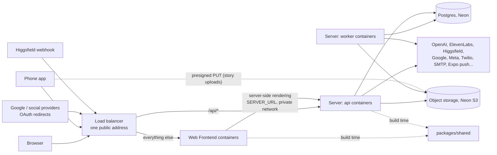

# Architecture

Last written: 2026-11-16, from the code on branch `desktop-shell` and the approved design
`docs/superpowers/specs/2026-11-16-server-web-split-design.md`.

This document has two kinds of statements. Each section says which kind it holds:

- **[Today]**: how the code works now. One Next.js app, `apps/web`, serves both the API and the website.
- **[Planned]**: the approved split into Server, Web Frontend and Mobile App on AWS EC2. **Not built yet.** When the
  split ships, a fresh pass updates this document to what was built.

`apps/brandpilot-ai` (a Reddit Devvit app) is unrelated to this product and is left out.

---

## 1. Overview

### 1.1 The apps

| Folder | Name | Owns | Deploys as |
|---|---|---|---|
| `apps/web` **[Today]** | `web` | Everything: 98 API route files (`app/api/**/route.ts`), `server/` (agents, AI, jobs, Prisma, rendering, integrations), `auth.ts`, the website pages (`app/`), `components/`, `lib/`, `prisma/`, `scripts/` | One Next.js app. `vercel.json` (region `fra1`, one daily cron). Port 3100 in dev and `next start`. |
| `apps/server` **[Planned]** | `server`, "Server" | API routes only (`/api/v1/*`, `/api/auth/*`), `server/`, Prisma, Auth.js, scripts, vitest tests. Two roles from one image: **api** (`next start`) and **worker** (job loop and daily sweep). | Docker image (Next.js `output: "standalone"`, carries Prisma engine, ffmpeg/ffprobe, fonts). API and worker are separate EC2 groups. Port 3101 in dev. |
| `apps/web` **[Planned]** | `web-frontend`, "Web Frontend" | Pages, components, browser-safe `lib/`, `public/`, Playwright e2e. No database, no Prisma, no server secrets. | Docker image, its own EC2 group. Port 3100 in dev; rewrites `/api/:path*` to the Server. |
| `apps/mobile` | `mobile-app` (planned name) | Expo (React Native) app. Calls the API over HTTP with a Bearer token (`src/api/client.ts`, `src/api/endpoints.ts`). Deep-link scheme `espanda`. | Store builds (unchanged). |
| `packages/shared` **[Planned]** | `@espanda/shared` | Pure TypeScript shared by Server and Web Frontend: API response types, `PERMISSIONS`, shell cookie names, story limits and by-hand steps, `zoneCity`/`offerPercents`, product-name helpers, possibly `usdInrRate`. No server imports. | Not deployed; imported at build time. |

### 1.2 Who talks to whom

**[Today]**

```
browser ──▶ apps/web (Next.js on Vercel)
              ├─ pages: server components read the database directly (Prisma, server/)
              ├─ /api/auth/*  Auth.js
              └─ /api/v1/*    route handlers ──▶ Postgres, object storage, AI and social providers
phone ─────▶ apps/web /api/v1/*   (EXPO_PUBLIC_API_URL, Bearer token)
Vercel cron (daily 05:00 UTC) ──▶ GET /api/v1/jobs/run  (CRON_SECRET)
providers (OAuth redirects, Higgsfield webhook) ──▶ apps/web /api/v1/*
```

**[Planned]**



The browser sees one origin, so the Auth.js session cookie, the shell cookies (`bp_active_workspace_id`,
`bp_active_brand_id`) and OAuth callbacks keep working with no CORS.

### 1.3 Things that hold in both today and after the split (checked in code)

- **Tenancy:** User → Workspace → Brand (called "project" or "business" in the UI). Brand routes live under
  `/api/v1/workspaces/[workspaceId]/brands/[brandId]/*`.
- **Route guard:** brand routes call `authorizeBrandRoute` (`server/api/brand-route.ts`): signed-in user → the optional
  `X-Workspace-Id` header must match the path (`assertWorkspaceHeaderMatchesPath`) → `requireBrandAccess` →
  `requirePermission(workspaceId, userId, permission, brandId)`. Workspace routes use `workspaceHandler`
  (`server/api/workspace-route.ts`) with the same order minus brand access. Errors are `application/problem+json`.
- **Who is calling:** `requestUserId` (`server/auth/request-user.ts`): an `Authorization: Bearer` header is checked as a
  mobile token first; otherwise the Auth.js session cookie. So almost every v1 route accepts both.
- **Sessions:** Auth.js v5, stateless JWT in an encrypted cookie, 7 days rolling (`auth.config.ts`). Revocation through
  `User.sessionVersion`. Mobile tokens are the same JWE with a different salt (`mobile-session`), 30 days; a disabled
  account or a bumped `sessionVersion` kills both.
- **Platform admin:** `User.isPlatformAdmin`, set in the database. API: `platformAdmin()` → 401/403. Pages:
  `requirePlatformAdminPage()` → redirect to `/login` or a plain 404.
- **Provider credentials** are stored encrypted (`server/crypto/credentials.ts`, `CREDENTIALS_ENCRYPTION_KEY`, versioned
  keys). Tokens never go to the browser or phone; routes return connection status only.
- **Jobs** live in Postgres. Claiming is lease-based (`server/jobs/claim.ts`), so several runners are safe.
- **Media** lives in a private S3-compatible bucket (Neon Object Storage, `server/storage/media.ts`). Clients get
  signed links that last about an hour.

---

## 2. Every path a request or link takes

Each path lists: who starts it, which app serves it, how it is authenticated, and what env var or external
registration it depends on.

### 2.1 Browser → website page

| | Today | Planned |
|---|---|---|
| Starts | Browser navigation | Same |
| Served by | `apps/web` page (server component) | Web Frontend page |
| Data | Server components call `server/` directly: `loadShellContext`, `effectivePermissions`, `isPlatformAdmin`, Prisma, `server/services/platform-admin.ts` (see §5) | Server components call the Server through `serverFetch(path)`: prefixes `SERVER_URL`, forwards the incoming `cookie` header and `x-forwarded-for` |
| Auth | `middleware.ts` runs Auth.js `authorized()`: public pages `/login`, `/invite/*`, `/forgot-password`, `/reset-password`; everything else needs a session, or redirects to `/login`. Matcher skips `/api/auth`, `_next/*`, `favicon.ico`, `icon.png`, `brand/*`. | Middleware only checks that a session cookie is present (→ `/login?next=…`). The real check: the shell layout calls `GET /api/v1/me/shell` and redirects to login on 401. |
| Depends on | `AUTH_SECRET`, `DATABASE_URL` in the same app | `SERVER_URL` (Web Frontend). No secrets. |

### 2.2 Browser → `/api/v1/*` → API

| | Today | Planned |
|---|---|---|
| Starts | Client components: `fetch` through the `request()` helper in `components/settings/api.ts` and similar; `navigator.sendBeacon` for page views; the AI SDK chat transport | Same code, relative `/api/...` URLs |
| Served by | `apps/web` route handler | Load balancer sends `/api/*` to Server api containers (dev: Web Frontend `next.config` rewrite to `http://localhost:3101`) |
| Auth | Session cookie (same origin). 401 from a settings call sends the browser to login (`components/settings/api.ts`). | Same cookie; it is set on the website's origin and reaches the Server through the load balancer. |
| Long requests | 18 route files export `maxDuration = 300`, 2 export 120, 2 export 60 (see §3). Most of the 300 s ones are long only because queued work runs after the response (`kickRunner` → `after()`). | Load balancer idle timeout and any nginx `proxy_read_timeout` above 300 s; response buffering off for streaming (chat, reel NDJSON, story zip). |
| Upload size | Image upload (`media`) 4 MB, voice clone 4 MB, voice take 1 MB (multipart). Story photos and clips do not pass through the API: the phone PUTs them straight to storage with a presigned URL. | Request body limit at least the largest multipart upload (4 MB plus form overhead). |

### 2.3 `/api/auth/*`: sign-in, sign-out, session, Google callback

- **Served by:** `app/api/auth/[...nextauth]/route.ts` (`GET`, `POST` = Auth.js handlers). **[Planned]** moves to the
  Server, still at `/api/auth/*`, reached through the load balancer.
- **Providers:** Credentials (email + password, `checkPassword` with login rate limits: 5 per email per IP, 50 per email,
  30 per IP, each per 15 min, keyed by `x-forwarded-for`) and Google (only when `GOOGLE_CLIENT_ID` and
  `GOOGLE_CLIENT_SECRET` are set; verified emails only; new users provisioned by `provisionGoogleUser`).
- **Sign-in [Today]:** `app/login/page.tsx` uses **server actions** that call `signIn("credentials")` and
  `signIn("google")` in-process. Credentials sign-in does not go over HTTP to `/api/auth/*`. Google sign-in redirects
  the browser to Google; Google redirects back to `/api/auth/callback/google`.
  **[Planned]:** the login and welcome pages call `next-auth/react` `signIn(...)`, which posts to `/api/auth/*`.
- **Sign-out:** `components/workspace/sign-out-item.tsx` calls `next-auth/react` `signOut({ redirectTo: "/login" })`
  → `POST /api/auth/signout` (browser, today and planned).
- **Session:** `next-auth/react` reads `/api/auth/session`; server code calls `auth()` (wrapped in `auth.ts` to throw
  `SessionUnverifiedError` when the database can't be reached).
- **Depends on:** `AUTH_SECRET`, `AUTH_URL` (the website's public URL), `trustHost: true` (set in `auth.config.ts`;
  `AUTH_TRUST_HOST` is also in `.env.example`). Google: OAuth client registered with redirect URI
  `<AUTH_URL>/api/auth/callback/google`. The planned split keeps that URI.

### 2.4 Account emails and the pages they open

- **Starts:** the Server when someone is invited (`POST …/invitations`, `POST …/brands/[brandId]/members`) or asks for a
  password reset (`POST /api/v1/auth/password/forgot`).
- **Built with:** `appUrl()` in `server/auth/tokens.ts`: `AUTH_URL` + `/invite/<token>` or
  `/reset-password?token=<token>`. In production a missing `AUTH_URL` throws. Dev fallback `http://localhost:3100`.
- **Sent by:** the job queue (`EMAIL_SEND_JOB`) over SMTP (`SMTP_HOST`, `SMTP_PORT`, `SMTP_USER`, `SMTP_PASS`,
  `SMTP_TIMEOUT`, `EMAIL_FROM`). Without `SMTP_HOST` and `EMAIL_FROM`, email is "not configured" and routes say so.
- **Opens:** website pages `/invite/[token]` and `/reset-password`, which then call `GET /api/v1/auth/invitations/[token]`,
  `POST /api/v1/auth/invitations/accept` and `POST /api/v1/auth/password/reset`. Auth: the token itself.
- **Planned:** unchanged. `AUTH_URL` on the Server stays the website's public URL.

### 2.5 Phone → API

- **Starts:** the Expo app. `API_URL = EXPO_PUBLIC_API_URL ?? "http://localhost:3100"`; every call goes to
  `${API_URL}/api/v1${path}`. **[Planned]** same public address, load balancer sends `/api/*` to the Server; dev moves to
  `:3101`.
- **Auth:** `Authorization: Bearer <token>`, plus `X-Workspace-Id` on workspace and brand calls. Tokens come from the
  mobile sign-in endpoints, all `POST /api/v1/mobile/*`, no prior auth:
  - email code: `/mobile/email-step` → `/mobile/code` → `/mobile/session`
  - password: `/mobile/password`; new account: `/mobile/register` → `/mobile/register/verify`
  - phone: `/mobile/phone/code` → `/mobile/phone/session` (Twilio Verify: `TWILIO_ACCOUNT_SID`, `TWILIO_AUTH_TOKEN`,
    `TWILIO_VERIFY_SERVICE_SID`)
  - Google: the app gets a Google ID token natively (`EXPO_PUBLIC_GOOGLE_WEB_CLIENT_ID`,
    `EXPO_PUBLIC_GOOGLE_IOS_CLIENT_ID`) and posts it to `/mobile/google`; the Server checks it against Google's keys
    with audience `GOOGLE_CLIENT_ID`.
- **Connectivity check:** the app probes `GET /api/v1/me` (any answer counts as online).
- **Push:** the app registers its Expo push token at `POST /api/v1/mobile/push-device`; the Server sends through
  `https://exp.host/--/api/v2/push/send` (`EXPO_ACCESS_TOKEN` optional).
- **Dev only:** `next.config.ts` adds CORS headers on `/api/v1/*` for the Expo web preview at `http://localhost:8090`.
  **[Planned]** this moves to the Server's config.

### 2.6 Social-provider OAuth connect

Providers with OAuth: `meta`, `instagram`, `threads`, `google` (Analytics/Search Console), `google_business`, `reddit`,
`pinterest` (`PROVIDER_SLUGS` in `server/integrations/providers.ts`). Shopify is connected with an Admin API token
instead (`POST …/integrations/shopify`), no OAuth.

1. **Start.** Website or phone calls `POST /api/v1/workspaces/[workspaceId]/brands/[brandId]/connections/start`
   (session or Bearer, `integrations.manage`). Body has `provider`; the phone adds `client: "mobile"`. The Server stores
   an `OAuthStateTransaction` (hashed state, 10 min TTL, `client` web or mobile) and returns the consent URL.
2. **Provider.** The browser (web) or an in-app browser (`expo-web-browser` `openAuthSessionAsync`, phone) goes to the
   provider's consent page.
3. **Callback.** The provider redirects to `<AUTH_URL>/api/v1/integrations/<slug>/callback`, or to
   `<PROVIDER>_REDIRECT_URI` when that env var is set (`META_REDIRECT_URI`, `INSTAGRAM_REDIRECT_URI`,
   `THREADS_REDIRECT_URI`, `GOOGLE_REDIRECT_URI`, `GOOGLE_BUSINESS_REDIRECT_URI`, `REDDIT_REDIRECT_URI`,
   `PINTEREST_REDIRECT_URI`). This exact URL must be registered in each provider's developer console.
   **[Planned]** the URL stays on the website's origin; the load balancer delivers it to the Server.
4. **Web flow.** The callback needs the browser's session cookie, completes the connect (`completeConnect` re-checks
   brand access and `integrations.manage`), then redirects 303 to `<AUTH_URL>/settings?tab=connections` with
   `connected=` or `connectError=`. Signed out mid-connect → `/login?next=/settings?tab=connections`.
5. **Phone flow.** If the stored state says `client: "mobile"`, the callback does **not** complete the connect (the
   in-app browser has no session). It redirects 303 to `espanda://connect?provider=…&state=…&code=…` (or
   `error=cancelled`). The app then calls `POST /api/v1/integrations/[provider]/complete` with its Bearer token;
   the connect only succeeds for the user who started it.
- **Depends on:** `AUTH_URL`; provider keys `META_APP_ID`/`META_APP_SECRET`, `INSTAGRAM_APP_ID`/`INSTAGRAM_APP_SECRET`,
  `THREADS_APP_ID`/`THREADS_APP_SECRET`, `GOOGLE_CLIENT_ID`/`GOOGLE_CLIENT_SECRET` (shared by sign-in, Google and Google
  Business connects), `REDDIT_CLIENT_ID`/`REDDIT_CLIENT_SECRET`, `PINTEREST_APP_ID`/`PINTEREST_APP_SECRET`;
  the `espanda` scheme in `apps/mobile/app.json`; `CREDENTIALS_ENCRYPTION_KEY` to store tokens.

### 2.7 Incoming webhooks

Only one webhook exists in code:

- `POST /api/v1/webhooks/higgsfield/[renderId]?s=<secret>`. **Starts:** Higgsfield, when a reel clip finishes.
  **Auth:** a per-render secret in the query string, compared in constant time with `ReelRender.webhookSecret`; rate
  limited 120/min per IP. The body is never trusted: it only queues the render's next poll. Always answers `200 {}`.
- **Registration:** none in a console. The Server passes the URL with each Higgsfield request, built from `AUTH_URL`,
  and only when `AUTH_URL` starts with `https://` (Higgsfield can't call localhost; polling carries the render then).
- **Planned:** reaches the Server through the load balancer's `/api/*` rule.

There are no ElevenLabs or Shopify webhook routes. Shopify catalogue sync is pulled by jobs; ElevenLabs calls are
synchronous.

### 2.8 Jobs: queue, `after()`, worker, daily sweep

Job types (`server/jobs/runner.ts`): agent run, catalogue sync, daily sweep, email send, photoshoot, publish, reel
asset, reel render, story render, voice delete.

**[Today]** three things run the queue (`runDueJobs`):

1. **`kickRunner()`** right after a route queues work: `after(() => runDueJobs())`, so the job runs in the same API
   process after the response. This is why many routes export `maxDuration = 300`.
2. **`kickIfDue()`** on routes the open app polls (agents, agent runs, context docs, first ideas, photoshoots, products,
   reel options, reel detail): at most once per 30 s per instance, kicks the runner if a job is overdue.
3. **Cron:** `vercel.json` calls `GET /api/v1/jobs/run` daily at 05:00 UTC. `GET` enqueues the daily sweep
   (idempotent per day: token refresh, daily agents) and drains the queue for up to 120 s. `POST` only drains.
   Auth: `Authorization: Bearer $CRON_SECRET`, constant-time compare; fails closed when `CRON_SECRET` is unset.

Locally, `npm run worker:dev -w web` (`scripts/worker-dev.ts`) drains every 5 s.

Two admin views also use `after()` to record "page viewed": `app/(shell)/admin/people/[userId]/page.tsx` and
`app/(shell)/admin/workspaces/[workspaceId]/layout.tsx`.

**[Planned]**: worker containers run `runDueJobs` on a loop (interval from an env var; a short interval keeps Neon awake,
which costs money) plus the daily sweep once a day. `vercel.json` is removed. `kickRunner()` / `after()` still run in
the api process. `/api/v1/jobs/run` stays for a manual or external trigger. The admin "page viewed" writes move into the
new `/api/v1/admin/*` endpoints.

### 2.9 Outbound calls from the API (and planned worker)

| To | Used for | Env |
|---|---|---|
| Postgres (Neon) via Prisma | Everything | `DATABASE_URL` (pooled), `DATABASE_URL_UNPOOLED` (migrations) |
| Object storage (Neon, S3 API) | Media, story frames, reel clips, voice takes; presigned GET and PUT | `AWS_ACCESS_KEY_ID`, `AWS_SECRET_ACCESS_KEY`, `AWS_ENDPOINT_URL_S3`, `AWS_REGION` |
| OpenAI (`api.openai.com`) | Agents, chat (with web search tool), photoshoots, model-name checks | `OPENAI_API_KEY`; models are set in the app (platform admin), not env |
| ElevenLabs (`api.elevenlabs.io`) | Reel voices, voice cloning, voice library | `ELEVENLABS_API_KEY` |
| Higgsfield (`api.higgsfield.ai`) | Reel clips, presenters, previews | `HIGGSFIELD_API_KEY_ID`, `HIGGSFIELD_API_KEY_SECRET` |
| Google | OAuth, Analytics, Business Profile (reviews, posts), Places search, PageSpeed | `GOOGLE_CLIENT_ID`, `GOOGLE_CLIENT_SECRET`, `GOOGLE_MAPS_API_KEY` (falls back to `GOOGLE_PAGESPEED_API_KEY`), `GOOGLE_PAGESPEED_API_KEY` |
| Meta, Instagram, Threads, Pinterest, Reddit | Publishing, inbox, insights, token refresh | Provider app id/secret (see §2.6) |
| Shopify (store admin API) | Catalogue sync | Per-store token, stored encrypted |
| Twilio Verify (`verify.twilio.com`) | Phone sign-in codes | `TWILIO_*` |
| SMTP | Account emails | `SMTP_*`, `EMAIL_FROM` |
| Expo push (`exp.host`) | Phone notifications | `EXPO_ACCESS_TOKEN` (optional) |
| LanguageTool | Optional French grammar pass | `LANGUAGETOOL_URL` |
| `open.er-api.com` | USD→INR rate for spend views | `USD_INR` overrides it |
| Brand and competitor websites | Research, site check, audits (SSRF-guarded `safeFetch`) | none |

### 2.10 Website server-side rendering → Server **[Planned]**

Web Frontend server components call `serverFetch(path, init)`: `SERVER_URL` (private VPC address) + path, forwarding the
visitor's `cookie` and `x-forwarded-for`. The Server authorises it like any browser call. Client components keep relative
`/api/...` URLs through the public load balancer.

### 2.11 Shared code **[Planned]**

Both apps import `@espanda/shared` at build time only. A lint rule in the Web Frontend forbids imports other than
`@espanda/shared`, its own code and npm packages.

---

## 3. API route inventory **[Today]**

**98 route files, 128 method handlers, one row per handler below.** All live in `apps/web/app/api/`. After the split they
move unchanged to `apps/server/app/api/`.

How to read the columns:

- **Auth.** *none*: no sign-in needed (a token in the body or path may stand in, noted). *session or Bearer*: web session
  cookie or mobile Bearer token (`requestUserId`). *cron secret*, *webhook signature*, *platform admin*: as named.
- **Permission.** The permission key passed to `authorizeBrandRoute` / `workspaceHandler` / `requirePermission`. "member"
  means `requireWorkspaceMember` only. "—" means none beyond Auth.
- **Called by.** Found by searching `apps/web/components`, `apps/web/app` and `apps/mobile/src` for the path and method.
  *website*, *phone*, *both*, *provider*, *cron*, or **nobody** when no caller was found.
- All `/api/v1/*` responses for errors are `application/problem+json`.

### 3.1 Auth.js (2)

| # | Method | Path | Auth | Permission | Purpose | Called by | Notes |
|---|---|---|---|---|---|---|---|
| 1 | GET | `/api/auth/[...nextauth]` | none (Auth.js) | — | Session, CSRF, providers, OAuth callbacks (`/callback/google`) | website, Google | Auth.js `handlers`. Middleware skips `/api/auth`. |
| 2 | POST | `/api/auth/[...nextauth]` | none (Auth.js CSRF) | — | Sign-in and sign-out | website (sign-out via `next-auth/react`) | Credentials sign-in today runs in-process from the login server action, not through this route. Login rate limits in `checkPassword`. |

### 3.2 Account: invitations and passwords (4)

| # | Method | Path | Auth | Permission | Purpose | Called by | Notes |
|---|---|---|---|---|---|---|---|
| 3 | GET | `/api/v1/auth/invitations/[token]` | none (token in path) | — | Preview an invitation | website (`/invite/[token]`) | |
| 4 | POST | `/api/v1/auth/invitations/accept` | none (token in body) | — | Accept an invitation; sets `bp_active_*` cookies | website | Sets a password for a new user. |
| 5 | POST | `/api/v1/auth/password/forgot` | none | — | Queue a reset email | website (`/forgot-password`) | `maxDuration` 300; always 202 (no account enumeration); `kickRunner`. |
| 6 | POST | `/api/v1/auth/password/reset` | none (reset token in body) | — | Set a new password | website (`/reset-password`) | |

### 3.3 Mobile sign-in and device (11)

| # | Method | Path | Auth | Permission | Purpose | Called by | Notes |
|---|---|---|---|---|---|---|---|
| 7 | POST | `/api/v1/mobile/email-step` | none | — | Next step for an email: password, code or register | phone | |
| 8 | POST | `/api/v1/mobile/code` | none | — | Email a 6-digit sign-in code | phone | `maxDuration` 300; 503 if email not configured; same 202 for any valid email. |
| 9 | POST | `/api/v1/mobile/session` | none (emailed code) | — | Code → Bearer token | phone | |
| 10 | POST | `/api/v1/mobile/password` | none | — | Email + password → Bearer token | phone | Shares web's password check and rate limits. |
| 11 | POST | `/api/v1/mobile/register` | none | — | Start an email + password account; emails a code | phone | 503 if email not configured. |
| 12 | POST | `/api/v1/mobile/register/verify` | none (emailed code) | — | Create the account → Bearer token | phone | |
| 13 | POST | `/api/v1/mobile/phone/code` | none | — | Text a sign-in code (Twilio Verify) | phone | |
| 14 | POST | `/api/v1/mobile/phone/session` | none (texted code) | — | Code → Bearer token, or `needsEmail` + `phoneTicket` | phone | |
| 15 | POST | `/api/v1/mobile/google` | none (Google ID token) | — | Google ID token → Bearer token | phone | Audience `GOOGLE_CLIENT_ID`. |
| 16 | POST | `/api/v1/mobile/push-device` | session or Bearer | — | Register an Expo push token | phone | |
| 17 | DELETE | `/api/v1/mobile/push-device` | session or Bearer | — | Forget a push token (sign-out) | phone | |

### 3.4 User and onboarding helpers (5)

| # | Method | Path | Auth | Permission | Purpose | Called by | Notes |
|---|---|---|---|---|---|---|---|
| 18 | GET | `/api/v1/me` | session or Bearer | — | User and workspaces | phone | Also the phone's connectivity probe. Not changed by the split. |
| 19 | GET | `/api/v1/permissions` | session or Bearer | — | Permission catalogue | website (settings, roles) | |
| 20 | POST | `/api/v1/activity/page-views` | session or Bearer (204 when signed out) | — | Record a page visit | both (web `sendBeacon`) | Always 204; 120/min per user. |
| 21 | POST | `/api/v1/places/search` | session or Bearer | — | Google Places search for onboarding | phone | 30/h per user; billed Google call. |
| 22 | POST | `/api/v1/site-check` | session or Bearer | — | Does this website exist? | phone | 30/h per user; SSRF-guarded fetch. |

### 3.5 Platform admin: AI models (4)

| # | Method | Path | Auth | Permission | Purpose | Called by | Notes |
|---|---|---|---|---|---|---|---|
| 23 | GET | `/api/v1/ai-models` | platform admin | — | Models, prices, tier assignments | website (`/admin/models`) | |
| 24 | PUT | `/api/v1/ai-models` | platform admin | — | Add or update a model (name checked with OpenAI) | website | |
| 25 | DELETE | `/api/v1/ai-models/[name]` | platform admin | — | Remove a model no tier uses | website | |
| 26 | PUT | `/api/v1/ai-tiers` | platform admin | — | Set a tier's model and backup | website | |

### 3.6 Workspaces, members, roles, billing (17)

| # | Method | Path | Auth | Permission | Purpose | Called by | Notes |
|---|---|---|---|---|---|---|---|
| 27 | GET | `/api/v1/workspaces/[workspaceId]/brands` | session or Bearer | member | Brands this user can open | phone | Website reads brands server-side today (`loadShellContext`). |
| 28 | POST | `/api/v1/workspaces/[workspaceId]/brands` | session or Bearer | `brand.create` (in `createBrandWithResearch`) | Create a brand and start Research | both | `maxDuration` 300; `kickRunner`; 201. |
| 29 | PATCH | `/api/v1/workspaces/[workspaceId]/brands/[brandId]` | session or Bearer | `context.edit` | Rename brand or fix its website | both | |
| 30 | GET | `/api/v1/workspaces/[workspaceId]/my-permissions` | session or Bearer | member, or brand access with `?brandId=` | Caller's effective permissions | both | |
| 31 | GET | `/api/v1/workspaces/[workspaceId]/members` | session or Bearer | `members.read` | Workspace members | both | |
| 32 | PATCH | `/api/v1/workspaces/[workspaceId]/members/[memberId]` | session or Bearer | `members.manage` | Change a member's role | website | |
| 33 | DELETE | `/api/v1/workspaces/[workspaceId]/members/[memberId]` | session or Bearer | `members.manage` | Remove a member | website | |
| 34 | POST | `/api/v1/workspaces/[workspaceId]/members/[memberId]/primary-owner` | session or Bearer | `members.read` + service checks caller is primary owner | Hand over primary ownership | website | |
| 35 | GET | `/api/v1/workspaces/[workspaceId]/invitations` | session or Bearer | `invitations.manage` | Open invitations | website | `maxDuration` 300 is on the file (for POST). |
| 36 | POST | `/api/v1/workspaces/[workspaceId]/invitations` | session or Bearer | `invitations.manage` | Invite by email | website | `kickRunner` sends the email; link built from `AUTH_URL`. |
| 37 | DELETE | `/api/v1/workspaces/[workspaceId]/invitations/[invitationId]` | session or Bearer | `invitations.manage` | Revoke an invitation | website | |
| 38 | GET | `/api/v1/workspaces/[workspaceId]/roles` | session or Bearer | `roles.read` | Roles | website | |
| 39 | POST | `/api/v1/workspaces/[workspaceId]/roles` | session or Bearer | `roles.manage` | Create a role | website | |
| 40 | PATCH | `/api/v1/workspaces/[workspaceId]/roles/[roleId]` | session or Bearer | `roles.manage` | Edit a role | website | |
| 41 | DELETE | `/api/v1/workspaces/[workspaceId]/roles/[roleId]` | session or Bearer | `roles.manage` | Delete a role | website | |
| 42 | GET | `/api/v1/workspaces/[workspaceId]/credits` | session or Bearer | member | Credit balance; `?history=1` adds last 20 ledger lines | phone | |
| 43 | GET | `/api/v1/workspaces/[workspaceId]/subscription` | session or Bearer | member | Plan and plans on offer | phone | |

### 3.7 Brand people and settings (9)

| # | Method | Path | Auth | Permission | Purpose | Called by | Notes |
|---|---|---|---|---|---|---|---|
| 44 | GET | `/api/v1/workspaces/[workspaceId]/brands/[brandId]/members` | session or Bearer | `brand.read` | People on this project, project roles | website | |
| 45 | POST | `/api/v1/workspaces/[workspaceId]/brands/[brandId]/members` | session or Bearer | `project.members.manage` | Add or invite someone to the project | website | `kickRunner` if an invitation email is queued. |
| 46 | PATCH | `/api/v1/workspaces/[workspaceId]/brands/[brandId]/members/[grantId]` | session or Bearer | `project.members.manage` | Change project role | website | |
| 47 | DELETE | `/api/v1/workspaces/[workspaceId]/brands/[brandId]/members/[grantId]` | session or Bearer | `project.members.manage` | Remove from project | website | |
| 48 | DELETE | `/api/v1/workspaces/[workspaceId]/brands/[brandId]/invitations/[invitationId]` | session or Bearer | `project.members.manage` | Revoke a project invitation | website | |
| 49 | GET | `/api/v1/workspaces/[workspaceId]/brands/[brandId]/assets` | session or Bearer | `brand.read` | Logo, colours, fonts, photos, summary from Research | phone | Signed image links, 1 h. |
| 50 | PATCH | `/api/v1/workspaces/[workspaceId]/brands/[brandId]/assets` | session or Bearer | `context.edit` | Edit palette, tagline, audience, tones, language | phone | |
| 51 | GET | `/api/v1/workspaces/[workspaceId]/brands/[brandId]/automations` | session or Bearer | `brand.read` | Automation switches | phone | |
| 52 | PATCH | `/api/v1/workspaces/[workspaceId]/brands/[brandId]/automations` | session or Bearer | `publish.execute` for `autoPublish`, `agents.run` for `monthlyPlan` | Turn automations on or off | phone | Audited. |


### 3.8 Agents, context and research (11)

| # | Method | Path | Auth | Permission | Purpose | Called by | Notes |
|---|---|---|---|---|---|---|---|
| 53 | GET | `/api/v1/workspaces/[workspaceId]/brands/[brandId]/agents` | session or Bearer | `agents.read` | Agents and their status | website | `maxDuration` 300; `kickIfDue`. |
| 54 | GET | `/api/v1/workspaces/[workspaceId]/brands/[brandId]/agents/[agentKey]/runs` | session or Bearer | `agents.read` | One run's status (`?id=`) | phone (planner) | `maxDuration` 300; `kickIfDue`. |
| 55 | POST | `/api/v1/workspaces/[workspaceId]/brands/[brandId]/agents/[agentKey]/runs` | session or Bearer | `agents.run` | Start an agent run (research, planner, others) | both | `kickRunner`. |
| 56 | GET | `/api/v1/workspaces/[workspaceId]/brands/[brandId]/agent-events` | session or Bearer | `agents.read` | Agent log feed, `?after=` polling | both | |
| 57 | GET | `/api/v1/workspaces/[workspaceId]/brands/[brandId]/context-docs` | session or Bearer | `agents.read` | Brand context documents | both | `maxDuration` 300; `kickIfDue`. |
| 58 | PUT | `/api/v1/workspaces/[workspaceId]/brands/[brandId]/context-docs/[kind]` | session or Bearer | `context.edit` | Human edit → new draft version | website | |
| 59 | POST | `/api/v1/workspaces/[workspaceId]/brands/[brandId]/context-docs/[kind]/confirm` | session or Bearer | `context.confirm` | Confirm latest version as brand truth | website | |
| 60 | GET | `/api/v1/workspaces/[workspaceId]/brands/[brandId]/first-ideas` | session or Bearer | `brand.read` | Onboarding Scout run state | phone | `maxDuration` 300; `kickIfDue`. |
| 61 | POST | `/api/v1/workspaces/[workspaceId]/brands/[brandId]/first-ideas` | session or Bearer | `agents.run` | Start onboarding Scout (free) | phone | Free restarts limited per brand per day; `kickRunner`. |
| 62 | GET | `/api/v1/workspaces/[workspaceId]/brands/[brandId]/opportunities` | session or Bearer | `brand.read` | Ideas from the Opportunities agent | both | |
| 63 | PATCH | `/api/v1/workspaces/[workspaceId]/brands/[brandId]/opportunities/[opportunityId]` | session or Bearer | `content.create` | Shortlist, dismiss or reset an idea | website | |

### 3.9 Chat, competitors, performance (8)

| # | Method | Path | Auth | Permission | Purpose | Called by | Notes |
|---|---|---|---|---|---|---|---|
| 64 | GET | `/api/v1/workspaces/[workspaceId]/brands/[brandId]/chat` | session or Bearer | `brand.read` | Latest conversation | website | |
| 65 | POST | `/api/v1/workspaces/[workspaceId]/brands/[brandId]/chat` | session or Bearer | `brand.read` | One chat turn | website | **Streaming** (AI SDK `streamText`, OpenAI + web search); `maxDuration` 300; per-user rate limit; 503 if AI not configured. |
| 66 | GET | `/api/v1/workspaces/[workspaceId]/brands/[brandId]/competitors` | session or Bearer | `brand.read` | Competitors, latest audits, credits | website | |
| 67 | POST | `/api/v1/workspaces/[workspaceId]/brands/[brandId]/competitors` | session or Bearer | `agents.run` | Add a competitor | website | |
| 68 | DELETE | `/api/v1/workspaces/[workspaceId]/brands/[brandId]/competitors/[competitorId]` | session or Bearer | `agents.run` | Stop tracking a competitor | website | |
| 69 | POST | `/api/v1/workspaces/[workspaceId]/brands/[brandId]/competitors/[competitorId]/audit` | session or Bearer | `agents.run` | Paid fresh website audit | website | `maxDuration` 300; `kickRunner`. |
| 70 | GET | `/api/v1/workspaces/[workspaceId]/brands/[brandId]/audit-reports` | session or Bearer | `analytics.read` | Latest SEO and GEO reports | website | |
| 71 | GET | `/api/v1/workspaces/[workspaceId]/brands/[brandId]/learning-notes` | session or Bearer | `analytics.read` | Learning notes | website | |

### 3.10 Content and posts (5)

| # | Method | Path | Auth | Permission | Purpose | Called by | Notes |
|---|---|---|---|---|---|---|---|
| 72 | GET | `/api/v1/workspaces/[workspaceId]/brands/[brandId]/content` | session or Bearer | `brand.read` | Calendar items with latest draft and check | both | |
| 73 | POST | `/api/v1/workspaces/[workspaceId]/brands/[brandId]/content` | session or Bearer | `content.create` | New post or story (writer + quality check) | phone | `maxDuration` 300; paid story once per `requestId`; `kickRunner`. |
| 74 | GET | `/api/v1/workspaces/[workspaceId]/brands/[brandId]/content/[contentId]` | session or Bearer | `brand.read` | Approval and publish history, destinations, story frames | both | `maxDuration` 300 on file. |
| 75 | POST | `/api/v1/workspaces/[workspaceId]/brands/[brandId]/content/[contentId]` | session or Bearer | by `action`: `content.create` (edit, editStory, rewrite, duplicate, delete); `content.approve` (decide); `publish.execute` (publish, cancel, posted, not-posted, postRest, markDone, settleFrame, byHand, postedByHand) | Every post action | both | `kickRunner` on several actions. |
| 76 | POST | `/api/v1/workspaces/[workspaceId]/brands/[brandId]/media` | session or Bearer | `publish.execute` | Upload one image (multipart); `library=1` adds to photo library | both | **Upload**, 4 MB max (comment cites Vercel's 4.5 MB body cap); library max 60. |

### 3.11 Stories (5)

| # | Method | Path | Auth | Permission | Purpose | Called by | Notes |
|---|---|---|---|---|---|---|---|
| 77 | GET | `/api/v1/workspaces/[workspaceId]/brands/[brandId]/stories/due` | session or Bearer | `publish.execute` | Stories due to post by hand | both | |
| 78 | GET | `/api/v1/workspaces/[workspaceId]/brands/[brandId]/stories/sources` | session or Bearer | `content.create` | Photos and clips a frame can use | phone | |
| 79 | POST | `/api/v1/workspaces/[workspaceId]/brands/[brandId]/stories/uploads` | session or Bearer | `content.create` | Get a presigned PUT slot for a photo or clip | phone | The phone then PUTs straight to storage. |
| 80 | POST | `/api/v1/workspaces/[workspaceId]/brands/[brandId]/stories/uploads/[uploadId]` | session or Bearer | `content.create` | Check the uploaded file | phone | Phone waits up to 120 s. |
| 81 | GET | `/api/v1/workspaces/[workspaceId]/brands/[brandId]/stories/[contentId]/package` | session or Bearer | `publish.execute` | Frames and link to post by hand; `?format=zip` | both (web zip, phone JSON) | **Streams** an uncompressed zip; 20/h per user. |

### 3.12 Reels and voices (16)

| # | Method | Path | Auth | Permission | Purpose | Called by | Notes |
|---|---|---|---|---|---|---|---|
| 82 | GET | `/api/v1/workspaces/[workspaceId]/brands/[brandId]/reels` | session or Bearer | `brand.read` | Studio reels | phone | `maxDuration` 120. |
| 83 | POST | `/api/v1/workspaces/[workspaceId]/brands/[brandId]/reels` | session or Bearer | `content.create` | New reel with first plan (two AI calls) | phone | **Streams NDJSON** when `Accept: application/x-ndjson`; 201. |
| 84 | GET | `/api/v1/workspaces/[workspaceId]/brands/[brandId]/reels/[contentId]` | session or Bearer | `brand.read` | Plan, render progress, checks, chat | phone | `maxDuration` 300; `kickIfDue`; nudges a stalled render. |
| 85 | PATCH | `/api/v1/workspaces/[workspaceId]/brands/[brandId]/reels/[contentId]` | session or Bearer | `content.create` | Save an edited plan (AI call) | phone | |
| 86 | POST | `/api/v1/workspaces/[workspaceId]/brands/[brandId]/reels/[contentId]` | session or Bearer | by `action`: `content.create` (render, recheck); `content.approve` (send); `publish.execute` (register-link) | Render, download, recheck, add posted link | phone | `kickRunner` on render. |
| 87 | POST | `/api/v1/workspaces/[workspaceId]/brands/[brandId]/reels/[contentId]/plan` | session or Bearer | `content.create` | Revise the plan from a message or template | phone | `maxDuration` 120; **streams NDJSON** on request. |
| 88 | POST | `/api/v1/workspaces/[workspaceId]/brands/[brandId]/reels/[contentId]/recordings` | session or Bearer | `content.create` | Upload one voiceover take (M4A), transcribe | phone | **Upload**, 1 MB max; `maxDuration` 60; 30/h per user, 60/h per reel. |
| 89 | GET | `/api/v1/workspaces/[workspaceId]/brands/[brandId]/reels/options` | session or Bearer | `brand.read` | Templates, presenters, traits | phone | `kickIfDue`. |
| 90 | POST | `/api/v1/workspaces/[workspaceId]/brands/[brandId]/reels/presenters` | session or Bearer | `content.create` | Create a presenter (paid) | phone | `kickRunner`. |
| 91 | DELETE | `/api/v1/workspaces/[workspaceId]/brands/[brandId]/reels/presenters/[presenterId]` | session or Bearer | `content.create` | Remove a presenter | phone | |
| 92 | POST | `/api/v1/workspaces/[workspaceId]/brands/[brandId]/reels/previews` | session or Bearer | `content.create` | Paid template preview with the brand's photo | phone | `kickRunner`. |
| 93 | GET | `/api/v1/workspaces/[workspaceId]/brands/[brandId]/voices` | session or Bearer | `brand.read` | Voices a reel may use, cloning info | phone | |
| 94 | GET | `/api/v1/workspaces/[workspaceId]/brands/[brandId]/voices/library` | session or Bearer | `brand.read` | ElevenLabs public voices, filtered | phone | |
| 95 | POST | `/api/v1/workspaces/[workspaceId]/brands/[brandId]/voices/clones` | session or Bearer | `voices.manage` | Clone a voice from a 60–90 s reading | phone | **Upload**, 4 MB max; `maxDuration` 60; 5/h per user. |
| 96 | PATCH | `/api/v1/workspaces/[workspaceId]/brands/[brandId]/voices/clones/[voiceId]` | session or Bearer | `brand.read` + service: voice owner or `voices.manage` | Rename a cloned voice | **nobody** | No web or phone caller found. |
| 97 | DELETE | `/api/v1/workspaces/[workspaceId]/brands/[brandId]/voices/clones/[voiceId]` | session or Bearer | `brand.read` + service: owner or `voices.manage`; `?withdraw=1` owner only | Delete a clone or withdraw consent | phone | |


### 3.13 Photoshoots (3)

| # | Method | Path | Auth | Permission | Purpose | Called by | Notes |
|---|---|---|---|---|---|---|---|
| 98 | GET | `/api/v1/workspaces/[workspaceId]/brands/[brandId]/photoshoots` | session or Bearer | `brand.read` | Photoshoots, newest first | phone | `maxDuration` 300; `kickIfDue`. |
| 99 | POST | `/api/v1/workspaces/[workspaceId]/brands/[brandId]/photoshoots` | session or Bearer | `content.create` | New shoot on a tier | phone | `kickRunner` (an OpenAI shoot takes minutes). |
| 100 | GET | `/api/v1/workspaces/[workspaceId]/brands/[brandId]/photoshoots/[shootId]` | session or Bearer | `brand.read` | One shoot (polled) | phone | `kickIfDue`. |

### 3.14 Products and campaigns (11)

| # | Method | Path | Auth | Permission | Purpose | Called by | Notes |
|---|---|---|---|---|---|---|---|
| 101 | GET | `/api/v1/workspaces/[workspaceId]/brands/[brandId]/products` | session or Bearer | `brand.read` | Products and sync status; `?status=1`, `?archived=1` | both | `kickIfDue`. No pagination. |
| 102 | POST | `/api/v1/workspaces/[workspaceId]/brands/[brandId]/products` | session or Bearer | `context.edit` (+ `rules.approve` for stock, prices, facts) | Add a product by hand | website | |
| 103 | GET | `/api/v1/workspaces/[workspaceId]/brands/[brandId]/products/[productId]` | session or Bearer | `brand.read` | One product with description | both | |
| 104 | PATCH | `/api/v1/workspaces/[workspaceId]/brands/[brandId]/products/[productId]` | session or Bearer | `context.edit` (+ `rules.approve` for vouched fields) | Edit a product | both | Audited before/after. |
| 105 | DELETE | `/api/v1/workspaces/[workspaceId]/brands/[brandId]/products/[productId]` | session or Bearer | `context.edit` | Delete a manual product | website | |
| 106 | POST | `/api/v1/workspaces/[workspaceId]/brands/[brandId]/products/sync` | session or Bearer | `context.edit` | Queue a catalogue sync | both | `maxDuration` 300; `kickRunner`. |
| 107 | GET | `/api/v1/workspaces/[workspaceId]/brands/[brandId]/campaigns` | session or Bearer | `brand.read` | Campaigns and brand timezone | website | |
| 108 | POST | `/api/v1/workspaces/[workspaceId]/brands/[brandId]/campaigns` | session or Bearer | `commercial.manage` | Create a campaign, offer or priority | website | |
| 109 | PATCH | `/api/v1/workspaces/[workspaceId]/brands/[brandId]/campaigns/[campaignId]` | session or Bearer | `commercial.manage` | Edit a campaign; returns affected posts | website | |
| 110 | DELETE | `/api/v1/workspaces/[workspaceId]/brands/[brandId]/campaigns/[campaignId]` | session or Bearer | `commercial.manage` | Withdraw (archive) a campaign | website | |
| 111 | PUT | `/api/v1/workspaces/[workspaceId]/brands/[brandId]/campaigns/time-zone` | session or Bearer | `commercial.manage` | Set the brand timezone | website | |


### 3.15 Integrations and customers (14)

| # | Method | Path | Auth | Permission | Purpose | Called by | Notes |
|---|---|---|---|---|---|---|---|
| 112 | GET | `/api/v1/workspaces/[workspaceId]/brands/[brandId]/connections` | session or Bearer | `brand.read` | Connectable channels and this brand's connections | both | |
| 113 | POST | `/api/v1/workspaces/[workspaceId]/brands/[brandId]/connections/start` | session or Bearer | `integrations.manage` | Provider consent URL (`client: "mobile"` from the phone) | both | See §2.6. |
| 114 | DELETE | `/api/v1/workspaces/[workspaceId]/brands/[brandId]/connections/[connectionId]` | session or Bearer | `integrations.manage` | Disconnect | both | |
| 115 | GET | `/api/v1/integrations/[provider]/callback` | none at entry; web flow needs the session cookie | `integrations.manage` (in `completeConnect`) | OAuth redirect target | provider (browser redirect) | 303 to `/settings?tab=connections` or to `espanda://connect`. |
| 116 | POST | `/api/v1/integrations/[provider]/complete` | session or Bearer | `integrations.manage` (in `completeConnect`; must be the user who started) | Phone finishes a connect | phone | |
| 117 | POST | `/api/v1/workspaces/[workspaceId]/brands/[brandId]/integrations/shopify` | session or Bearer | `integrations.manage` | Connect Shopify with an Admin API token; queue sync | website | `maxDuration` 300; `kickRunner`; token stored encrypted. |
| 118 | GET | `/api/v1/workspaces/[workspaceId]/brands/[brandId]/google` | session or Bearer | `brand.read` | Business Profile and latest posts | phone | |
| 119 | POST | `/api/v1/workspaces/[workspaceId]/brands/[brandId]/google/posts` | session or Bearer | `publish.execute` | Publish a Business Profile post | phone | |
| 120 | GET | `/api/v1/workspaces/[workspaceId]/brands/[brandId]/google/reviews` | session or Bearer | `brand.read` | Google reviews | phone | |
| 121 | PUT | `/api/v1/workspaces/[workspaceId]/brands/[brandId]/google/reviews/[reviewId]/reply` | session or Bearer | `publish.execute` | Post a review reply | phone | |
| 122 | GET | `/api/v1/workspaces/[workspaceId]/brands/[brandId]/customers/inbox` | session or Bearer | `brand.read` | Instagram and Messenger conversations | phone | |
| 123 | GET | `/api/v1/workspaces/[workspaceId]/brands/[brandId]/customers/inbox/[connectionId]/[conversationId]` | session or Bearer | `brand.read` | One conversation | phone | |
| 124 | POST | `/api/v1/workspaces/[workspaceId]/brands/[brandId]/customers/inbox/[connectionId]/[conversationId]` | session or Bearer | `publish.execute` | Send a reply | phone | |
| 125 | POST | `/api/v1/workspaces/[workspaceId]/brands/[brandId]/customers/draft` | session or Bearer | `content.create` | AI draft for a reply or post (text only) | phone | |


### 3.16 Jobs and webhooks (3)

| # | Method | Path | Auth | Permission | Purpose | Called by | Notes |
|---|---|---|---|---|---|---|---|
| 126 | GET | `/api/v1/jobs/run` | cron secret (`Bearer $CRON_SECRET`) | — | Enqueue daily sweep, then drain jobs (120 s budget) | cron (`vercel.json`, daily 05:00 UTC) | `maxDuration` 300; fails closed without `CRON_SECRET`. |
| 127 | POST | `/api/v1/jobs/run` | cron secret | — | Drain due jobs only | **nobody** in code (manual or external cron; `docs/ENV_SETUP.md` suggests it every 5 min) | `maxDuration` 300. |
| 128 | POST | `/api/v1/webhooks/higgsfield/[renderId]` | webhook signature (per-render secret `?s=`) | — | Nudge a reel render when a clip finishes | provider (Higgsfield) | `maxDuration` 300; 120/min per IP; always `200 {}`. |

**Count check:** 2 + 4 + 11 + 5 + 4 + 17 + 9 + 11 + 8 + 5 + 5 + 16 + 3 + 11 + 14 + 3 = **128 handlers** (rows #1–#128),
in 98 route files. Each section heading gives its exact row count.

### 3.17 Routes nobody calls

- `PATCH …/voices/clones/[voiceId]` (rename a cloned voice): no caller in the website or the phone.
- `POST /api/v1/jobs/run`: no caller in code; documented for manual or external cron use.

Every other handler has at least one caller in `apps/web/components`, `apps/web/app` or `apps/mobile/src`, or is called
by a provider or cron.

### 3.18 Who calls what, in short

- **Phone only:** mobile sign-in, `/me`, places, site check, credits, subscription, workspace brand list, assets,
  automations, first ideas, reels, voices, photoshoots, stories sources and uploads, Google Business, customer inbox
  and drafts, `content` POST, agent run status GET, integrations complete.
- **Website only:** Auth.js, invitation and password pages, permissions catalogue, AI models, roles, workspace
  invitations, member management, project people, chat, competitors, audit reports, learning notes, context-doc edit and
  confirm, opportunity triage, campaigns, product create/delete, Shopify connect, agents list.
- **Both:** page views, brand create and rename, my-permissions, members list, agent runs POST, agent events, context
  docs, opportunities, content list and post actions, media upload, stories due and package, products list/get/edit/sync,
  connections list/start/delete.

---

## 4. Planned new endpoints **[Planned, not built]**

From the design. Exact names and shapes under `/api/v1/admin/*` are left to the builder.

| Method | Path | Auth | Purpose | Replaces |
|---|---|---|---|---|
| GET | `/api/v1/me/shell` | session (cookie forwarded by `serverFetch`) | Workspaces, brands, active ids from the shell cookies, role label, permissions, `isPlatformAdmin` | `loadShellContext`, `loadRoleLabel`, `effectivePermissions`, `isPlatformAdmin` calls in `app/(shell)/layout.tsx` and the shell pages; possibly the home page's Prisma brand read |
| POST | `/api/v1/me/context` | session | Set `bp_active_workspace_id` / `bp_active_brand_id` cookies after a membership check | Server actions `setActiveWorkspace`, `setActiveBrand` in `app/(shell)/actions/shell-context.ts` |
| GET | `/api/v1/admin/*` (several) | platform admin | Read endpoints for every admin page, backed by `server/services/platform-admin.ts` and `server/services/activity.ts`; record "page viewed" for person and workspace views | Direct calls in the 17 files under `app/(shell)/admin/` and in `components/admin/logs-view.tsx`, `components/admin/spend-view.tsx` |
| GET | `/api/v1/health` | none | Server health (database reachable) for the load balancer | — |
| GET | `/healthz` | none | Web Frontend health | — (a website route, not under `/api`) |

`GET /api/v1/me` is **not** changed: the phone uses it.

---

## 5. Website pages **[Today]**

31 `page.tsx` files under `apps/web/app`. "Direct" means the page's server component imports `@/auth` or `@/server/*`
and reads data in-process; "API" means a client component on the page fetches `/api/v1/*`. After the split every
"Direct" read goes through the Server API (§4).

The shell layout `app/(shell)/layout.tsx` wraps every `(shell)` page and reads directly: `auth()`, `loadShellContext`,
`loadRoleLabel`, `effectivePermissions`, `isPlatformAdmin`. It renders `PageViewTracker` (→ `POST /activity/page-views`).
Other layouts with direct reads: `app/(shell)/admin/layout.tsx` (`requirePlatformAdminPage`) and
`app/(shell)/admin/workspaces/[workspaceId]/layout.tsx` (Prisma `workspace` read, `recordWorkspaceView` in `after()`).
Server actions with direct reads: `app/(shell)/actions/shell-context.ts` (used by the brand and workspace switchers, the
new-brand dialog and the welcome flow) and the inline actions in `app/login/page.tsx` and `app/welcome/page.tsx`.
In all, 28 files under `app/` outside `app/api` import server code.

| Page (URL) | File | Server data today |
|---|---|---|
| `/` | `app/(shell)/page.tsx` | Direct: `auth`, `loadShellContext`, `isPlatformAdmin`, Prisma `brand.findFirstOrThrow`. Redirects to `/admin`, `/welcome` or `/login`. Then API via `Workspace` (content, opportunities, agents, stories/due, audit-reports, learning-notes, chat, competitors, content/[contentId], media, stories package, brand PATCH). |
| `/agents` | `app/(shell)/agents/page.tsx` | Direct: `auth`, `loadShellContext`. API via `AgentsBoard` (agents, agent runs, agent-events). |
| `/agents/[agent]` | `app/(shell)/agents/[agent]/page.tsx` | None (static agent registry; "coming soon" or redirect). |
| `/calendar` | `app/(shell)/calendar/page.tsx` | None (redirects to `/?panel=content`). |
| `/chat` | `app/(shell)/chat/page.tsx` | None (redirects to `/`). |
| `/studio` | `app/(shell)/studio/page.tsx` | None ("coming soon"). |
| `/connections` | `app/(shell)/connections/page.tsx` | Direct: `auth`, `loadShellContext`, `effectivePermissions`. API via `ConnectionsTab` (connections, connections/start, connection DELETE, Shopify). |
| `/context` | `app/(shell)/context/page.tsx` | Direct: `auth`, `loadShellContext`. API via `ContextBoard` (context-docs, edit, confirm, research run, my-permissions). |
| `/performance` | `app/(shell)/performance/page.tsx` | Direct: `auth`, `loadShellContext`. API via `AuditBoard` (audit-reports). |
| `/products` | `app/(shell)/products/page.tsx` | Direct: `auth`, `loadShellContext`, `effectivePermissions`. API via `ProductsBoard` (products, sync, campaigns, time-zone). |
| `/settings` | `app/(shell)/settings/page.tsx` | Direct: `auth`, `loadShellContext`. API via `SettingsBoard` (roles, members, invitations, project people, connections, permissions, my-permissions). |
| `/admin` | `app/(shell)/admin/page.tsx` | Direct: `requirePlatformAdminPage`, `platformOverview`, `spendBreakdown`, `platformLogs`, `usdInrRate`. |
| `/admin/activity` | `app/(shell)/admin/activity/page.tsx` | Direct: `requirePlatformAdminPage`, `peopleMatching`, `activityList`, `pickerOptions`, `usdInrRate`. |
| `/admin/activity/[userId]` | `app/(shell)/admin/activity/[userId]/page.tsx` | Direct: `requirePlatformAdminPage`, `personSummary`, `personTimeline`, `pickerOptions`, `usdInrRate`. |
| `/admin/logs` | `app/(shell)/admin/logs/page.tsx` | Direct: `requirePlatformAdminPage`; `LogsView` (a server component in `components/admin/`) calls `platformLogs`, `peopleMatching`, `pickerOptions`, `usdInrRate`. |
| `/admin/models` | `app/(shell)/admin/models/page.tsx` | Direct: `requirePlatformAdminPage`. API via `AiModelsTab` (`/ai-models`, `/ai-tiers`). |
| `/admin/people` | `app/(shell)/admin/people/page.tsx` | Direct: `requirePlatformAdminPage`, `listPeople`. |
| `/admin/people/[userId]` | `app/(shell)/admin/people/[userId]/page.tsx` | Direct: `requirePlatformAdminPage`, `personDetail`, `platformLogs`; `recordPersonView` in `after()`. |
| `/admin/spend` | `app/(shell)/admin/spend/page.tsx` | Direct: `requirePlatformAdminPage`; `SpendView` (server component) calls `spendBreakdown`, `usdInrRate`. |
| `/admin/workspaces` | `app/(shell)/admin/workspaces/page.tsx` | Direct: `requirePlatformAdminPage`, `listWorkspaces`, `usdInrRate`. |
| `/admin/workspaces/[workspaceId]` | `app/(shell)/admin/workspaces/[workspaceId]/page.tsx` | Direct: `requirePlatformAdminPage`, workspace detail, spend, logs, runs, `usdInrRate`. |
| `/admin/workspaces/[workspaceId]/logs` | `…/[workspaceId]/logs/page.tsx` | Direct: `requirePlatformAdminPage`; `LogsView` as above. |
| `/admin/workspaces/[workspaceId]/people` | `…/[workspaceId]/people/page.tsx` | Direct: `requirePlatformAdminPage`, `workspaceDetail`. |
| `/admin/workspaces/[workspaceId]/projects` | `…/[workspaceId]/projects/page.tsx` | Direct: `requirePlatformAdminPage`, `workspaceDetail`. |
| `/admin/workspaces/[workspaceId]/roles` | `…/[workspaceId]/roles/page.tsx` | Direct: `requirePlatformAdminPage`, `workspaceDetail`, `PERMISSIONS`. |
| `/admin/workspaces/[workspaceId]/spend` | `…/[workspaceId]/spend/page.tsx` | Direct: `requirePlatformAdminPage`; `SpendView` as above. |
| `/login` | `app/login/page.tsx` | Direct: `auth()` (already signed in → redirect); server actions `signIn("google")`, `signIn("credentials")`; `login_email` cookie. |
| `/welcome` | `app/welcome/page.tsx` | Direct: `auth`, `loadShellContext`, `effectivePermissions`; server action `setActiveWorkspace`. API via `WelcomeFlow` (brand POST, research run). |
| `/forgot-password` | `app/forgot-password/page.tsx` | API: `POST /api/v1/auth/password/forgot`. |
| `/reset-password` | `app/reset-password/page.tsx` | API via `ResetPasswordForm`: `POST /api/v1/auth/password/reset`. |
| `/invite/[token]` | `app/invite/[token]/page.tsx` | API via `AcceptInvite`: invitation preview and accept. |

Client components that import runtime values from `server/` today (to move into `@espanda/shared`):
`components/admin/access.tsx` (`PERMISSIONS`), `components/admin/activity-pickers.tsx` (`NO_WORKSPACE`),
`components/products/campaigns.tsx` (`offerPercents`, `zoneCity`, product-check helpers),
`components/workspace/release-panel.tsx` (`zoneCity`, `BY_HAND_STEPS`). Several others import types only.

---

## 6. Environment variables per app

Names only. Never copy values from a real `.env`. Sources: `apps/web/.env.example`, root `.env.example`,
`docs/ENV_SETUP.md`, and every `process.env.*` in code.

### 6.1 Server (**[Today]** `apps/web`; **[Planned]** `apps/server`, api and worker roles)

| Group | Variables |
|---|---|
| Database | `DATABASE_URL`, `DATABASE_URL_UNPOOLED` (Prisma `directUrl`, migrations) |
| Storage | `AWS_ACCESS_KEY_ID`, `AWS_SECRET_ACCESS_KEY`, `AWS_ENDPOINT_URL_S3`, `AWS_REGION` |
| Auth | `AUTH_SECRET`, `AUTH_URL` (the **website's** public URL, also after the split), `AUTH_TRUST_HOST` (optional; `trustHost: true` is in code) |
| Jobs | `CRON_SECRET`; **[Planned]** a worker poll-interval variable (name not chosen yet) |
| Credentials at rest | `CREDENTIALS_ENCRYPTION_KEY`, `CREDENTIALS_ENCRYPTION_KEY_<version>`, `CREDENTIALS_KEY_VERSION` |
| AI | `OPENAI_API_KEY`, `AI_ALLOW_MOCK` (demo only), `AI_MAX_TIER` (dev cost cap; unset in production) |
| Reels and voices | `ELEVENLABS_API_KEY`, `HIGGSFIELD_API_KEY_ID`, `HIGGSFIELD_API_KEY_SECRET` |
| Google | `GOOGLE_CLIENT_ID`, `GOOGLE_CLIENT_SECRET`, `GOOGLE_MAPS_API_KEY`, `GOOGLE_PAGESPEED_API_KEY` |
| Social providers | `META_APP_ID`, `META_APP_SECRET`, `INSTAGRAM_APP_ID`, `INSTAGRAM_APP_SECRET`, `THREADS_APP_ID`, `THREADS_APP_SECRET`, `PINTEREST_APP_ID`, `PINTEREST_APP_SECRET`, `REDDIT_CLIENT_ID`, `REDDIT_CLIENT_SECRET` |
| OAuth redirect overrides (optional) | `META_REDIRECT_URI`, `INSTAGRAM_REDIRECT_URI`, `THREADS_REDIRECT_URI`, `GOOGLE_REDIRECT_URI`, `GOOGLE_BUSINESS_REDIRECT_URI`, `REDDIT_REDIRECT_URI`, `PINTEREST_REDIRECT_URI` |
| Phone sign-in | `TWILIO_ACCOUNT_SID`, `TWILIO_AUTH_TOKEN`, `TWILIO_VERIFY_SERVICE_SID`, `TWILIO_SMS_USD` (spend report) |
| Email | `SMTP_HOST`, `SMTP_PORT`, `SMTP_USER`, `SMTP_PASS`, `SMTP_TIMEOUT`, `EMAIL_FROM` |
| Push | `EXPO_ACCESS_TOKEN` (optional) |
| Other | `LANGUAGETOOL_URL` (optional), `UNLIMITED_CREDIT_WORKSPACES` (testing), `USD_INR` (fixed rate for spend views), `NODE_ENV` |
| Scripts, seed and tests only | `SEED_OWNER_PASSWORD`, `SEED_ADMIN_EMAIL`, `SEED_ADMIN_NAME`, `SEED_ADMIN_PASSWORD`, `SEED_ALLOW_DB_HOSTS`, `SEED_BRANDS_PATH`, `SMOKE_BASE_URL`, `INSTAGRAM_TEST_TOKEN`, `THREADS_TEST_TOKEN`, `PW_CHROMIUM_PATH`, `PLAYWRIGHT_BASE_URL` (`playwright.config.ts`) |

`FONTCONFIG_FILE` is set by code (`server/stories/render.ts`), not by you.

Names in `.env.example` files or `docs/ENV_SETUP.md` that **no code reads**: `NEON_BRANCH`, `INTEGRATIONS_MODE`,
`OAUTH_STATE_SECRET`, `AI_PROVIDER_DEFAULT`, `ANTHROPIC_API_KEY`, `WEB_SEARCH_API_KEY`, `WEB_SEARCH_PROVIDER`,
`LINKEDIN_CLIENT_ID`, `LINKEDIN_CLIENT_SECRET`, `LINKEDIN_REDIRECT_URI`, `GA4_PROPERTY_ID`, `GSC_SITE_URL`.

### 6.2 Web Frontend **[Planned]**

| Variable | Use |
|---|---|
| `SERVER_URL` | The Server's private address, for server-side rendering calls only |
| `NODE_ENV` | Standard |

Nothing secret. No `DATABASE_URL`, no `AUTH_SECRET`, no provider keys. (Today the website shares every Server variable
because it is the same app; its middleware decodes the session JWT with `AUTH_SECRET`.)

### 6.3 Mobile App

| Variable | Use |
|---|---|
| `EXPO_PUBLIC_API_URL` | Public base URL; the app appends `/api/v1`. Default `http://localhost:3100`. **[Planned]** dev value moves to `:3101`. |
| `EXPO_PUBLIC_GOOGLE_WEB_CLIENT_ID` | Google sign-in; the ID token's audience must equal the Server's `GOOGLE_CLIENT_ID` |
| `EXPO_PUBLIC_GOOGLE_IOS_CLIENT_ID` | Google sign-in on iOS |

`EXPO_PUBLIC_*` values are built into the app and are public.

---

## 7. Known gaps between code, docs and the design

- **Webhooks.** The design lists incoming webhooks from "Higgsfield, ElevenLabs, Shopify and others". The code has only
  the Higgsfield webhook.
- **Direct database reads outside `app/`.** The design counts 28 files under `app/` (confirmed). It does not name
  `components/admin/logs-view.tsx` and `components/admin/spend-view.tsx`: server components that call `platformLogs`,
  `spendBreakdown`, `peopleMatching`, `pickerOptions` and `usdInrRate` directly. They must move to `/api/v1/admin/*` too.
- **Long routes.** The design says "about 15 routes run up to 5 minutes". The code has 18 route files with
  `maxDuration = 300` and 4 more with 60 or 120. Most 300 s routes are long only because of `kickRunner()` running jobs
  in `after()`; with a worker, that in-process run remains unless it is removed.
- **"Page viewed" writes.** The design says two admin *pages* use `after()`; one is a page
  (`admin/people/[userId]/page.tsx`), the other a layout (`admin/workspaces/[workspaceId]/layout.tsx`).
- **Largest upload.** The design names the voice clone as the largest upload. Image upload (`media`) has the same 4 MB
  limit; story uploads skip the API (presigned PUT to storage).
- **OAuth callback URLs.** The design says providers keep `<website>/api/v1/integrations/<provider>/callback`. The code
  also honours a per-provider `<PROVIDER>_REDIRECT_URI` override; if one is set in production, it must also point at the
  public address.
- **Dev ports.** `apps/web/.env.example` sets `AUTH_URL="http://localhost:3000"`, but the app runs on 3100 and
  `appUrl()` falls back to 3100 (`docs/ENV_SETUP.md` says 3100).
- **Stale files.** Root `docker-compose.yml` starts a MongoDB service "for apps/web (Prisma)"; the app uses Postgres.
  `docs/ENV_SETUP.md` still describes Vercel cron and `vercel.json`, which the split removes.
- **Cron calls.** `docs/ENV_SETUP.md` suggests `POST /api/v1/jobs/run` every 5 minutes. `POST` only drains; it does
  not enqueue the daily sweep (`GET` does).
