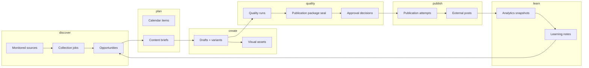

# Architecture — Multi-Brand AI CMO Platform

**Phase:** 0.5+ multi-brand blueprint (documentation draft pending architecture sign-off)  
**Runtime:** Single Next.js application (App Router), Node.js on Windows dev / Linux production  
**First onboarded brand (seed only):** Bois & Chiffons (B&C) — not product identity

---

## 1. Goals

- One deployable app with clear layers: UI → API routes → services → integrations → database
- **Multi-brand:** Platform → Workspace → **many Brands** → brand-scoped ops (DEC-021)
- Content lifecycle: **discovery → planning → creation → quality → approval → publish → analytics → learning** (per brand)
- Replaceable AI and visual providers
- Workspace-scoped multi-user access with explicit roles; optional brand-level access (DEC-021)
- Fail-closed security: no publish without human approval on a specific version; **no cross-brand data or AI context mixing** (DEC-023)

---

## 2. Layered structure (target)

```
src/
  app/                    # App Router: layouts, pages, route handlers
    (workspace)/          # Workspace shell; brand segment in path or session
    (workspace)/brands/[brandId]/  # Brand-scoped feature routes
    api/                  # REST-style route handlers (or server actions + routes)
  components/             # UI: design system + feature components
  lib/                    # Shared utilities (non-domain)
  server/
    auth/                 # Session, workspace + brand access resolution
    db/                   # Prisma client, transactions
    services/             # Business logic (pure where possible)
    integrations/         # Connectors + mocks
    ai/                   # Provider abstraction + workflows
    validators/           # Deterministic rules (claims, stock, approval)
  types/                  # Shared TypeScript types
prisma/
  schema.prisma
```

**Conventions**

- Route handlers: parse input → authorize → call service → return DTO
- Services: no direct `fetch` to social APIs (delegates to integrations)
- Integrations: map external errors to typed `IntegrationError`
- AI workflows: return structured JSON validated by Zod; persist `workflowVersion`

---

## 3. Content lifecycle



### State principles

| Stage | Guard |
|-------|--------|
| Publish | Valid `PublicationPackage` (not superseded) AND latest `ApprovalDecision` = `APPROVED` AND `packageHashAtDecision === publicationPackage.packageHash` AND `contentVersionId === draft.currentVersionId` AND fresh stock/offer/product snapshots per DEC-020 AND non-waivable blockers clear |
| AI generation | Read-only access to brand rules + product snapshots; cannot write approvals |
| External HTML/text | Stored as data; rendered escaped; never passed to `eval` or script contexts |

**Authoritative state (do not infer across layers):**

| Concern | Source of truth |
|---------|-----------------|
| Production tracking / UI | `ContentDraft.workflowStatus` (`ContentWorkflowStatus`) |
| What may be published | `PublicationPackage` + `PublicationPackageApprovalState` + pre-publish validators |
| External post exists | `PublishedPost` + connector `externalId` |
| Calendar scheduling | `CalendarItem` (planning only until DEF-008 lifted) |

Transition table: `docs/API_CONTRACTS.md` § State transitions.

**Publication package (DEC-016):** Sealing freezes platform, account, copy, media hashes, destination URL, tracking params, and linked product/offer snapshots. Any material edit to publish-relevant data creates a **new** package version and invalidates prior approvals on the old package.

---

## 4. Authentication, workspace, and brand isolation

**Candidate:** Auth.js (NextAuth v5) with session cookie — see `docs/DECISIONS.md` DEC-001.

**Hierarchy**

```
Platform (deployable app)
  └── Workspace (org / team, billing boundary)
        └── Brand (1..N) — all marketing ops scoped here
              └── BrandProfile, products, content, integrations, …
```

**Isolation model**

1. Every **brand-specific** business row includes `workspaceId` **and** `brandId` (DEC-021)
2. Session carries `userId`; active `workspaceId` from selector or URL; active `brandId` from brand switcher or `/brands/:brandId` segment (REQ-PLAT-003)
3. Middleware / server helpers:
   - `requireWorkspaceMember(workspaceId, userId)`
   - `requireBrandAccess(workspaceId, brandId, userId)` — workspace member **and** brand not archived **and** optional `BrandMember` grant (DEC-021)
   - `requireCapability(workspaceId, userId, capability)` — workspace-level; brand routes also validate brand access
4. Roles (MVP): `OWNER`, `ADMIN`, `EDITOR`, `REVIEWER`, `VIEWER` at workspace level
5. Brief operational roles (REQ-BRIEF-002) map to workspace roles **plus duty flags** per brand where configured (see `docs/API_CONTRACTS.md`).

**Rules**

- Cross-workspace queries forbidden at service layer (assert `workspaceId` on all reads/writes)
- Cross-brand queries forbidden unless **explicit portfolio scope** (DEC-022) — portfolio endpoints aggregate with per-brand permission checks; never return another brand’s row bodies by id guessing
- Load-by-id pattern: `findFirst({ where: { id, workspaceId, brandId } })` on brand data — never `findUnique({ id })` alone
- Background jobs: `Job.workspaceId` and `Job.brandId` (when brand-scoped) must match every entity id in `payload`; reject if any FK resolves outside `(workspaceId, brandId)`
- Database: composite integrity `(workspaceId, brandId)` on child FKs (see `docs/DATA_MODEL.md` §1)
- Archive brand: `Brand.status = ARCHIVED` — read-only history; no new drafts/opportunities/jobs for that brand
- Negative tests: `docs/ADVERSARIAL_ACCEPTANCE_TESTS.md` (AT-001, AT-002, AT-017, AT-019–AT-024)
- Service accounts (future) are workspace-scoped API keys — not in MVP

---

## 5. AI provider layer

```
server/ai/
  provider.ts           # interface: complete(), embed() optional
  providers/
    openai.ts
    anthropic.ts
    mock.ts
  workflows/
    opportunity-analysis.ts
    caption-generate.ts
    hook-score.ts       # ported from ig-reel heuristics
    caption-lint.ts     # ported from ig-caption
    humanize.ts         # ported from ig-human
    ...
  prompts/              # versioned templates (file or DB)
```

**Behavior**

- Each workflow: `inputSchema`, `outputSchema`, `promptVersion`, timeout, retry policy
- Log: `workspaceId`, `brandId`, `workflowId`, `promptVersion`, token usage (no PII in logs)
- On malformed output: single repair attempt then fail with user-visible error

**Skill adaptation**

- MIT assets from `instagram-agent-skill` may be translated to TypeScript (hooks.json, slop.json, rubrics)
- Do not subprocess Python in production unless explicitly decided (operational complexity on Windows)

---

## 6. Media storage for publishing (DEC-013)

Meta and similar APIs require **public HTTPS URLs** for uploaded image/video bytes at publish time. MVP options:

1. **Product/catalogue URLs** when assets are already public on the brand’s site (read-only publish path).
2. **Workspace object storage** (e.g. S3-compatible or Vercel Blob) for uploads and generated previews — signed upload from server; store stable public URL on `VisualAsset`.

Do not expose bucket credentials to the client. Upload-only MVP (DEC-010) still needs DEC-013 for any connected publish test.

---

## 7. Connector architecture

See `docs/INTEGRATIONS.md` for platform matrix.

```
server/integrations/
  types.ts              # ConnectorCapability enum, ConnectionHealth
  registry.ts           # registerConnector(id, factory)
  meta/
  linkedin/
  reddit/
  pinterest/
  google/
  web-search/
  mocks/
```

Each connector implements a subset of:

- `research` — public permitted fetch
- `account` — OAuth token refresh, profile metadata
- `publish` — create post/media container
- `insights` — post/account metrics
- `websiteAnalytics` — GA4 / GSC

**Credential flow**

1. OAuth callback route (server-only) stores encrypted refresh token linked to `IntegrationConnection`
2. Frontend receives connection status only (no tokens)

---

## 8. Security boundaries

| Boundary | Implementation |
|----------|----------------|
| Secrets | Server env only; `.env` gitignored; `.env.example` names only |
| Credentials | Encrypt at rest (`CREDENTIALS_ENCRYPTION_KEY`); decrypt in integration worker |
| Authorization | Per-route permission table in `docs/API_CONTRACTS.md` |
| Audit | `AuditEvent` on: rule changes, role changes, approval transitions, publish attempts |
| Untrusted input | Zod validation; HTML sanitize for rich text; strip control chars (humanizer pass) |
| AI prompt injection | External snippets wrapped as quoted data; system rules immutable |
| Publish | `PublishService` asserts sealed `PublicationPackage`, approval hash match, integration capability, public media URLs (DEC-013), reconcile ambiguous attempts (DEC-015) |
| Job execution | Atomic claim + lease (DEC-015); worker may run via cron hitting `/api/v1/jobs/run` — not long-lived in-process timers on serverless |
| AI self-approval | Non-human actors cannot approve; `approvedByUserId` required (REQ-MDI-049) |
| Human self-approval | `approver !== contentVersion.createdByUserId` unless `OWNER` override (DEC-008) |

---

## 8b. Brand context for AI and agents (DEC-023)

**Brand context loader** (`server/ai/brand-context.ts`): for a single request/job, load exactly one `brandId`:

- Active `BrandProfile` + current `BrandRuleVersion`
- Approved claims and product snapshot pointers referenced by the workflow
- Locale list and channel config for that brand only

**Rules**

- Workflows and conversational CMO **must not** accept multiple `brandId` values in one run
- Portfolio summaries use a dedicated **portfolio workflow** that only receives aggregated metrics (counts, KPI rollups)—never concatenated prompts from two brands’ rule sets
- Terminal / Agents Feed events are tagged `brandId` (or `portfolio` scope) and filtered in UI (REQ-PLAT-005)
- REF-OKARA-001: URL-driven strategy and per-channel agents — pattern only; implementation stays brand-scoped

### Specialist agents (platform capabilities — seven)

Orchestrated by the conversational **AI CMO**; each specialist is a workflow bundle with fixed input/output schemas (not autonomous posting).

| # | Specialist | Primary workflows | Brand scope |
|---|------------|-------------------|-------------|
| 1 | **Opportunity intelligence** | Source scan, dedupe, rank, explain | Single brand watchlist + products |
| 2 | **Brand strategy** | Voice, pillars, claim grounding, positioning Q&A | Single brand rules |
| 3 | **Content studio** | Briefs, captions, carousel, reel scripts | Single brand |
| 4 | **Channel adaptation** | IG/FB/Pinterest/LinkedIn/other variants | Single brand channel config |
| 5 | **Calendar & capacity** | 30-day roll, mix rules, overdue detection | Single brand |
| 6 | **Quality & compliance** | Fact, stock, offer, rights, editorial checks | Single brand catalogue |
| 7 | **Analytics & learning** | Import, baselines, learning notes, weekly patterns | Single brand; portfolio rollup only via DEC-022 |

User-facing “agents feed” lists runs for **selected brand** or **portfolio** view (explicit toggle).

---

## 9. Observability (MVP)

- Structured logs (JSON) for integration failures and publish attempts
- Optional: Sentry later — not Phase 0
- Health endpoint: DB ping + integration queue depth

---

## 10. Testing strategy

| Layer | Tool |
|-------|------|
| Services / validators | Vitest |
| API routes | Vitest + supertest or `next/test` patterns |
| UI critical paths | Playwright |
| Connectors | Mock adapters default in CI |

---

## 11. Deployment (future)

- Vercel or container hosting with managed PostgreSQL
- Cron: Vercel cron or separate worker for sync jobs — decision deferred (DEC-006)

---

## 12. Repository state (Phase 0.5)

**Current:** Documentation only; no `package.json`, Prisma, or `src/` yet. Phase 0.5 adversarial remediation + **multi-brand model** applied in `docs/` (see `FINDINGS_REGISTER.md`, `MULTI_BRAND_MIGRATION.md`).  
**Expected next:** Architecture sign-off → Phase 1 scaffold per `docs/IMPLEMENTATION_PLAN.md` (prove AT-001/002/017 **and AT-019–AT-024** before Screen 3+).
