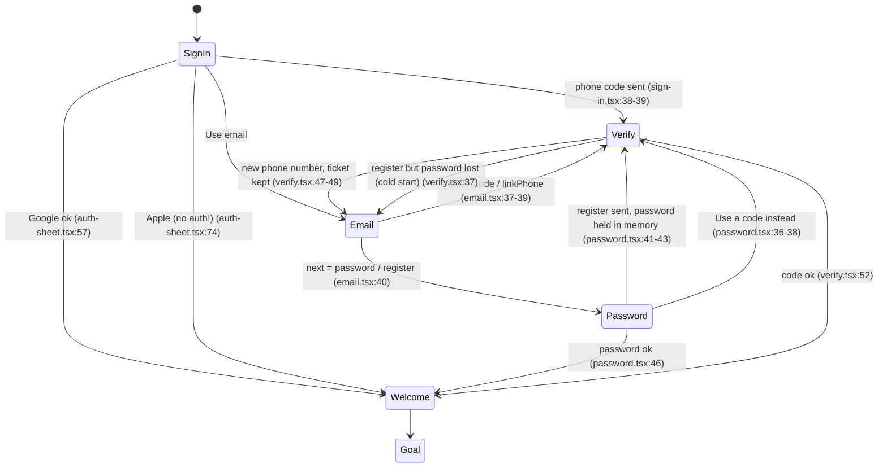
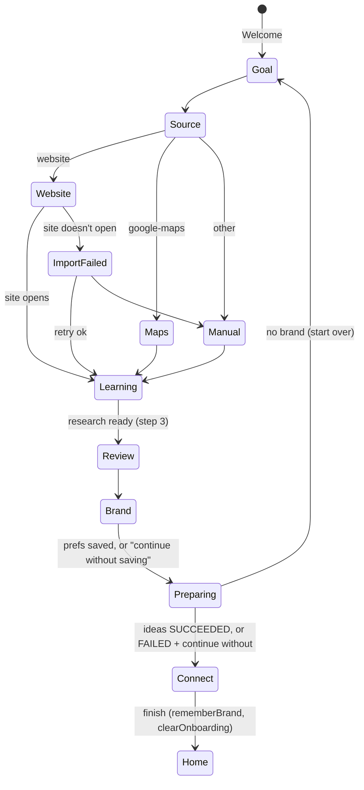
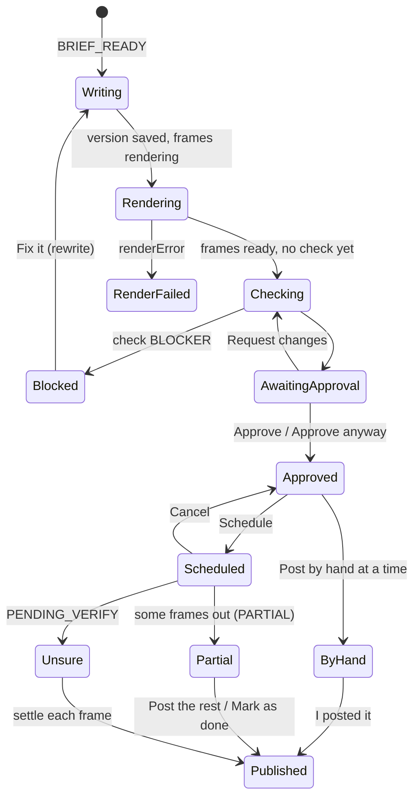
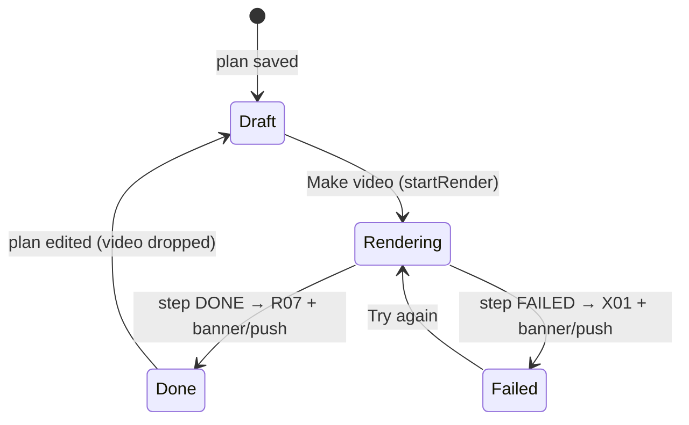

# Implicit state machines: mobile app (`apps/mobile`)

Read-only review, 2026-11-16. Scope: `apps/mobile/src/**`. The server was read only to learn which statuses a screen can see.
Every problem below was checked in the code. Line numbers are for the files as they are on branch `desktop-shell`.

Ratings: **Critical** = people lose work, pay twice or get stuck on the main path. **Important** = a real stuck or wrong state on a common path. **Minor** = an edge case or polish.

## Summary

26 machines.

| # | Machine | Main file(s) | Worst problem | Rating |
|---|---|---|---|---|
| 1 | Session (signed out / signed in / expired) | `api/client.ts`, `app/_layout.tsx`, `ui/account-actions.ts` | Expiry skips the sign-out cleanup: old business, posts, plan and push device stay | Important |
| 2 | Sign-in flow (phone, email, password, register, code, Google, Apple) | `app/onboarding/{sign-in,email,password,verify}.tsx`, `ui/onboarding/auth-sheet.tsx` | Every sign-in lands on Welcome and runs onboarding again, which makes a new brand | Critical |
| 3 | Server reachability (online / offline / back) | `api/client.ts`, `ui/connection-banner.tsx` | Several 401s at once fire the sign-out handler several times | Minor |
| 4 | Onboarding wizard and saved answers | `ui/onboarding/state.ts`, `app/onboarding/*` | A cold start never returns to onboarding; the app opens Posts half-onboarded | Important |
| 5 | Research run (A08 Learning) | `ui/onboarding/use-research.ts`, `app/onboarding/learning.tsx` | Polls forever with no time limit and no way on | Important |
| 6 | First ideas run (A11 Preparing) | `app/onboarding/preparing.tsx` | A run that never finishes blocks onboarding: no "continue without" until it fails | Important |
| 7 | Social connect (A12, Connections, X03) | `ui/connect-social.ts`, `app/onboarding/connect.tsx` | Android kills the app during sign-in: `espanda://connect` has no route, the code is lost | Important |
| 8 | Current business and switching | `api/endpoints.ts` (`currentBrand`), `ui/use-current-brand.ts`, `ui/account-actions.ts` | A failed or raced load leaves the business null, and nothing retries on that screen | Minor |
| 9 | Plan cache and activation | `ui/plans/use-plan.ts`, `app/plans/activated.tsx` | After a switch, an old in-flight read is reused and dropped; plan stays unknown until the next focus | Minor |
| 10 | Posts list cache | `ui/posts/use-posts.ts` | Not reset on session expiry (see 1) | Minor |
| 11 | Post detail lifecycle | `app/posts/[id].tsx`, `ui/posts/use-working-poll.ts` | Fine; polling is capped at 3 min with Try again | — |
| 12 | Schedule / approve two-step | `app/posts/schedule.tsx`, `api/endpoints.ts` (`publishContent`) | Spinner forever when the posts list fails or the item has no version | Minor |
| 13 | Story list and cards (P07) | `ui/stories/use-stories.ts`, `ui/stories/card.tsx` | Cards "Preparing frames…" are never re-read while the screen stays open | Important |
| 14 | Story detail (writing, rendering, approve, by hand, partly posted) | `app/posts/story/[id].tsx`, `ui/stories/card.tsx` (`Unfinished`) | A Planner story with no version shows "being written" here but "not written" on its card | Minor |
| 15 | Story editor (P08) | `app/posts/edit-story.tsx` | After 3 minutes of rendering the editor is read-only for good: no polling, no retry | Important |
| 16 | Story media upload | `ui/stories/upload.ts`, `ui/stories/picker.tsx` | Well built; no problem found | — |
| 17 | Generate trip (story ⇄ Photoshoot / Reels) | `ui/stories/generate.ts` | Module state, lost on a cold start (documented) | — |
| 18 | Post by hand package | `ui/stories/by-hand.tsx`, `ui/stories/package.ts` | No problem found | — |
| 19 | Planner run (P09 Generate calendar) | `app/posts/planner.tsx` | Leaving the screen forgets the run; Generate (5 credits) is offered again while it still runs | Important |
| 20 | Reel plan chat (streamed write) | `ui/reels/use-reel.ts` | Capped at 3 min; fine | — |
| 21 | Reel render and its watcher | `ui/reels/render-watch.ts`, `app/reels/generating.tsx`, `app/recovery/video-failed.tsx` | The watcher never forgets a reel it can't read: polls every 10 s for the app's life | Important |
| 22 | Reel review → publish → scheduled | `app/reels/{review,publish,scheduled}.tsx` | A failed or unconfirmed publish shows "Publishing now" forever | Important |
| 23 | Presenter and template preview "making" | `app/reels/actor.tsx`, `app/reels/templates.tsx` | Poll every 10 s with no cap | Minor |
| 24 | Voice recording and cloning | `app/reels/record.tsx`, `app/reels/clone.tsx` | A take whose upload fails is thrown away; it must be recorded again | Minor |
| 25 | Push permission and registration | `ui/push.ts`, `app/business/account.tsx` | Sign-out waits up to 20 s on the push DELETE with no feedback | Minor |
| 26 | Photoshoot run | `ui/photoshoot/start.ts`, `app/photoshoot/{generating,results}.tsx` | Create has no request id; a lost answer and a second tap can start a second paid shoot | Minor |

## Top problems

1. **Critical.** Every sign-in, including after an expired session, goes to Welcome and runs onboarding again, which creates a new brand. `app/onboarding/password.tsx:46`, `app/onboarding/verify.tsx:52`, `ui/onboarding/auth-sheet.tsx:57`, `ui/onboarding/use-research.ts:61-76`.
2. **Important.** R09 "Scheduled" says "Publishing now" forever after a publish fails or can't be confirmed. `app/reels/scheduled.tsx:35-36,99-100`.
3. **Important.** The reel render watcher never drops a reel it can't read (other business, signed out, deleted). `ui/reels/render-watch.ts:19-21`.
4. **Important.** Session expiry doesn't run the sign-out cleanup. `app/_layout.tsx:42` vs `ui/account-actions.ts:19-25`.
5. **Important.** A11 Preparing has no time limit and no way on until the run fails. `app/onboarding/preparing.tsx:38,107-124`.

---

## 1. Session

**Where the state lives.** The token in SecureStore (`espanda.session`, `api/client.ts:12-24`). There is no state object: "signed in" means "a token is stored". `app/index.tsx:8-13` reads it once at launch.

**States.** `NoToken` → `TokenStored` (not checked) → `Valid` / `Rejected`.

| From → To | Trigger | Where |
|---|---|---|
| NoToken → TokenStored | Code, password, register, phone or Google sign-in saves the token | `api/endpoints.ts:23-54` |
| TokenStored → Valid | `/me` answers at launch and on every return to the foreground | `app/_layout.tsx:47-56` |
| any → Rejected → NoToken | Any 401 while a token was sent: token cleared, listeners fire, app resets to sign-in with `expired=1` | `api/client.ts:176-179`, `app/_layout.tsx:42` |
| Valid → NoToken | Sign out (push off, token cleared, onboarding, brand, posts, plan, reel forgotten) | `ui/account-actions.ts:19-25` |

There is no refresh token. Expiry always means signing in again.

**Problems**

- **Important. Expiry skips the cleanup that sign-out does.** `_layout.tsx:42` only calls `resetTo(sign-in)`. It does not call `forgetBrand`, `forgetCurrentBrand`, `forgetPosts`, `forgetPlan`, `openReel(null)` or `disablePush` (all in `signOut()`, `account-actions.ts:19-25`). Scenario: a shared phone; A's session expires; B signs in. `currentBrand()` still returns A's cached business (`endpoints.ts:183`), so B's requests carry A's workspace id. When B finishes onboarding, `connect.tsx:22` resets `currentBrand` but not the `use-current-brand` store, so headers show A's business name and logo for up to 50 min (`use-current-brand.ts:12,63-65`). The phone also stays registered for A's push notifications, because nothing tells the server to drop the device.
- **Minor. Several 401s at once fire the handler several times.** Each request reads the token before it starts (`client.ts:140`), so three requests in flight all see `token` set and all run `store.clear()` and the listeners (`client.ts:176-179`). Result: three `resetTo` calls in a row. Harmless today, but any listener with side effects would run three times.

## 2. Sign-in flow

**Where the state lives.** Route params (`phone`, `email`, `linkPhone`, `register`, `create`), the in-memory password (`ui/onboarding/registration.ts`), `onboarding.phoneTicket` (`state.ts:28`), and per-screen `busy`/`error` state.

**Problems**

- **Critical. Every successful sign-in starts onboarding again.** `password.tsx:46`, `verify.tsx:52` and `auth-sheet.tsx:57` all go to `/onboarding/welcome`. Welcome only offers Get started (`welcome.tsx:21`). Nothing asks the server whether this person already has a business. For a returning person, `onboarding` was cleared when they finished (`connect.tsx:23`), so A08 calls `createBrand` again (`use-research.ts:61-76`), which also starts Research, SEO and GEO. Scenario: a session expires (or the person signs in on a new phone); they sign in; they must go through goal, source and website again, and end up with a second copy of their business, unless the server refuses it. The only way around it is to kill the app, because `app/index.tsx:13` sends a stored token to `/posts`.
- **Important. "Apple" signs no one in.** `auth-sheet.tsx:74` pushes `/onboarding/welcome` with no token. The person walks through goal, source and website; A08 then fails on `me()`, and `use-research.ts:84` sends them back to sign-in. The button is shown in release builds.
- **Minor. Google uses `router.replace`, not `resetTo`.** `auth-sheet.tsx:57`. On the email screen the stack keeps sign-in behind Welcome, so Back returns to a sign-in screen while signed in. The other paths use `resetTo` (`password.tsx:46`, `verify.tsx:52`).

## 3. Server reachability

**Where the state lives.** Module variables in `api/client.ts:49-76`: `connectionState`, `probing`, `probeFailures`. The banner adds a third UI state, `back`, for 3 s (`connection-banner.tsx:15-23`).

| From → To | Trigger | Where |
|---|---|---|
| online → offline | A fetch throws (not a timeout, not a screen's cancel) | `client.ts:163-166` |
| offline → online | Any answer, or the 5 s probe of `/me` answers | `client.ts:69-74,170` |
| (GET only) offline → wait ≤ 60 s → retry once | `untilReachable` | `client.ts:166` |
| upload PUT fails → offline | `waitForServer` | `client.ts:92-105` |

A timeout does not count as offline (`client.ts:162-163`). Writes are never repeated. This is a sound design.

**Problems.** Only the 401 fan-out above (section 1).

## 4. Onboarding wizard

**Where the state lives.** The module object `onboarding` (`ui/onboarding/state.ts:12-29`), saved to SecureStore when the app goes to the background (`_layout.tsx:30`) and restored at launch (`_layout.tsx:28`). Steps are routes.

**Problems**

- **Important. A cold start never resumes onboarding.** Answers are saved so "the brand isn't forgotten on the way back" (`state.ts:4-7`), but at launch `app/index.tsx:13` sends anyone with a token to `/posts`. Scenario: Android kills the app on A12 while the Instagram page is open; the person reopens Espanda and lands on Posts. `rememberBrand` was never called (`connect.tsx:22`), so `currentBrand()` falls back to `onboarding.brandId` (`endpoints.ts:172,176`) and mostly works, but `onboarding` is never cleared and A12 is skipped.

## 5. Research run (A08 Learning)

**Where the state lives.** `useResearch` (`ui/onboarding/use-research.ts:24-113`): `step` 0-3, `failed`, `attempt`, a `started` ref; ids in `onboarding`.

| From → To | Trigger | Where |
|---|---|---|
| idle → creating | No brand for this source yet | `use-research.ts:61-79` |
| creating → polling | Brand created, run id saved | `:76-80` |
| polling → step 1 / 2 | Any event of this run / BrandSummary event | `:44` |
| polling → done (3) | BrandReview event or run SUCCEEDED | `:42` |
| polling → failed | Run FAILED | `:43` |
| failed → polling | Try again: restart Research or create again | `:96-111` |
| any → sign-in | 401 | `:50,84` |

**Problems**

- **Important. No time limit.** A run stuck in `QUEUED` (no worker) or `RUNNING` keeps the screen polling every 2.5 s with "In progress" and a disabled button (`learning.tsx:51`). There is no slow message and no way on. Compare `use-working-poll.ts`, which stops after 3 min.
- **Minor. Every error is treated as a network blip.** A 403 or 404 (the brand was removed, the workspace changed) is retried every 5 s forever (`use-research.ts:46-50`).

## 6. First ideas run (A11 Preparing)

**Where the state lives.** `useFirstIdeas` (`app/onboarding/preparing.tsx:24-76`): `run`, `waiting`, `failed`, `attempt`.

States: `starting` → `waiting for Research` (server says `waiting`, ask again every 2.5 s) → `following` (QUEUED/RUNNING) → `ready` (SUCCEEDED) or `failed` (FAILED, or the start call failed).

**Problems**

- **Important. A run that never ends blocks onboarding.** The footer shows only a disabled, spinning button until `ready` or `failed` (`preparing.tsx:107-124`). "Continue without" exists only in the `failed` branch (`:118`). Both loops have no cap: `waiting` repeats `start` forever (`:54`), and `follow` repeats `poll` for any status that isn't SUCCEEDED, including `null` (`:38`). Scenario: Research never writes its documents; the server answers `waiting` forever; the person can't reach A12 or the app.
- **Minor. Poll errors never surface.** `firstIdeas` failures are retried every 5 s silently (`:42-46`); a 403/404 looks like "still preparing".

## 7. Social connect

**Where the state lives.** `connectSocial` (`ui/connect-social.ts:15-27`) plus `busy`/`failed`/`connected`/`done` in each caller (`connect.tsx:27-46`, `connections.tsx:37-61`, `recovery/reconnect.tsx:31-46`).

States: `idle` → `starting` (get consent URL) → `in browser` → `completing` (send state + code) → `connected` / `cancelled` (`[]`) / `failed`.

**Problems**

- **Important. The return link has no screen.** The browser returns to `espanda://connect` (`connect-social.ts:6`). There is no `app/connect.tsx`; only `+not-found.tsx` exists. If Android kills the app while the consent page is open (the case `_layout.tsx:29-30` prepares for), the relaunch opens that link, shows "not found", and the `state` and `code` are never sent to `/integrations/…/complete`. The account is not connected and nothing says so.
- **Minor. Connections does nothing while the business is loading.** `connect` runs `brand && …` (`connections.tsx:57`); a tap before `brand` loads silently does nothing and clears `busy`.

## 8. Current business and switching

**Where the state lives.** Two module stores that must agree:
- `current` / `pending` in `api/endpoints.ts:166-198` (ids and name; used for every request);
- `brand` / `loading` in `ui/use-current-brand.ts:13-38` (name, logo, full view; used for headers and Business screens).

| From → To | Trigger | Where |
|---|---|---|
| unknown → looked up | First `currentBrand()`: saved choice, else onboarding's, else newest | `endpoints.ts:169-186` |
| looked up → other business | Drawer switch: `rememberBrand` (name dropped, so `current = null`), then `forgetBusinessState` | `account-actions.ts:47-50`, `drawer.tsx:83-89` |
| loaded → stale | View older than 50 min, on focus | `use-current-brand.ts:62-65` |

**Problems**

- **Minor. A load in flight during a switch leaves the business null.** `load()` returns at once while another load runs (`use-current-brand.ts:28`). Scenario: Photos' Refresh starts a load; the person switches business; `forgetCurrentBrand` sets `null`; the new screen's hook calls `load()`, which returns because the old one is still running; the old one then sees `brand?.id !== A` and sets nothing (`:34`). The effect's dependency `b` stays `null`, so it never runs again on that screen (`:59-61`), and focus only reloads when a view exists (`:64`). Headers stay blank; Products shows its loading rows forever (`products.tsx:46,133-134`) until another screen mounts.
- **Minor. A failed lookup is never retried on the same screen.** Same mechanism: `currentBrand()` fails (offline past the 60 s wait, a 5xx), `brand` stays null, nothing retries until a new screen mounts.
- **Minor. The drawer's business list is read once per drawer mount.** `togglePicking` loads only when `list` is null (`drawer.tsx:80`); a failure sets `[]` and shows an empty list with no retry, and a business added later doesn't appear.

## 9. Plan cache and activation

**Where the state lives.** `ui/plans/use-plan.ts:13-50`: `state`, `inflight`, `failed`, fresh for 30 s. L04 adds a 10 s timeout (`app/plans/activated.tsx:21-25`). Activation is detected by comparing with a per-workspace SecureStore key (`use-plan.ts:67-76`).

**Problems**

- **Minor. A switch can reuse the old workspace's read.** `forgetPlan` does not clear `inflight` (`use-plan.ts:50`). The next `reloadPlan()` returns the old promise (`:38`); its answer is dropped as the wrong workspace (`:40`). `state` stays null, so `loaded` is false and Posts/Reels don't redirect a plan-less workspace to L05/L01 until the next focus (`posts/index.tsx:26-28`, `reels/index.tsx:23-26`).

## 10. Posts list cache

**Where the state lives.** `ui/posts/use-posts.ts:13-44`: `state {items, error}`, `inflight`, `generation`. Reloaded on every Posts focus. A `generation` counter drops answers from before a sign-out or switch. Good.

**Problems.** Not reset on session expiry (see section 1).

## 11. Post detail lifecycle

**Where the state lives.** The server's `status` on the item, plus `fixing` (the version "Fix it" was tapped on), `settling`, `asking` (`app/posts/[id].tsx:62-72`). `useWorkingPoll` polls every 5 s while `working`, stops after 3 min, then shows `slow` with Try again (`use-working-poll.ts:12-28`).

States shown: `writing` (BRIEF_READY), `checking` (DRAFT_REVIEW without a check, or sent back, or being fixed), `blocked` (DRAFT_REVIEW + BLOCKER), `ready` (AWAITING_APPROVAL / APPROVED), `scheduled` (a SCHEDULED attempt: Cancel), `uncertain` (a PENDING_VERIFY attempt: Was posted / Not posted), `failed publish` (`publishIssue === "FAILED"`).

**Server statuses.** `PostStatus` in `api/endpoints.ts:475` lacks `CANCELLED`, but the content list route filters it out (`apps/web/app/api/v1/…/content/route.ts:18`), so the app never sees it. All other `ContentStatus` values have a label (`ui/posts/format.ts:27-38`).

**Problems.** None worth a rating. The 3-minute cap and `waitingOn` version are a good pattern.

## 12. Schedule / approve two-step

**Where the state lives.** `app/posts/schedule.tsx:50-65` (`release`, `slot`, `account`, `board`, `mode`, `busy`, `loadError`), and the two calls in `publishContent` (`api/endpoints.ts:370-379`): approve first when needed, then publish.

**Problems**

- **Minor. Spinner forever when the post can't be shown.** `if (!post || !post.latest) return <PageLoading/>` (`schedule.tsx:86-92`) ignores `usePosts().error`. If the list read fails, or the id is gone, the screen spins with no message or retry.
- **Minor. "Now" is frozen when the screen opens.** `const [now] = useState(Date.now)` (`:59`). Left open past the picked time, the slot still counts as `future` (`:106`), and the server refuses it on tap. The error is shown, so nothing is lost.

## 13. Story list and cards (P07)

**Where the state lives.** `useStories` (`ui/stories/use-stories.ts:45-87`): `items`, `due`, `error`, an `inflight` ref. Each card derives a status line (`ui/stories/card.tsx:17-26`).

Card states: `writing` (BRIEF_READY + request id + under 10 min, `use-stories.ts:17-18`), `rendering` ("Preparing frames…"), `not written` (no version), `add photos`, then by `tab`: drafts / scheduled (or by hand) / posted (partly posted, needs check).

**Problems**

- **Important. "Preparing frames…" is never re-read.** The 5 s poll runs only while some card is `writing` (`use-stories.ts:74-82`). A card that is `rendering` (`card.tsx:81-82`) stays "Preparing frames…" until the person leaves and comes back. Scenario: save a story with a clip, go back to P07; the card spins for good.
- **Minor. A writer lost for 10 minutes silently turns into a draft.** `isWriting` uses the phone's clock against `createdAt` (`use-stories.ts:18`). A phone clock that is ahead flips a fresh story to "not written" early. Documented as a ponytail.

## 14. Story detail

**Where the state lives.** `app/posts/story/[id].tsx:36-79`: `release` (from `stories.get`), `fixing`, `busy`, `listRead`, plus `Unfinished` (`card.tsx:114-184`) with `attempts`, `pending`, `expiredOk`.

**Problems**

- **Minor. Detail and card disagree about stories nobody is writing.** The card treats a BRIEF_READY story without a request id as a plain draft ("not written", `use-stories.ts:13-18`, `card.tsx:82`). The detail treats any BRIEF_READY story as `working` (`story/[id].tsx:77`): it polls for 3 min, shows "not ready yet", then offers Try again, which calls `posts.rewrite` (`:124-135`).

## 15. Story editor (P08)

**Where the state lives.** `app/posts/edit-story.tsx:74-101`: `edits {draft, history, key, base}`, `savedFrom {version, rendering}`, `release`, `busy`, `readError`, `incoming` (a Generate result), `picking`, `leaving`. Derived flags at `:138-143,176-180,347`.

```mermaid
stateDiagram-v2
  [*] --> Loading
  Loading --> ReadOnly: no release / not editable / by hand
  Loading --> Clean: release read, editable
  Clean --> Dirty: change()
  Dirty --> Clean: undo past the first change
  Dirty --> Stale: someone else saved (version != base)
  Dirty --> Saving: Save / Save and check / Generate
  Saving --> Dirty: save refused (error shown)
  Saving --> Pending: saved; waits for the new version
  Pending --> Clean: new version landed
  Pending --> Dirty: render failed (edits kept)
  Pending --> StuckSlow: 3 min cap, no retry
  Clean --> Trip: Generate → Photoshoot / Reels
  Trip --> Dirty: Use in story (incoming placed)
```

**Problems**

- **Important. After 3 minutes the editor is stuck read-only.** `useWorkingPoll(!!release?.rendering || pending, …)` stops after 3 min (`edit-story.tsx:162`). The editor takes only `slow`, not `retry`, and has no Try again button. `pending` (`:141`) stays true because neither `landed` nor `renderFailed` can change without a new read. Scenario: a long clip renders for 4 minutes; the editor says "taking longer" forever, every tool is disabled (`:180`), and the result (or the render error with the kept edits) never shows. Only leaving and reopening helps.

## 16. Story media upload

**Where the state lives.** `ui/stories/upload.ts:33-105` (closure: `cancelled`, `task`, `ctrl`, `reachableFailures`) and `progress`/`rights`/`error` in the picker (`picker.tsx:52-58`).

States: `slot` → `PUT` (progress) → `done check` → `verified` / `rejected`; on a failed transfer → `offline wait` → (background) `until active` → new slot. Gives up after 3 failures while the server answered. Cancel stops every step. Closing the sheet cancels. No problem found.

## 17. Generate trip

**Where the state lives.** Module `pending` and `handoff` in `ui/stories/generate.ts:21-32`, cleared by the editor on focus and unmount (`edit-story.tsx:131-132`). `returnTo` route param wins.

No rated problem. It does not survive a cold start; this is documented at `generate.ts:16-19`.

## 18. Post by hand package

**Where the state lives.** `ui/stories/by-hand.tsx:19-25` (`pending`, `note`, `error`, `copied`, `left`). Save frames is all-or-nothing (`package.ts:34-74`). No problem found.

## 19. Planner run (P09)

**Where the state lives.** Component state `run` in `app/posts/planner.tsx:48-73`. Polled every 5 s until SUCCEEDED or FAILED.

**Problems**

- **Important. Leaving the screen forgets the run.** `run` lives only in the component. Scenario: tap Generate calendar (5 credits), go to the calendar, come back: `started` is false (`:49`), so "Generate calendar" shows again (`:201-203`) while the first run is still going. A second tap charges again unless the server refuses it.
- **Minor. No time limit.** A run stuck in QUEUED polls forever with "planning started" (`:55-68,79`).

## 20. Reel plan chat

**Where the state lives.** Module `currentId` and `inflight` in `ui/reels/use-reel.ts:10-25`. A dropped stream waits for the reply up to 3 min (`:31-56`). One message at a time (`:148`). No rated problem.

## 21. Reel render and its watcher

**Where the state lives.** The server's `renders[0].step` (VOICE → CLIPS → JOIN → DONE / FAILED). Module `watching` set and `timer` in `ui/reels/render-watch.ts:13-41`. Screens route by step: `generating.tsx:36-40`, `video-failed.tsx:42-47`, `storyboard.tsx:29-44`.

**Problems**

- **Important. The watcher never drops a reel it can't read.** `look()` turns any error into `null` and `continue`s (`render-watch.ts:19-21`), so the id stays in `watching` and the 10 s timer never stops (`:25-28`). `reels.get` uses the current business (`endpoints.ts:276-279`). Scenario: start a render, switch business (or sign out, or the reel is deleted); every 10 s for the rest of the session the app asks the new business for that reel and gets 404, plus once more on each return to the foreground (`:32`). The "ready" banner for that reel never shows. Signing out doesn't clear `watching` either (`account-actions.ts:11-16`).
- **Minor. R05 polls every 3 s with no end** when no render exists; it only shows a note after 30 s (`generating.tsx:24,33`).

## 22. Reel review → publish → scheduled

**Where the state lives.** The server's item `status` and `checks`, plus `rechecks`/`slow` on R07 (`review.tsx:36-78`), `busy` on R08 (`publish.tsx:39`), `attemptId`/`cancelling` on R09 (`scheduled.tsx:25-28`).

R07 states: `checking` (DRAFT_REVIEW, no checks) → auto recheck at 90 s → `slow` at 150 s → `sendable` (AWAITING_APPROVAL / APPROVED / SCHEDULED / PUBLISHED, not BLOCKER) or `blocked`.
R09 states: `later` (SCHEDULED, slot ahead), `published`, else "Publishing now".

**Problems**

- **Important. "Publishing now" forever after a failed or unconfirmed publish.** R09 knows only `published`, `later` (SCHEDULED with a future slot) and everything else (`scheduled.tsx:35-36,99-100`). On a failed publish the server moves the item back to APPROVED (`apps/web/server/services/publishing.ts:650`); on an unknown outcome (PENDING_VERIFY) it stays SCHEDULED with a slot in the past. Both show "Publishing now" with a 5 s poll that never ends (`scheduled.tsx:23`). The person is never told it failed or asked to check Instagram; the post screens do this (`posts/[id].tsx:179-194`).
- **Minor. R07 says "Checking…" for statuses that won't be checked.** The footer falls through to `review.checking` for anything not sendable or blocked (`review.tsx:126`), e.g. REJECTED or BLOCKED without a check.

## 23. Presenter and template preview "making"

**Where the state lives.** `round` counters; poll every 10 s while any presenter is RUNNING or any template preview is `making` (`actor.tsx:38-56`, `templates.tsx:48-64`).

**Problems**

- **Minor. No cap.** A presenter that stays RUNNING keeps both screens polling every 10 s while open.

## 24. Voice recording and cloning

**Where the state lives.** `record.tsx:28-39` (`pending`, `starting` refs; `sending`, `take`, `problem`) and `clone.tsx:28-41` (`taken`, `sending`, `starting`, `stopping`).

States: `asking mic` → `ready` → `recording` (≤ 15 s / ≤ 90 s) → `sending` → `take shown` (heard text matches or not) → `kept` / `re-record`. The `pending` flag stops Stop and the auto-stop from both sending (`record.tsx:64-90`).

**Problems**

- **Minor. A failed upload loses the take.** `send` sets `pending.current = false` before uploading (`record.tsx:67`) and keeps no uri; on error only `problem` is set (`:71-72`). The person has to record again. Clone keeps `taken` and can resend (`clone.tsx:97-111`).

## 25. Push permission and registration

**Where the state lives.** Module `token` in `ui/push.ts:17-23`, mirrored in SecureStore; the OS permission. Asked on the first Make video (`render-watch.ts:36`).

States: `unavailable` (no EAS project / native module) → `off` → `asking` → `on` (token registered) / `denied`. Off on sign-out.

**Problems**

- **Minor. Sign-out waits on the network with no feedback.** `signOut` awaits `disablePush`, which awaits the DELETE (`push.ts:65-72`, `account-actions.ts:20`). On a slow network that is up to 20 s (`client.ts:125`) with no spinner on the Sign out button (`account.tsx:96-104`), so people tap it again.
- See section 1: expiry never unregisters the device.

## 26. Photoshoot run

**Where the state lives.** The server's shoot `status` (RUNNING / DONE / FAILED), polled every 5 s on F05 (`generating.tsx:27-50`) and every 10 s on F06 while any is running (`results.tsx:22-43`). Both stop on unfocus. Good.

**Problems**

- **Minor. No request id on create.** `photoshoots.create` sends no idempotency key (`endpoints.ts:466-469`), unlike `stories.create` (`endpoints.ts:653-655`, `posts/stories.tsx:28-33`). Scenario: the create call takes over 20 s and times out after the server already charged and queued it; the person taps Generate again and a second shoot starts, unless the server dedupes.

---

## Server statuses vs what the app handles

| Server enum (`apps/web/prisma/schema.prisma`) | App type | Gaps |
|---|---|---|
| `ContentStatus` (11 values, :812) | `PostStatus` (`endpoints.ts:475`), `ContentStatus` (`:222`) | `CANCELLED` missing from `PostStatus`, but the list route filters it out. Reels' `ContentStatus` lacks `BRIEF_READY` and `REVIEWED` (not expected for studio reels). R09 doesn't handle "back to APPROVED after a failed publish" (section 22). |
| `PublicationStatus` (:1143) | `string` | Posts handle SCHEDULED and PENDING_VERIFY; stories also PARTIAL. FAILED shows through `publishIssue`. R09 handles none of them. |
| `ReelRenderStep` (:867) | `RenderStep` | All handled. |
| `AgentRunStatus` (:294) | `RunStatus` | All handled, but QUEUED/RUNNING have no cap on A08, A11 and P09. |
| `ConnectionStatus` (:660) | `Connection.status` | All handled. |
| Presenter / shoot `RUNNING / DONE / FAILED` | yes | All handled. |
