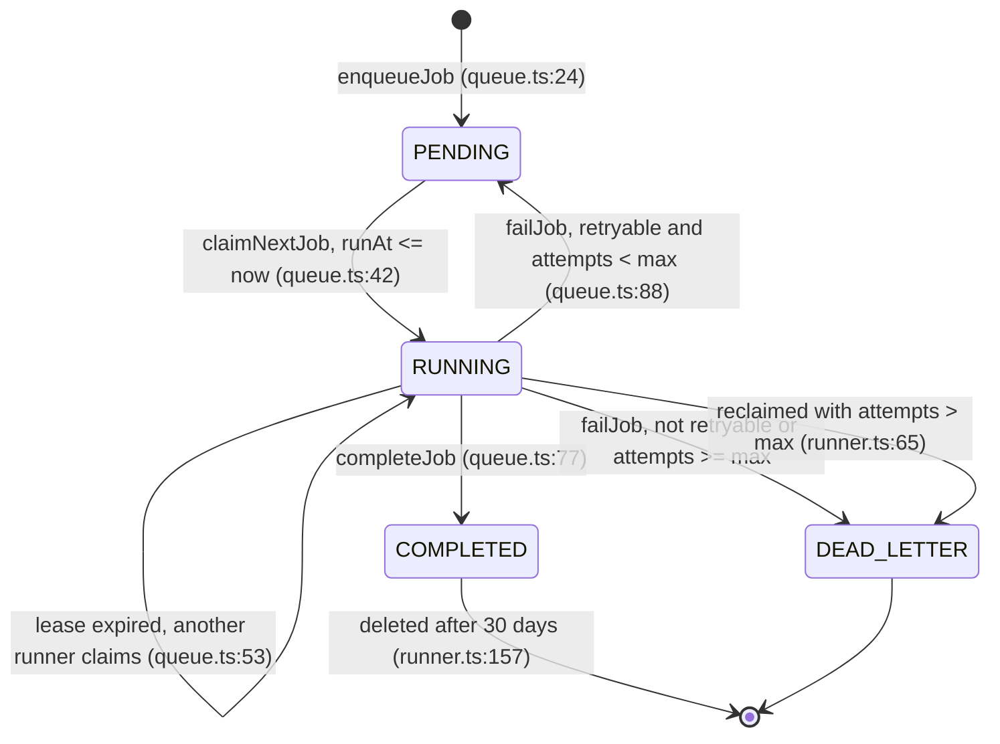
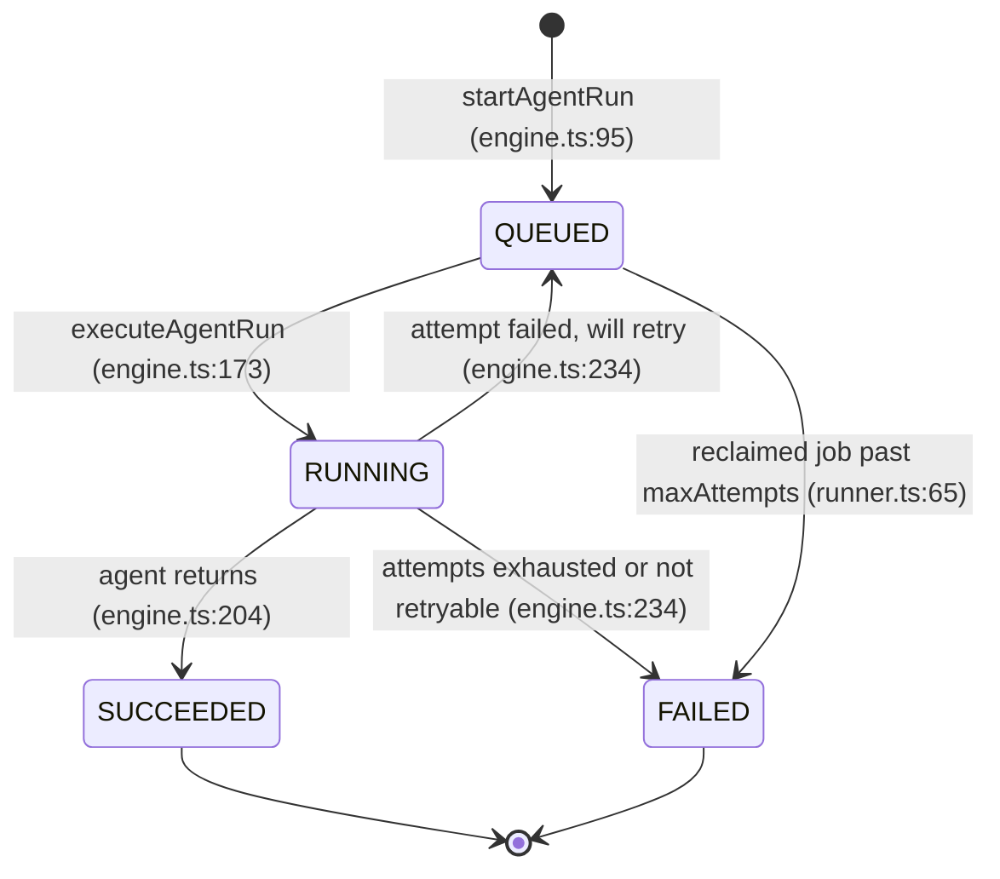
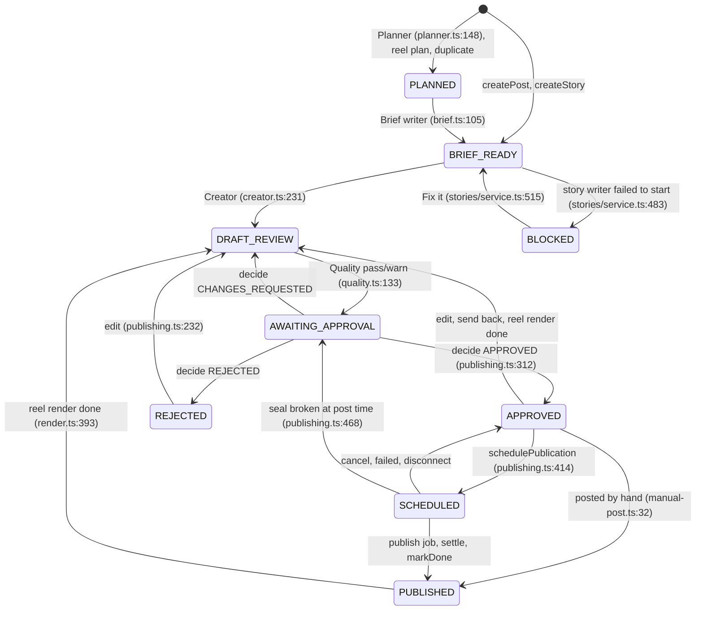
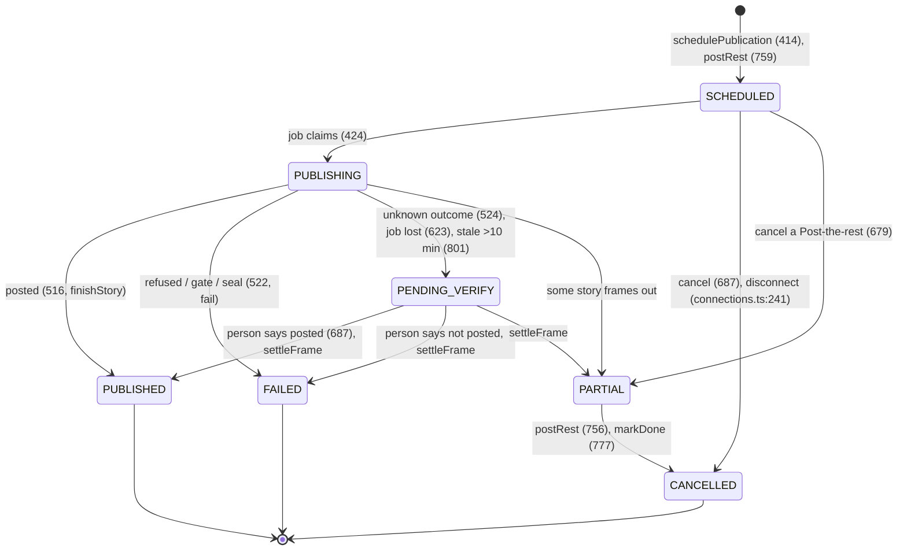
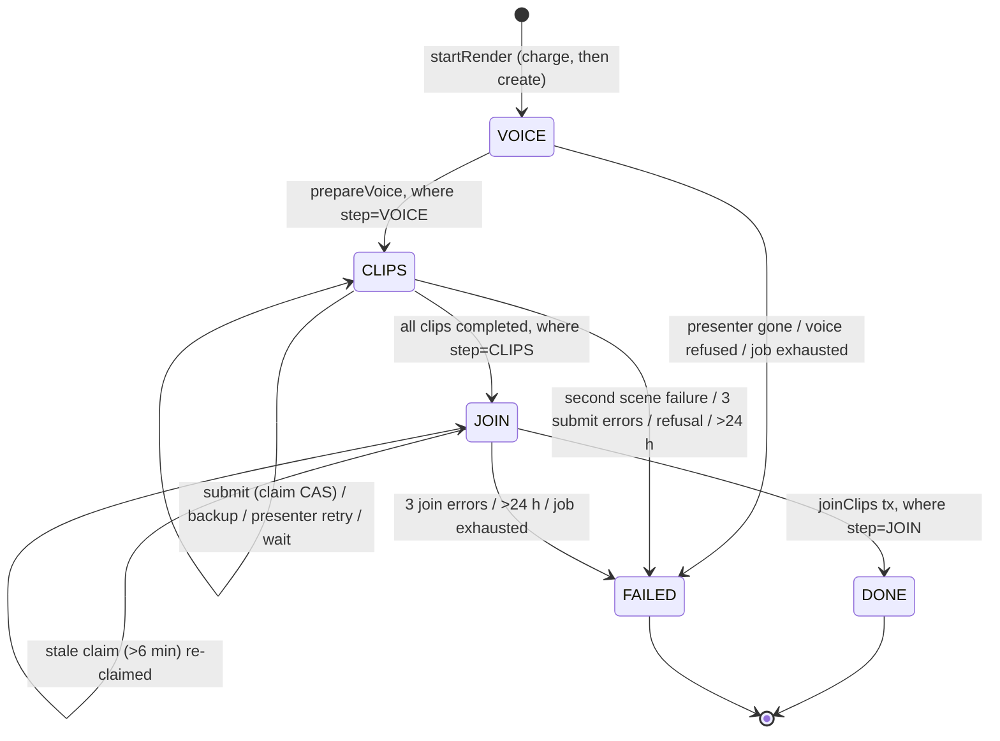
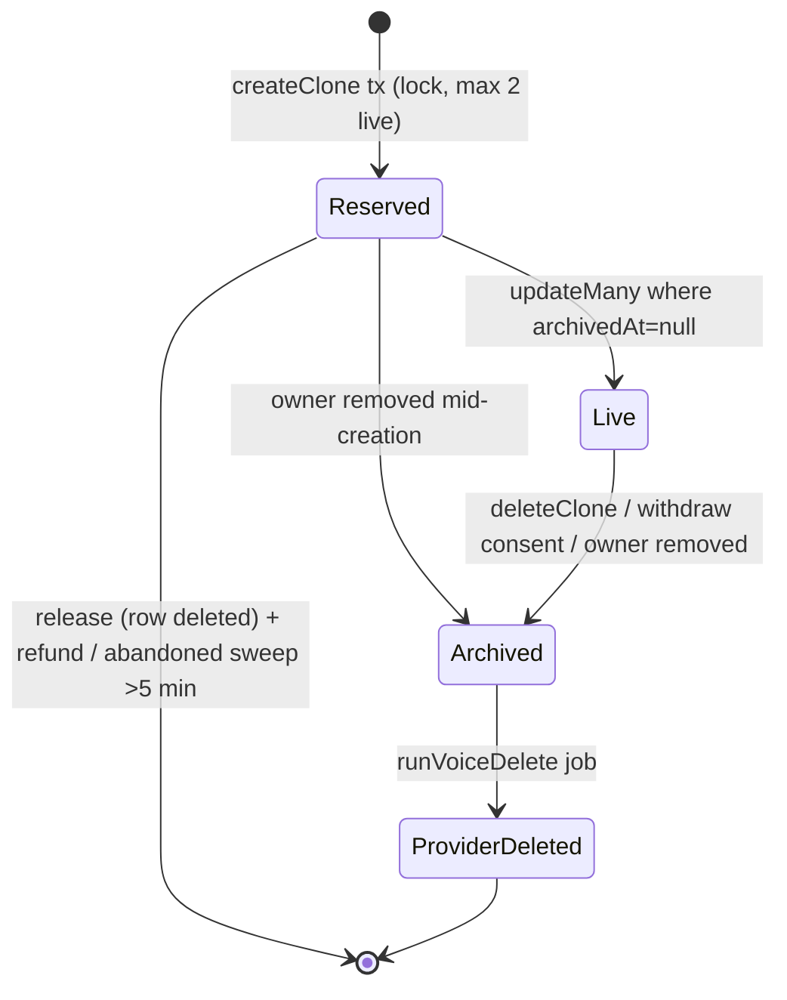
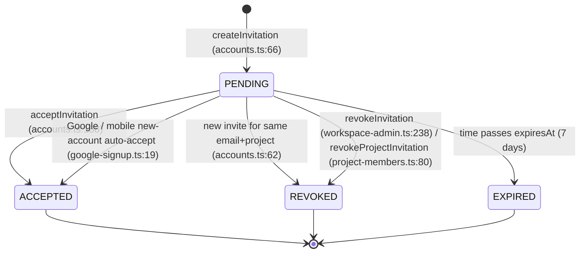
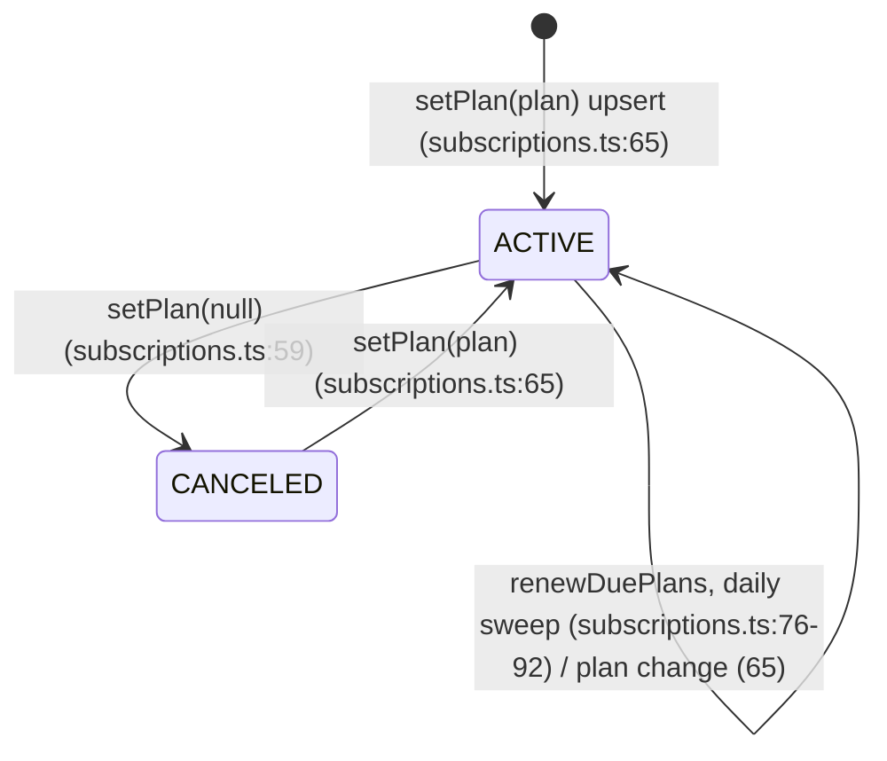
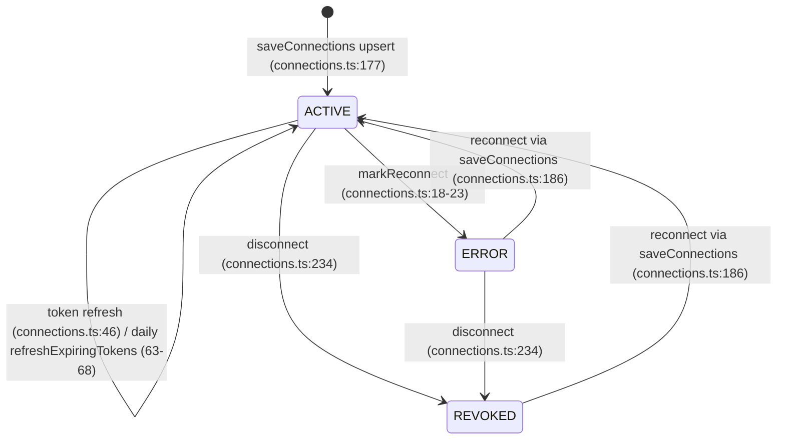

# Server state machines (implicit)

Date: 2026-11-16. Branch `desktop-shell`. Read-only review; no code changed.

Scope: `apps/web/prisma/schema.prisma`, `apps/web/server/**`, `apps/web/app/api/**`, `apps/web/auth*.ts`, `apps/web/middleware.ts`, `apps/web/scripts/worker-dev.ts`. Website pages are covered by a separate review.

An "implicit state machine" here is a record or process that moves through states without one declared transition table: an enum column, nullable timestamps used as states, flag combinations, or a job lifecycle. All file paths are under `apps/web/`. Line numbers are as of commit `c17339d`.

Every problem below was checked against the code. Ratings:

- **Critical**: loses money or data, or gets stuck for good, with no person able to fix it from the app.
- **Important**: a realistic race or path gives a wrong state the user will see or pay for.
- **Minor**: an edge case, cosmetic, or documented.

## Summary

28 machines.

| # | Machine | States | Where | Worst problem |
|---|---|---|---|---|
| 1 | Job queue | 4 (+ orphaned lease) | `Job.status`, `leasedBy/leasedUntil`, `attempts` | Important: a runner that lost its lease still runs failure hooks and refunds (queue.ts:89, runner.ts:81-82) |
| 2 | Agent run | 4 | `AgentRun.status`, `startedAt/finishedAt` | Important: every status write is unguarded, so FAILED + refunded can become SUCCEEDED (engine.ts:173, 204, 234) |
| 3 | Credit charge | 2 (charged, refunded) | `CreditEntry` rows by `refId` | Important: a refund is not tied to whether the work still finished |
| 4 | Content item | 11 (+ `byHand`, approval) | `ContentItem.status`, `byHand`, `scheduledFor` | Important: a finished reel render puts a PUBLISHED or SCHEDULED reel back to DRAFT_REVIEW (reels/render.ts:393) |
| 5 | Publication attempt | 7 (+ per-frame progress) | `PublicationAttempt.status`, `target.progress` | Important: unguarded `finish` lets a late worker overwrite a person's settle, so the post can go out twice (publishing.ts:431-432) |
| 6 | Approval (derived) | 3 (none, holds, void) | `ApprovalDecision` rows | Minor: item APPROVED while its approval is void |
| 7 | Opportunity | 4 | `Opportunity.status` | Important: Planner marks ideas it made no post for as PLANNED, and they are locked for good (planner.ts:164) |
| 8 | Brand context doc | 3 | `BrandContextDoc.status` | Minor: two CONFIRMED rows possible |
| 9 | Catalogue sync + product archive | 4 + 2 | `BrandProfile.catalogSync`, `Product.archivedAt` | Minor: two syncs of one brand can run at once (documented) |
| 10 | Reel render | 5 steps (+ claim) | `ReelRender.step`, `claimedAt`, `requests`, `outputs` | **Critical**: if Higgsfield status reads keep failing, it polls forever, is never refunded, and blocks re-renders (reels/render.ts:169-170) |
| 11 | Reel asset | 3 (+ submitted) | `ReelAsset.status` (string), `requestId` | Minor: a row with no job stays RUNNING until a later request |
| 12 | Photoshoot | 3 (+ submitted) | `PhotoShoot.status` (string), `requests` | Minor: a shoot whose job was never queued stays RUNNING, credits held |
| 13 | Voice clone | 4 | `Voice.providerVoiceId`, `archivedAt`, `sampleKey` | Important: a withdrawn voice can stay at ElevenLabs for good (no failure handler on the delete job) |
| 14 | Reel recording | 2 | row exists + referenced by a version | Minor: the purge's check and delete are not atomic |
| 15 | Media upload | 3 (+ hidden "checking") | `MediaUpload.status` (string), `reason` | Minor: a check that dies leaves the upload REJECTED "checking" for good |
| 16 | Story render ("Preparing frames") | 4 | `Job` rows of type `story.render` + `body.renderId` | Minor: `failStoryStart` sets BLOCKED from any status |
| 17 | Invitation | 4 | `acceptedAt`, `revokedAt`, `expiresAt` | Minor: acceptance does not re-check the inviter's right to invite an owner |
| 18 | Password reset token | 3 | `usedAt`, `expiresAt` | Minor: 3 requests by a stranger block resets for an hour |
| 19 | Mobile sign-in code | 3 | `VerificationToken` `mobile-code:<email>` | Important: a stranger can keep a code-only user locked out (mobile-auth.ts:43) |
| 20 | Auth session | 4 | JWT `sub/sv` vs `User.status/deletedAt/sessionVersion` | Minor: sign-out does not revoke the token |
| 21 | Rate-limit bucket | 3 | `RateLimitBucket.count/windowStart` | Minor: per-email limits let a stranger lock someone out (by design) |
| 22 | User account | 3 declared, 1 reachable | `User.status`, `deletedAt`, `emailVerified` | Minor: nothing in the app can disable, restore or delete a user |
| 23 | Workspace membership + primary owner | roles + owner flag | `WorkspaceMember.roleId/role`, `Workspace.ownerUserId` | Minor: last-owner check runs outside a transaction |
| 24 | Brand status | 2 | `Brand.status`, `Brand.archivedAt` | Minor: ARCHIVED has no writer |
| 25 | Subscription | 2 + period | `Subscription.status/periodStart/periodEnd` | Minor: renewal does a blind update over a plan change |
| 26 | Email outbox | 4 | `EmailOutbox.status/attempts` | Minor: FAILED rows keep live links and are never pruned |
| 27 | Integration connection | 3 + token expiry | `IntegrationConnection.status`, `encryptedCredentials`, `tokenExpiresAt` | Important: a token refresh can write live credentials back onto a disconnected row (connections.ts:46) |
| 28 | OAuth state | 3 | `OAuthStateTransaction.consumedAt/expiresAt/client` | None found |

Not machines: `PushDevice` (upsert or delete only). `Session` is unused because auth uses JWT (`auth.config.ts:9`). `AiWorkflowRun.status`, `QualityCheck.overall` and `ApprovalDecision.verdict` are written once and never move.

### Top problems, in order

1. **Critical.** Reel render polls forever when Higgsfield status reads fail. The 24 h give-up is skipped, the credits are never refunded, and the reel can't be rendered again (`server/reels/render.ts:169-170`).
2. **Important.** A finished reel render sets the item to DRAFT_REVIEW from any status, including PUBLISHED and SCHEDULED (`server/reels/render.ts:393`).
3. **Important.** The non-story publish `finish` has no status guard. A late worker overwrites PENDING_VERIFY or a person's "not posted", which can lead to a double post (`server/services/publishing.ts:431-432`).
4. **Important.** A job runner that lost its lease still runs `onFailure`, which refunds and fails work another runner is finishing (`server/jobs/queue.ts:89`, `server/jobs/runner.ts:81-82`).
5. **Important.** Disconnecting an account cancels a story's "Post the rest" attempt as if nothing was posted, so the next schedule reposts the frames already out (`server/services/connections.ts:239-245`).

Also Important: token refresh revives a disconnected connection (`server/services/connections.ts:46`); sign-in code lockout (`server/services/mobile-auth.ts:43`); voice delete has no failure handler (`server/jobs/runner.ts:47`); voice orphaned at ElevenLabs after a crash (`server/reels/clones.ts:89-98`); Planner locks unused ideas (`server/agents/definitions/planner.ts:164`); unguarded AgentRun writes (`server/agents/engine.ts:173, 204, 234`).

### Patterns

- **Read, then `update where id`.** Most bugs share this shape. The good code paths use `updateMany where { id, status }` and check `count` (publish claim, story frames, assets, shoots, render steps). The bad ones are the older `update where id` calls listed above. One rule would fix most of them: never write a status without the expected "from" status in the `where`.
- **Hidden states in other columns.** "Submitted" lives in `requestId`/`requests`, "checking" in `MediaUpload.reason`, "rendering" in Job rows, "orphaned" in `leasedUntil`. The UI can only show these if it knows the convention.
- **Free-string statuses.** `PhotoShoot.status`, `ReelAsset.status` and `MediaUpload.status` are strings, not enums. Nothing in the schema stops a typo.
- **Dead enum values.** `ContentStatus.REVIEWED` and `CANCELLED`, `UserStatus.INVITED` and `DISABLED`, and `BrandStatus.ARCHIVED` are never written by server code, but code still branches on them.

---

## 1. Job queue (`Job`)

**Where:** `Job.status` (`PENDING`, `RUNNING`, `COMPLETED`, `DEAD_LETTER`) plus `attempts`, `maxAttempts`, `runAt`, `leasedBy`, `leasedUntil`, `idempotencyKey`. Code: `server/jobs/queue.ts`, `server/jobs/runner.ts`, `app/api/v1/jobs/run/route.ts`, `scripts/worker-dev.ts`.

`RUNNING` with an expired lease is a hidden fifth state: "orphaned, can be taken again".

| From | To | Trigger | Guard |
|---|---|---|---|
| (none) | PENDING | `enqueueJob` queue.ts:24 | With a key: `upsert` with `update: {}` returns the old row in any state |
| PENDING | RUNNING | `claimNextJob` queue.ts:42 | `runAt <= now`, `FOR UPDATE SKIP LOCKED`; `attempts + 1` |
| RUNNING (lease expired) | RUNNING | `claimNextJob` queue.ts:53 | `leasedUntil < now` |
| RUNNING | RUNNING (lease extended) | `holdLease` timer queue.ts:67 | `leasedBy` and `status = RUNNING`; errors swallowed (queue.ts:71) |
| RUNNING | COMPLETED | `completeJob` queue.ts:77 | `leasedBy` and `RUNNING` |
| RUNNING | PENDING / DEAD_LETTER | `failJob` queue.ts:88 | `leasedBy` and `RUNNING`; backoff `2^n × 15 s`, cap 1 h |
| RUNNING | DEAD_LETTER | runner.ts:65 | reclaimed job whose `attempts > maxAttempts` |

**Terminal:** `COMPLETED`, `DEAD_LETTER`. **Timeouts:** 5 min lease, renewed every 100 s. **Retries:** default 5; publish 1; story render 2; photoshoot/asset 3; voice delete 8.

**Problems**

- **Important. A runner that lost its lease still runs the failure hooks.** `failJob` returns `exhausted` from the runner's own copy of the job, even when its `updateMany` matched nothing (queue.ts:89-98). The runner then calls `handler.onFailure(..., exhausted)` anyway (runner.ts:81-82). Scenario: lease renewal fails for 5 min (DB blip; errors are swallowed at queue.ts:71). Runner B reclaims the agent job and starts it. Runner A then throws on its last attempt. A's `onAgentRunFailure` marks the run `FAILED` and refunds the credits while B is still working. B then writes `SUCCEEDED` (engine.ts:204): a finished run that was also refunded. The same path refunds reel renders, photoshoots and assets (`failRender`, `onShootFailure`, `onAssetFailure`).
- **Important. A lost lease means the job runs twice.** Renewal errors are swallowed (queue.ts:71) and the old runner is never told it lost the lease. It keeps calling AI, Higgsfield or a publisher. Publishing is the dangerous case; see PublicationAttempt below.
- **Minor. An idempotency key can never run again.** `enqueueJob` with a key returns the existing row even when it is `COMPLETED` or `DEAD_LETTER` (queue.ts:35-39). A daily sweep that dead-letters (`daily-sweep:<day>`) cannot be re-queued that day by calling the cron again: the cron "succeeds" and nothing runs.
- **Minor. `DEAD_LETTER` rows live forever.** Nothing moves them on and the prune only deletes `COMPLETED` (runner.ts:157). Nothing in the server shows them except the story render error lookup (stories/service.ts:311).

## 2. Agent run (`AgentRun`)

**Where:** `AgentRun.status` (`QUEUED`, `RUNNING`, `SUCCEEDED`, `FAILED`) plus `startedAt`, `finishedAt`, `error`, `input.chargeId`. Code: `server/agents/engine.ts`. Driven by its `agent.run` job.

| From | To | Trigger | Guard |
|---|---|---|---|
| (none) | QUEUED | `startAgentRun` engine.ts:95 | advisory lock per brand+agent; joins an identical `QUEUED`/`RUNNING` run under 30 min old (engine.ts:85-94) |
| QUEUED | RUNNING | `executeAgentRun` engine.ts:173 | read-check at engine.ts:153 only; the write is `update where id` |
| RUNNING | SUCCEEDED | engine.ts:204 | none (`update where id`) |
| RUNNING | QUEUED / FAILED | `onAgentRunFailure` engine.ts:232-239 | read-then-write: skips if `SUCCEEDED` |
| FAILED | (refund) | engine.ts:243 | only if exhausted, has `chargeId`, and nothing was delivered |

**Terminal:** `SUCCEEDED`, `FAILED`. Retries come from the job (5 attempts, backoff). A run older than 30 min stops blocking a new identical run.

**Problems**

- **Important. All three writes are unguarded.** RUNNING (engine.ts:173), SUCCEEDED (engine.ts:204) and QUEUED/FAILED (engine.ts:234) use `update where id` with no status check. With the lease race above, a `FAILED` + refunded run can be overwritten to `SUCCEEDED`, or a `SUCCEEDED` run's check at engine.ts:233 can pass just before the other runner writes `SUCCEEDED`, giving `FAILED` over real output.
- **Minor. A run can stay RUNNING forever.** If `onAgentRunFailure` itself throws, the runner swallows it (runner.ts:82 `.catch(() => {})`). The job is dead-lettered but the run stays `RUNNING`. Nothing sweeps old runs. After 30 min it stops blocking new runs, but the agent log shows it running for good.

## 3. Credit charge (`CreditEntry`)

**Where:** no status column. The state of one charge is the set of rows with the same `refId`: a negative row (charged), then maybe a `reason: "refund"` row (refunded). Code: `server/services/credits.ts`.

| From | To | Trigger | Guard |
|---|---|---|---|
| (none) | charged | `spendCredits` credits.ts:46 | advisory lock per workspace; balance check; unique `(workspaceId, reason, refId)` |
| charged | refunded | `refundCharge` credits.ts:77 | unique `(workspaceId, "refund", refId)`: one refund per charge |

**Terminal:** refunded. Charged is also final unless a failure hook refunds it.

**Problems**

- **Important. Refund and delivery are not tied together.** A charge is refunded by a failure hook that does not check whether the work still finished (see Job and AgentRun). Scenario as in the Job section: a run delivered and refunded.
- **Minor. A refund row needs a negative row with the same `refId` (credits.ts:78), but not the same reason.** Two features that reuse a `refId` value would refund each other. Today callers prefix their refIds (story `story:<brand>:<id>`, reel `<versionId>:<n>`), so this is not live.

## 4. Content item (`ContentItem`)

**Where:** `ContentItem.status` (11 values) plus `byHand`, `scheduledFor`, `studio`, `postUrl`, and the derived "approval holds" (latest `ApprovalDecision` is `APPROVED` for the latest version and its hash matches, publishing.ts:117). Lock: `pg_advisory_xact_lock("content:<id>")` (publishing.ts:153).

| From | To | Trigger | Guard |
|---|---|---|---|
| (none) | PLANNED | Planner planner.ts:148; reel `createReel` reels/service.ts:129; `duplicateStory` stories/service.ts:388 | none |
| (none) | BRIEF_READY | `createPost` publishing.ts:181; `createStory` stories/service.ts:465 | none |
| any reel status except SCHEDULED/PUBLISHED | PLANNED | `savePlan` reels/service.ts:93 | lock; no active render; version match |
| PLANNED | BRIEF_READY | Brief writer brief.ts:105 | `updateMany where status PLANNED, no versions` |
| BRIEF_READY, DRAFT_REVIEW (sent back), BLOCKED→BRIEF_READY | DRAFT_REVIEW | Creator creator.ts:231 | lock; status and version unchanged since read |
| BRIEF_READY (story) | BLOCKED | `failStoryStart` stories/service.ts:483 | **none** (`updateMany where id`) |
| BLOCKED | BRIEF_READY | `reopenStoryWrite` stories/service.ts:515 | `where status BLOCKED` |
| DRAFT_REVIEW | AWAITING_APPROVAL (or stays) | Quality quality.ts:133 | lock; still `DRAFT_REVIEW` at same version |
| PLANNED…APPROVED, REJECTED, BLOCKED | DRAFT_REVIEW | `saveDraft` publishing.ts:232; `createStoryVersion` stories/service.ts:211 | lock; `EDITABLE`; not SCHEDULED; version match |
| AWAITING_APPROVAL (or APPROVED for override/send-back) | APPROVED / REJECTED / DRAFT_REVIEW | `decide` publishing.ts:312 | lock; latest version; Quality not BLOCKER; four-eyes rule; product gate |
| APPROVED | SCHEDULED | `schedulePublication` publishing.ts:414 | lock; approval holds; ACTIVE connection; no live attempt |
| APPROVED | PUBLISHED | `registerManualPost` manual-post.ts:32 | lock; `APPROVED`; stories also need the approval to hold |
| APPROVED (story) | APPROVED + `byHand` | `setByHand` by-hand.ts:41 | lock; approval holds; no SCHEDULED attempt |
| SCHEDULED | PUBLISHED / APPROVED / AWAITING_APPROVAL / SCHEDULED | `executePublication` `finish` publishing.ts:432 | **none** on the item |
| SCHEDULED | PUBLISHED / APPROVED / SCHEDULED | `finishStory` 447, `storyJobLost` 650, `settleFrame` 735, `markDone` 779 | attempt status guard in the same transaction |
| SCHEDULED / PENDING_VERIFY attempt | PUBLISHED / APPROVED | `settlePublication` publishing.ts:692 | attempt guard, but item write is a separate statement, no lock |
| SCHEDULED | APPROVED | `disconnect` connections.ts:245 | `where status SCHEDULED` |
| APPROVED, PUBLISHED (reel) | DRAFT_REVIEW | reel JOIN done reels/render.ts:393 | **none** on the item |

**Terminal:** `PUBLISHED` (in practice). `REJECTED` can still be edited back. `REVIEWED` and `CANCELLED` are never written by any server code.

**Problems**

- **Important. A finished reel render overwrites any item status.** `advanceRender`'s last step creates a new version and sets `DRAFT_REVIEW` with `update where id` (reels/render.ts:392-393). Rendering may start from `APPROVED` (render.ts:123 only refuses SCHEDULED/PUBLISHED). While it renders (minutes), nothing stops the person from scheduling (`schedulePublication` does not look at renders) or marking it posted by hand (manual-post.ts:27). Scenario A: "Try again" on an approved reel, then "I posted it" → item `PUBLISHED`; the render finishes → item back to `DRAFT_REVIEW`, the posted reel shows as a draft again and can be posted twice. Scenario B: the person schedules while rendering → item `DRAFT_REVIEW` while its attempt is `SCHEDULED` (illegal combo). At post time the seal fails and the item jumps to `AWAITING_APPROVAL` (publishing.ts:468). If that happens before the queued Quality run, Quality finds no `DRAFT_REVIEW` item (quality.ts:60) and the new version never gets a check, so `decide` refuses approval ("The quality check must pass") and the reel is stuck.
- **Important. The non-story publish `finish` writes the item without a guard.** publishing.ts:429-432 updates the attempt and the item with `update where id`. `finishStory` (publishing.ts:445) checks `status = PUBLISHING`; `finish` does not. Scenario: a slow Instagram reel publish runs past 10 min. Opening the post calls `releaseState`, which marks the attempt `PENDING_VERIFY` (publishing.ts:801). The person checks, sees nothing yet, picks "not posted" → attempt `FAILED`, item `APPROVED`; they schedule again. The first worker then finishes and writes `PUBLISHED` on the old attempt and on the item, while the new attempt is `SCHEDULED`. The second publish then posts the same reel twice. The lease race in section 1 gives the same result via `onPublishJobLost`.
- **Minor. `REVIEWED` and `CANCELLED` are dead states.** No server write sets them (grep for `"REVIEWED"`/`"CANCELLED"` on ContentItem). Code still filters on them (planner.ts:50, content/route.ts:18, stories/service.ts:321). There is no way to cancel a post; a person can only reject it.
- **Minor. `failStoryStart` has no status guard** (stories/service.ts:483). It is called after `startAgentRun` throws in the rewrite route (content/[contentId]/route.ts:145). If a Creator run for the same story is already in flight, the item is forced to `BLOCKED`; the in-flight Creator then sees a changed status and throws its draft away (creator.ts:229).
- **Minor. Illegal combos the schema allows.** `byHand = true` with any status other than `APPROVED`; `SCHEDULED` with no live attempt; `PUBLISHED` with a later unpublished version. The code keeps most of these out by hand (`byHand` is cleared in decide, schedule and createStoryVersion), but the reel render path above breaks it.

## 5. Publication attempt (`PublicationAttempt`)

**Where:** `PublicationAttempt.status` (7 values) plus `target.progress` (per-frame `publishing`/`published`/`not-posted` for stories), `publishedAt`, `error`. Code: `server/services/publishing.ts`, `server/services/connections.ts`.

| From | To | Trigger | Guard |
|---|---|---|---|
| (none) | SCHEDULED | `schedulePublication` 405; `postRest` 759 | item lock; no live attempt for same version + account |
| SCHEDULED | PUBLISHING | `executePublication` 424 | `updateMany where SCHEDULED` |
| PUBLISHING | PUBLISHED/FAILED/PENDING_VERIFY | `finish` 431 | **none** |
| PUBLISHING | any outcome (story) | `finishStory` 445 | `where PUBLISHING` |
| PUBLISHING | PENDING_VERIFY | `onPublishJobLost` 623; `releaseState` 801 | `where PUBLISHING` |
| PUBLISHING (story) | outcome from frames | `storyJobLost` 638-648 | row lock + `where PUBLISHING` |
| SCHEDULED | CANCELLED / PARTIAL | `settlePublication` 679/687 | `where SCHEDULED` |
| PENDING_VERIFY | PUBLISHED / FAILED | `settlePublication` 687 | `where PENDING_VERIFY` |
| PENDING_VERIFY (story) | PUBLISHED / PARTIAL / FAILED | `settleFrame` 724 | lock + `where PENDING_VERIFY` |
| PARTIAL | CANCELLED | `postRest` 756, `markDone` 777 | lock + `where PARTIAL` |
| SCHEDULED | CANCELLED | `disconnect` connections.ts:241 | `where SCHEDULED` |

**Terminal:** `PUBLISHED`, `FAILED`, `CANCELLED`. `PENDING_VERIFY` and `PARTIAL` wait for a person forever (by design). No retry: the job has `maxAttempts: 1`; a reclaim calls `onPublishJobLost`. A `PUBLISHING` row older than 10 min is settled when someone opens the post (`releaseState`), not by any job.

**Problems**

- **Important. `finish` is unguarded** (publishing.ts:431). See the content item section: a late worker overwrites `PENDING_VERIFY`, `FAILED` or a person's settle, and can cause a double post.
- **Important. Disconnect cancels a "Post the rest" attempt as if nothing was posted.** `disconnect` sets every `SCHEDULED` attempt on the account to `CANCELLED` and its item to `APPROVED` (connections.ts:239-245). It does not look at `target.progress`. `settlePublication` handles this case and goes back to `PARTIAL` instead (publishing.ts:676-680). Scenario: story frames 1-2 posted, person taps "Post the rest" (old attempt → `CANCELLED`, new one `SCHEDULED` carrying frames 1-2). Someone disconnects Instagram. Now the item is `APPROVED`, no attempt is `PARTIAL`, and scheduling again posts all frames, so frames 1-2 go out twice.
- **Minor. `PUBLISHING` past 10 min is only fixed on read.** `releaseState` (publishing.ts:794) is the only time-based sweep; it runs when someone opens the post. If nobody opens it and the job reclaim also fails, the row stays `PUBLISHING` and the item `SCHEDULED`.
- **Minor. `settlePublication` writes the item outside a transaction and without the item lock** (publishing.ts:692). The attempt write is guarded, so a double click is safe, but the item write can interleave with `decide` or `schedulePublication` on the same item.

## 6. Approval (derived, `ApprovalDecision`)

**Where:** append-only `ApprovalDecision` rows. "Approval holds" = the newest decision is `APPROVED`, for the latest version, with a matching `packageHash` (publishing.ts:117-121). States: none, holds, void (newer version or newer non-approve decision). `productOverride` adds "approved anyway".

No writes to change; every new version or decision moves it. Guards are good: `decide` runs under the item lock and checks the version. **Problem (Minor):** the item status and the approval can disagree. `settlePublication` "not posted" and "cancel" set the item `APPROVED` (publishing.ts:692) without checking the approval still holds. With the reel render race above, an item is `APPROVED` with a void approval. `registerManualPost` for a reel only checks the status (manual-post.ts:27-29), so that reel can be marked posted.

## 7. Opportunity (`Opportunity`)

**Where:** `Opportunity.status` (`NEW`, `SHORTLISTED`, `DISMISSED`, `PLANNED`). `decision` is set by the agent and never moves.

| From | To | Trigger | Guard |
|---|---|---|---|
| (none) | NEW | Scout scout.ts:90 | unique `(brandId, dedupeKey)` |
| NEW | NEW (refreshed) | Scout scout.ts:94 | read-check `status === NEW`, then `update where id` |
| NEW / SHORTLISTED / DISMISSED | NEW / SHORTLISTED / DISMISSED | PATCH opportunities/[id]/route.ts:16 | `status != PLANNED` |
| any | PLANNED | Planner planner.ts:164 | **none** |

**Terminal:** `PLANNED` (locked by the route).

**Problems**

- **Important. The Planner marks every idea it was shown as PLANNED, even those it made no post for.** planner.ts:164 updates all `opps`. The loop drops posts whose idea is invalid or already planned (planner.ts:127) and the model may skip ideas. Those ideas become `PLANNED` with no content item, and the route refuses to change a `PLANNED` idea (route.ts:17). The shortlisted idea is lost with no way back.
- **Minor. A dismissal during a Planner run is overwritten.** The AI call takes seconds to minutes; a person dismissing an idea meanwhile still gets it `PLANNED` and a post made.
- **Minor. Scout refresh races a person.** scout.ts:93-94 checks `NEW` then updates by id. A shortlist in between keeps `SHORTLISTED` (the update does not touch status) but swaps the title and angle under the person.

## 8. Brand context document (`BrandContextDoc`)

**Where:** `status` (`DRAFT`, `CONFIRMED`, `SUPERSEDED`) plus `confirmedAt`. Code: `server/services/context-docs.ts`.

| From | To | Trigger | Guard |
|---|---|---|---|
| (none) | DRAFT | `saveDraft` context-docs.ts:90 | base version check; unique `(brandId, kind, version)` |
| DRAFT (latest only) | CONFIRMED | `confirmDoc` context-docs.ts:144 | must be latest version |
| CONFIRMED | SUPERSEDED | `confirmDoc` context-docs.ts:140 | in the same transaction |

**Problems**

- **Minor. Two CONFIRMED rows are possible.** `confirmDoc` has no lock (context-docs.ts:131-147). Confirming v3 and v4 in two overlapping transactions (READ COMMITTED) can leave both `CONFIRMED`. `confirmedContext` then picks one at random (`Object.fromEntries` over unordered rows, context-docs.ts:55-58).
- **Minor. Old drafts stay DRAFT forever.** Only `CONFIRMED` rows are superseded. The status column says "draft" for versions that will never be confirmed (only the latest can be).

## 9. Catalogue sync and product archive

**Where:** `BrandProfile.catalogSync` JSON (`at`, `source`, `count`, `error`, `reason`) plus whether a `catalog.sync` job is `PENDING`/`RUNNING` (sync.ts:330). `Product.archivedAt` (null = live). `Campaign.archivedAt` is a simple flag.

| From | To | Trigger | Guard |
|---|---|---|---|
| idle | queued | `requestCatalogSync` sync.ts:341; daily sweep sync.ts:348 | check-then-create (manual); day key (daily) |
| queued | ok / failed / refused | `runCatalogSync` sync.ts:287-317 | none |
| product live | archived | `saveRows` gone sync.ts:269; `archiveShopifyRows` sync.ts:275 | `archivedAt null` |
| product archived | live | `saveRows` sync.ts:264 | row reappears in the feed |

**Problems (Minor):** two syncs of one brand can run at once (manual has no key; documented at sync.ts:337). A refused Shopify sync is dead-lettered and waits for a reconnect, which is the intended "stuck until a person acts".

## 10. Reel render (`ReelRender`)

**Where:** `ReelRender.step` (enum `ReelRenderStep`), plus `claimedAt` (a compare-and-set claim), `requests.CLIPS` (Higgsfield ids), `outputs` (voice keys, models, `backups`, `presenterRetried`, `submitErrors`, `joinErrors`, `clipUrls`, `seams`) and `chargeId`. Each tick is one `reel.render` job, at most one per render per 20 s slot (`server/reels/render.ts:100-103`).

CLIPS has hidden sub-states: not submitted (`requests.CLIPS` empty, `claimedAt` null), submitting (`claimedAt` set), and polling (ids saved).

| From → to | Trigger | Guard |
|---|---|---|
| none → VOICE | `startRender` render.ts:108-159 (route `reels/[contentId]/route.ts:66`) | Item lock; no active render; latest version matches; item not SCHEDULED/PUBLISHED; plan checks. Charge refId `${versionId}:${attempt}` (:134) |
| VOICE → CLIPS | `prepareVoice` :266 | `updateMany where step=VOICE` |
| CLIPS (claim) | `submitClips` :275 | CAS on `claimedAt`; stale after 2 min (:86) |
| CLIPS (ids saved) | :284 | **none** (plain `update`) |
| CLIPS (backup / presenter retry) | `retryOnBackup` :327, `retryPresenter` :313 | **none** (plain `update`) |
| CLIPS → JOIN | `join` :334 | `updateMany where step=CLIPS` |
| JOIN → JOIN (re-claim) | :335 | CAS on `claimedAt`, stale after 6 min (:84) |
| JOIN → DONE | `joinClips` :390 | `updateMany where step=JOIN` under the item lock. Also creates a version and sets the item DRAFT_REVIEW (:392-393) |
| VOICE/CLIPS/JOIN → FAILED | `failRender` :425 | `step in ACTIVE`; refund in the same transaction (:428) |

**Terminal:** DONE, FAILED. **Retries:** submit 3 tries (:272); one backup try per failed product scene, one retry per presenter scene (:91-94); join 3 tries (:42); each job 5 queue attempts, then `failRender` as `onFailure` (runner.ts:45). **Timeout:** 24 h from `createdAt` (:83). **Webhook:** `app/api/v1/webhooks/higgsfield/[renderId]/route.ts:22-25` only queues a tick, only when the step is CLIPS. It shares the 20 s slot with polling, so webhook and poll don't race on the claim.

**Problems**

- **Critical. A render can poll forever and is never refunded.** `advanceRender` returns `enqueueTick` when any status read throws (render.ts:169-170), before `nextStep` ever checks the 24 h give-up (:82). The comment at :168 says the give-up still applies; the code skips it. Scenario: the Higgsfield key is rotated to another account, or Higgsfield returns 404 for one purged request id. `Promise.all` rejects on every tick. The render stays in CLIPS for good, the credits stay charged, a new job row is written every 20 s (about 4,300 a day), and `startRender` returns this "running" render to every Try again (:120-121, :131), so the reel can never be rendered again.
- **Important. A finished render drags a posted or scheduled reel back to review.** `joinClips` sets the item to DRAFT_REVIEW with no status check (:393). See section 4 for the scenarios.
- **Minor. A crash between charge and row loses the credits.** `startRender` charges (:134) before the row exists (:142). The code says so (:151-152); there is no sweep.
- **Minor. Some writes have no step guard.** :284, :289, :313 and :327 use plain `update`. Two runners can work one render (a webhook tick takes a different slot from the job's own follow-up). A late write after `failRender` or DONE can overwrite `outputs` from a stale read, dropping `clipUrls` or `seams`, so the failure view (:457) or "softened joins" (:477) show the wrong thing. Duplicate Higgsfield submits are safe because of per-scene idempotency keys.
- **Minor. Polls need something to drain the queue.** In production the queue drains only on `after()` kicks, `kickIfDue` while the app is open (runner.ts:101-109) and cron. With no webhook (no https `AUTH_URL`, render.ts:204) and no frequent cron, a CLIPS render waits until someone opens the app.

## 11. Reel asset: template preview, presenter (`ReelAsset`)

**Where:** `ReelAsset.status` is a free string (RUNNING/DONE/FAILED). `requestId` null or set marks "submitted". `outputKey` holds the result. A partial unique index allows one RUNNING row per brand, kind and template (`prisma/migrations/20261112120000_reel_assets/migration.sql:25`).

| From → to | Trigger | Guard |
|---|---|---|
| none → RUNNING | `createAsset` assets.ts:34-53: charge (refId = row id) :40, create :42, queue :48 | Unique index; on a clash the charge is refunded and 409 |
| RUNNING (submitted) | `runAsset` :71 | **none**; template input also saved unguarded (templates.ts:145) |
| RUNNING → DONE | `runAsset` :82 | `where status=RUNNING` |
| RUNNING → FAILED | `failAsset` :97 (refusal, Higgsfield failure, >1 h at :85, job exhausted :89-92, stale sweep :37-38) | `where status=RUNNING`; refund in the same transaction |
| DONE/FAILED → deleted | `removePresenter` presenters.ts:182-188 | refused while RUNNING |

**Terminal:** DONE, FAILED, deleted (presenter). **Retries:** 3 job attempts. **Timeout:** 1 h; a failed status read still reaches the timeout check, so this one does give up.

**Problems**

- **Minor. A row with no job stays RUNNING.** A crash between create (:42) and enqueue (:48) leaves a row with no job. The only cleanup is the stale sweep inside the next `createAsset` of the same kind (:37). Until then the card shows "making" (templates.ts:175), the presenter can't be removed (presenters.ts:185), and the credits are held.
- **Minor. A timed-out asset can finish anyway.** It is refunded at 1 h, Higgsfield may still finish and bill us; the guarded DONE write just drops the result (:82).
- **Minor. DONE with a null `outputKey` is allowed by the schema.** The code always writes both together (:82).

## 12. Photoshoot (`PhotoShoot`)

**Where:** `PhotoShoot.status` is a free string (RUNNING/DONE/FAILED). `requests` empty or not marks "submitted". `outputKeys` holds results. Charge refId is the shoot id.

| From → to | Trigger | Guard |
|---|---|---|
| none → RUNNING | `createShoot` shoot.ts:78-96: charge :83, create :85, queue :91 | refund on create failure |
| RUNNING (submitted) | `runShoot` :129, :133 | **none** |
| RUNNING → DONE | `finish` :174 | `where status=RUNNING` |
| RUNNING → FAILED | `failShoot` :158 (refusal, failed shot, >1 h :145, exhausted :150-153, enqueue error :92) | `where status=RUNNING`; refund in the same transaction |

**Terminal:** DONE, FAILED. **Retries:** OpenAI tiers 1 attempt, Higgsfield 3 (:102). **Timeout:** 1 h.

**Problems**

- **Minor. A shoot whose job was never queued stays RUNNING for good**, credits held. A crash between create (:84) and enqueue (:91) is not swept; the comment at :90 says so.
- **Minor. One failed shot fails the whole shoot** and throws away finished shots we paid for (:142-143). A product choice.

## 13. Voice clone (`Voice`)

**Where:** `Voice.providerVoiceId` (null while being made, and again after deletion), `archivedAt`, `sampleKey`. Charge refId is the voice id.

| From → to | Trigger | Guard |
|---|---|---|
| none → reserved | `createClone` clones.ts:62-74 | advisory lock per workspace; live < 2 |
| reserved → removed | abandoned sweep :65-69 (>5 min, refunded); `release` :75 | — |
| reserved → live | :98 | `where archivedAt=null` |
| live → archived | `archiveClone` :155 via `deleteClone` :160-163 and `archiveMemberClones` :166-169 | **none** in the transaction; `archivedAt=null` checked only before it (:138) |
| archived → provider deleted | `runVoiceDelete` :175-184 | skips if `archivedAt` null |
| sample set | `makeSample` :123 | **none** |

**Terminal:** archived with provider id null (row kept as the consent record). **Retries:** delete job 8 attempts. A render using a clone checks it is live (voice.ts:49-52).

**Problems**

- **Important. A withdrawn voice can stay at ElevenLabs for good.** `VOICE_DELETE_JOB` has no `onFailure` (runner.ts:47). Backoff `15 s·2^n` spends all 8 tries in about an hour. An ElevenLabs outage over an hour, or a missing `ELEVENLABS_API_KEY` (`key()` throws, :32), dead-letters the job. The person's voice stays at ElevenLabs, with no alert and no retry.
- **Important. A crash after ElevenLabs makes the voice orphans it there.** If the process dies after `/voices/add` (:89-91) but before :98 saves `providerVoiceId`, the abandoned sweep (:65-69) deletes our row and refunds without calling ElevenLabs. The voice stays there with no record on our side.
- **Minor. A deleted voice's sample can be left in storage.** `makeSample` writes `sampleKey` unguarded (:123). A delete that runs between :98 and :123 leaves `sample.wav` behind on an archived row.
- **Minor. A lost refund can't be redone.** `release()` (:109) deletes the row before `refundCharge` (:110). If the refund fails, nothing is left for the sweep to find.

## 14. Reel recording (`ReelRecording`)

**Where:** the row exists, and whether any `ContentVersion.body.scenes[].recordingId` names it. No status column.

| From → to | Trigger | Guard |
|---|---|---|
| none → kept | `uploadRecording` recordings.ts:82-98 | studio item of this brand |
| kept → purged | `purgeOldRecordings` :151-166 (daily sweep, runner.ts:122) | older than 30 days and unused; check :160-161, delete :162 |

**Problems**

- **Minor. Check and delete are not atomic.** A plan save that keeps a 30-day-old recording between :160 and :162 leaves a version naming a deleted file. Render then refuses before charging ("recording missing", :136), so no money is lost.
- **Minor. The daily sweep runs its steps in a row** (runner.ts:117-123). A throw in one step (here or `purgeStaleUploads`) skips the steps after it, including the daily agents, until the job's retry.

## 15. Media upload (`MediaUpload`)

**Where:** `MediaUpload.status` is a free string (PENDING/VERIFIED/REJECTED). `reason = "checking"` while a check runs. `key` is `uploads/…` until verified, then the final key. `rightsConfirmedAt` is set at creation.

| From → to | Trigger | Guard |
|---|---|---|
| none → PENDING | `createUploadSlot` uploads.ts:31-52 | rights confirmed, type and size valid, 20 slots per hour |
| PENDING → "checking" (REJECTED + reason) | `verifyUpload` :71-74 (route `stories/uploads/[uploadId]/route.ts:12`) | `where status=PENDING` (the claim) |
| checking → VERIFIED | :93-96 | claimed row, plain `update` |
| checking → REJECTED | :104 | claimed row |
| PENDING/REJECTED → deleted | `purgeStaleUploads` :158-167 | older than 7 days |
| VERIFIED → deleted | :168-184 | older than 7 days, no product, no version names the key |

**Terminal:** VERIFIED (while used), REJECTED, deleted. **Timeouts:** presigned PUT 10 min (:23); none on the check.

**Problems**

- **Minor. A check that dies midway leaves the upload stuck.** The claim marks the row REJECTED "checking" (:73). If the instance dies while probing a large clip, a retried "done" gets 409 "already used" (:78). The person must upload again. The UI can't tell "checking" from a real rejection.
- **Minor. An old unused upload can be deleted mid-save.** The purge checks for use (:178-181) then deletes (:182) with no lock.

## 16. Story render, "Preparing frames"

**Where:** no model or column. "Rendering" = a `story.render` Job PENDING or RUNNING with `payload.itemId` (stories/service.ts:306-308). "Failed" = the newest DEAD_LETTER job from a person with `baseVersion >= latest` (:310-315). "Saved" = a version whose `body.renderId` equals the payload's (:255). Each clip frame is one job step with key `renderId:next` (:181-184). Photo-only saves render inside the request (:107-109).

| From → to | Trigger | Guard |
|---|---|---|
| idle → rendering | `saveStoryVersion` :102-105 | `assertEditable` (:65-71), rate limits (:87-88) |
| rendering → rendering (next clip) | `renderStep` :264-268 | `assertEditable` every step |
| rendering → saved | `createStoryVersion` :192-221 under the item lock | `assertEditable` with `statusAtSave` + stale check; sets DRAFT_REVIEW, `byHand` off (:211) |
| saved (retried final step) | :255-258 | same `renderId` found: only starts Quality |
| rendering → failed | Job DEAD_LETTER; refusals not retried (runner.ts:79) | — |
| failed (agent) → refunded | `onStoryRenderFailure` :277-280 | exhausted, agent actor with a `chargeId` |

**Retries:** 2 attempts per step (:182). **Credits:** 5 per story write, charged once per request (:438-475); `failStoryStart` refunds and sets BLOCKED (:479-487); `reopenStoryWrite` charges again only after a refund (:495-518).

**Problems**

- **Minor. `failStoryStart` sets BLOCKED from any status** (:483-486), called when `startAgentRun` throws (`content/route.ts:127`, `content/[contentId]/route.ts:145`). If the run's transaction committed but the client saw an error (connection drop on commit), the Creator run exists with the prepaid charge, `failStoryStart` refunds it and sets BLOCKED, and the run then writes a free story on a BLOCKED item. If the Creator reads the item after the flip, its compare-and-set (creator.ts:229) throws its draft away instead.
- **Minor. Some states can't be shown.** An agent's failed render is hidden by design (:311 filters on person actors). After its refund the story just stops rendering with no message.

## 17. Invitation (`Invitation`)

**Where:** `acceptedAt`, `revokedAt`, `expiresAt`. The state is worked out on read (`server/services/workspace-admin.ts:227`): ACCEPTED, REVOKED, EXPIRED or PENDING.

| From → to | Trigger | Guard |
|---|---|---|
| none → PENDING | `createInvitation` accounts.ts:66 | role scope matches; only an owner can invite an owner (:49); not already a member (:52, outside the transaction) |
| PENDING → REVOKED (replaced) | accounts.ts:62 | `where acceptedAt null, revokedAt null` |
| PENDING → REVOKED | workspace-admin.ts:238, project-members.ts:80 | same |
| PENDING → ACCEPTED | accounts.ts:158 | expiry checked earlier (:125); claim `where acceptedAt null, revokedAt null` |
| PENDING → ACCEPTED | google-signup.ts:19 | `expiresAt > now` (:15), then the same claim |

**Terminal:** ACCEPTED, REVOKED, EXPIRED. Never pruned.

**Problems**

- **Minor. Acceptance doesn't re-check the inviter's rights.** "Only owners invite owners" runs at creation only (accounts.ts:49), not at accept (accounts.ts:145-183). An owner who is demoted after inviting someone as Owner still gets that Owner created a week later.
- **Minor. A used role can never be deleted.** `deleteRole` refuses while `_count.invitations > 0` (workspace-admin.ts:103-108), and that count includes accepted, revoked and expired invitations, which are never deleted.
- **Minor. The accept claim doesn't include expiry** (accounts.ts:159). Expiry is checked about one bcrypt hash earlier (:125, :154), so an invite can be accepted a fraction of a second after it expires.
- **Minor. Accepting can overwrite a role.** `joinFromInvitation` upserts `update: { roleId }` (accounts.ts:190-194). If the person joined another way after the invite was sent, accepting replaces their workspace role.

## 18. Password reset token (`PasswordResetToken`)

**Where:** `usedAt`, `expiresAt` (1 hour).

| From → to | Trigger | Guard |
|---|---|---|
| none → LIVE | `requestPasswordReset` accounts.ts:248 | 3/h per email, 20/h per IP (:233-236); user ACTIVE and not deleted (:240) |
| LIVE → USED (superseded) | accounts.ts:244 | `usedAt null` |
| LIVE → USED | `resetPassword` accounts.ts:271 | `where usedAt null`; expiry checked at :266; bumps `sessionVersion` (:279) |
| LIVE → EXPIRED | time | — |

**Problems**

- **Minor. Rows are never pruned** (`pruneOldRows`, runner.ts:153-160, skips them).
- **Minor. A stranger can block resets.** 3 requests an hour for someone's email (accounts.ts:233) stop the real person asking for a link for an hour.

## 19. Mobile sign-in code (`VerificationToken`)

**Where:** rows with identifier `mobile-code:<email>`. One live code per email, 10 minutes.

| From → to | Trigger | Guard |
|---|---|---|
| none or LIVE → LIVE (new code) | `sendEmailCode` mobile-auth.ts:43-44 (deletes the old code, creates a new one) | 5 per 15 min per email, 30 per IP (:31-35); account not disabled (:38-39) |
| LIVE → SPENT | `spendCode` mobile-auth.ts:70 (atomic `deleteMany` with `expires > now`) | 8 attempts per 15 min per email (:67) |
| LIVE → EXPIRED | time | expired rows stay until the next code for that email |

**Problems**

- **Important. A stranger can keep a code-only user locked out.** Each `sendEmailCode` deletes the live code (mobile-auth.ts:43) and answers the same whoever asked; `startRegistration` reaches it too (:118). An attacker who requests a code for a Google, phone or email-code user every few minutes voids each code in the victim's inbox. After 5 requests the victim's own requests get 429 for 15 minutes (:35). 8 wrong guesses also lock verification for that email (:67). Password users can still sign in (:89); code-only users cannot.
- **Minor. Rows from abandoned flows are never pruned.**

## 20. Auth session (web JWT, mobile Bearer)

**Where:** a stateless JWT (`sub`, `sv`) checked on each request against `User.status`, `deletedAt`, `sessionVersion` (`auth.ts:46-74`, `server/auth/request-user.ts:17-23`). Web: 7 days, rolling (`auth.config.ts:10`). Mobile: 30 days (request-user.ts:11).

| From → to | Trigger | Guard |
|---|---|---|
| NONE → VALID | Credentials `authorize` auth.ts:109-127; Google `signIn` auth.ts:38-45; `issueMobileToken` mobile-auth.ts:102, 166, 210 | rate limits (password-check.ts:29-34); ACTIVE and not deleted (password-check.ts:16) |
| VALID → UNVERIFIED | DB unreachable in the jwt callback (auth.ts:59-62) | cleared on the next good request (:63) |
| VALID → REVOKED | `sessionVersion` bumped by reset (accounts.ts:279) or invite with password (accounts.ts:166); status not ACTIVE; `deletedAt` set | checked every request (auth.ts:64-70, request-user.ts:21) |
| VALID → NONE | expiry or client-side sign-out | no server revocation |

**Problems**

- **Minor. Sign-out doesn't revoke tokens.** No route bumps `sessionVersion` on sign-out; mobile sign-out only calls `forgetPushDevice` (push.ts:31-33). A copied token works for up to 30 days. There is no "sign out everywhere" short of a password reset.

## 21. Rate-limit bucket (`RateLimitBucket`)

**Where:** `count`, `windowStart`. Fixed window, moved forward by one atomic upsert (`server/auth/rate-limit.ts:10-21`). States: none → OPEN → OVER; a passed window resets to OPEN with `count = 1` (:15-18). A successful login deletes the bucket (`resetRateLimit` :23, called at password-check.ts:52 and accounts.ts:286). Pruned after 2 days (runner.ts:155).

**Problems**

- See the sign-in code lockout (section 19).
- **Minor.** The global `mobile-sms:all` limit of 300/h (mobile-auth.ts:187) lets one caller use up phone sign-in for everyone (documented). The per-email any-IP limit of 50 per 15 min (rate-limit.ts:39) lets anyone lock password login for a known email (intended).

## 22. User account (`User`)

**Where:** `status` (ACTIVE, INVITED, DISABLED), `deletedAt`, `emailVerified`, `passwordHash`, `sessionVersion`.

Writes in server code: none → ACTIVE (`acceptInvitation` accounts.ts:168, `signInVerifiedEmail` mobile-auth.ts:158, Auth.js adapter on Google sign-in). INVITED/DISABLED → ACTIVE (accounts.ts:166; DISABLED refused first at :153, not atomically). `emailVerified` set (mobile-auth.ts:161). `passwordHash` set once (mobile-auth.ts:128, `updateMany where passwordHash null`). Nothing in `server/` or `app/api/` writes `DISABLED`, `INVITED` or `deletedAt`; only `scripts/smoke-auth.ts:78` does.

**Problems**

- **Minor. Users can't be disabled, restored or deleted from the product.** Every guard on these states (auth.ts:43, 64-70; mobile-auth.ts:39, 156, 206) is unreachable, and "Ask a workspace owner to restore it" (mobile-auth.ts:156, 206) points at an action that doesn't exist.
- **Minor. Two parallel first sign-ins can fail.** `signInVerifiedEmail` reads then creates (mobile-auth.ts:155-158); the second create hits the unique email and returns 500.
- **Minor. An account can end up with no workspace.** User creation and `provisionGoogleUser` run separately (mobile-auth.ts:158-159; `events.createUser` auth.ts:86-88). If provisioning fails, nothing retries it.

## 23. Workspace membership and primary owner

**Where:** `WorkspaceMember.roleId`, the legacy enum `role` used when `roleId` is null (`server/auth/permissions.ts:31-41`), `Workspace.ownerUserId`.

| From → to | Trigger | Guard |
|---|---|---|
| none → member | `joinFromInvitation` accounts.ts:188-207; `ensurePersonalWorkspace` accounts.ts:221 | none |
| role A → role B | `changeMemberRole` workspace-admin.ts:166 | not the primary owner (:154); only owners touch owners (:159-162); one owner remains (:163) |
| member → removed | `removeMember` workspace-admin.ts:185-190 | not primary owner; last-owner check (:183) |
| primary owner X → Y | `transferPrimaryOwnership` workspace-admin.ts:195-209 | `FOR UPDATE` (:198); caller is the current primary owner |

**Problems**

- **Minor. The last-owner check can race.** `ownerCount` is read outside any transaction (workspace-admin.ts:139-142, 163, 183). It matters only when `ownerUserId` is null (owner's user row deleted, `onDelete: SetNull`): two owners demoting each other at once can leave no owner.
- **Minor. Legacy `role` goes stale.** `changeMemberRole` writes only `roleId` (:166); `joinFromInvitation` creates members with `role: VIEWER` even when invited as Owner (:193). Harmless while `roleId` is set.

## 24. Brand status (`Brand.status`, `Brand.archivedAt`)

**Problem (Minor).** No code under `server/`, `app/api/` or `scripts/` writes ARCHIVED; the only brand write is a rename (`brands/[brandId]/route.ts:23`). The `BRAND_ARCHIVED` check (`server/auth/access.ts:46`) and the Archived badge can never be reached. Two fields describe one state, and the schema allows ACTIVE with `archivedAt` set.

## 25. Subscription (`Subscription`)

**Where:** `status` (ACTIVE, CANCELED), `planId`, `periodStart`, `periodEnd`. Credits as `CreditEntry` keyed `sub:plan:periodStartDate`.

Only `scripts/set-plan.ts` calls `setPlan`. Same plan again is a no-op (:63). Grants are idempotent via P2002 (:43-47). Renewal catches up period by period (:82-86); a failed renewal is retried by tomorrow's sweep (:88-91).

**Problems**

- **Minor. Renewal can overwrite a newer plan.** It reads, then `update where { id }` (subscriptions.ts:77, 87) with no status or period check. A plan change or cancel during the sweep loop gets old-plan credits and the old period written back.
- **Minor. An unknown plan stays ACTIVE with a past end date.** A `planId` not in `PLANS` is skipped (:79); `activePlan` still reports it with 0 credits and a past `renewsAt` (:29).

## 26. Email outbox (`EmailOutbox`)

**Where:** `status`, `attempts`, `error`. One `email.send` job per row, written in the same transaction (`server/email/outbox.ts:18-27`).

| From → to | Trigger | Guard |
|---|---|---|
| none → PENDING | `queueEmail` outbox.ts:22 | — |
| PENDING/FAILED → NOT_CONFIGURED | outbox.ts:61 (no SMTP; link scrubbed) | skipped if SENT (:58) |
| PENDING/FAILED → FAILED | outbox.ts:77; job retries | — |
| PENDING/FAILED → SENT | outbox.ts:83 (link scrubbed) | — |

**Terminal:** SENT, NOT_CONFIGURED (pruned after 30 days, runner.ts:158). FAILED is terminal once its job is DEAD_LETTER.

**Problems**

- **Minor. FAILED rows keep their links and are never pruned.** Links are scrubbed only on SENT and NOT_CONFIGURED (:61, :83); the prune skips FAILED. A live reset or invite link stays in plain text (it expires in 1 h or 7 days).
- **Minor. NOT_CONFIGURED is never resent** once SMTP is set up (documented).

## 27. Integration connection (`IntegrationConnection`)

**Where:** `status` (ACTIVE, ERROR, REVOKED), `encryptedCredentials` (null once revoked), `tokenExpiresAt`, `lastError`.

`markReconnect` callers: refresh refused (connections.ts:55), publishing.ts:521, catalog/sync.ts:309, customers/inbox.ts:53, google/business.ts:51. Guards: `markReconnect` `where status ACTIVE`; `disconnect` `status != REVOKED`; the refresh write (:46) has none. Refresh runs 5 min ahead for Google, 3 days ahead for others (:36); Shopify never refreshes (:38).

**Problems**

- **Important. A refresh can bring disconnected credentials back.** The refresh `update` is `where: { id }` only (connections.ts:46-49). A publish or the daily sweep starts a refresh, the person clicks Disconnect (REVOKED, credentials null, :236), and the refresh finishes and writes fresh access and refresh tokens onto the REVOKED row. That breaks "null once revoked" and keeps live tokens for an account the person disconnected.
- **Minor. ERROR rows can lose their reason.** The same write clears `lastError` (:48) without touching `status`. If `markReconnect` ran during the refresh, the row is ERROR with no reason.
- See section 5 for how `disconnect` treats story attempts. It also leaves a `PUBLISHING` attempt on that connection alone (connections.ts:239).

## 28. OAuth state (`OAuthStateTransaction`)

**Where:** `consumedAt`, `expiresAt` (10 min), `client` (web or mobile).

| From → to | Trigger | Guard |
|---|---|---|
| none → OPEN | `startConnect` connections.ts:106 | provider set up |
| OPEN → CONSUMED | `completeConnect` connections.ts:129-138 from the web callback (`callback/route.ts:42`) or mobile completion (`complete/route.ts:25`) | same user and provider, `consumedAt null`, `expiresAt > now`, atomic; access re-checked after (:146-147) |
| CONSUMED (repeat within 2 min) | `replayedConnect` connections.ts:211-224 | same user and provider; read only |
| OPEN → EXPIRED → deleted | time; pruned 2 days after expiry (runner.ts:156) | — |

The web callback hands mobile-started states back to the app (callback/route.ts:26-30), so a mobile state never connects from the state alone.

**No verified problems.** A failed code exchange leaves the state consumed and the person starts again, which is intended.
