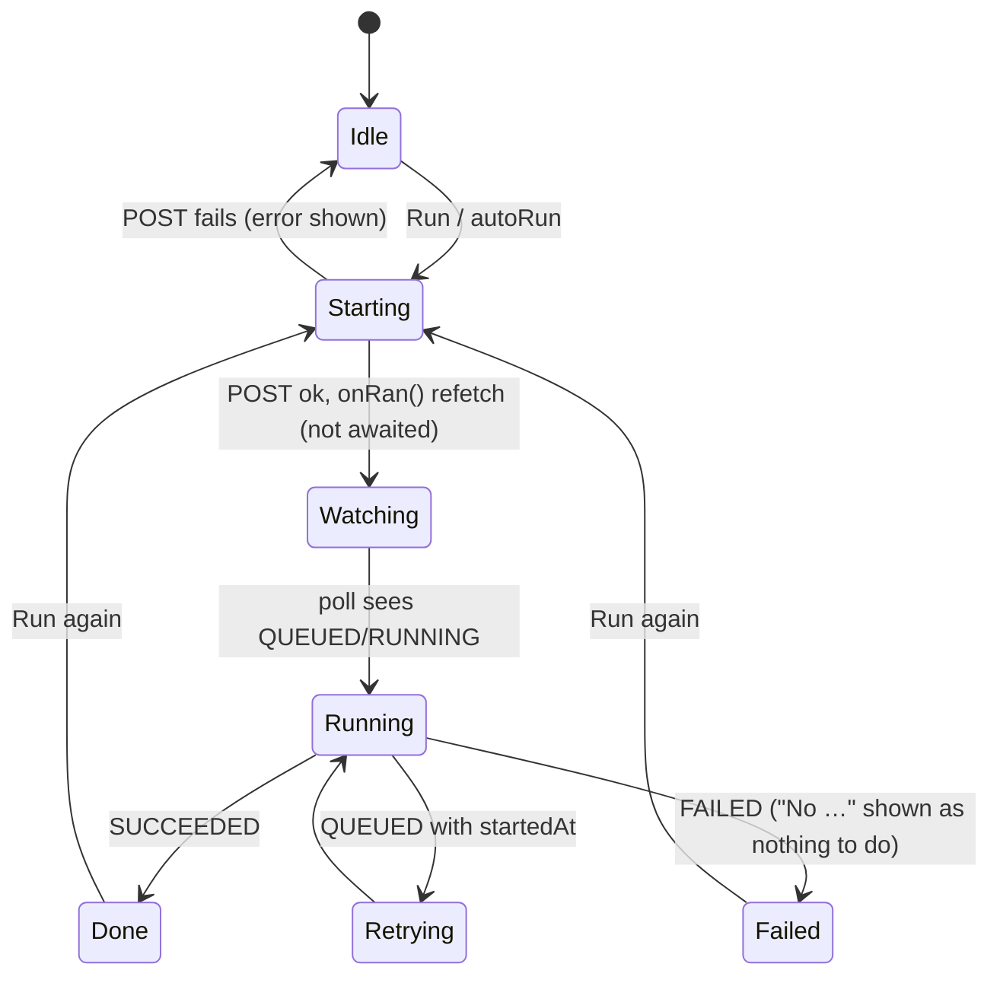
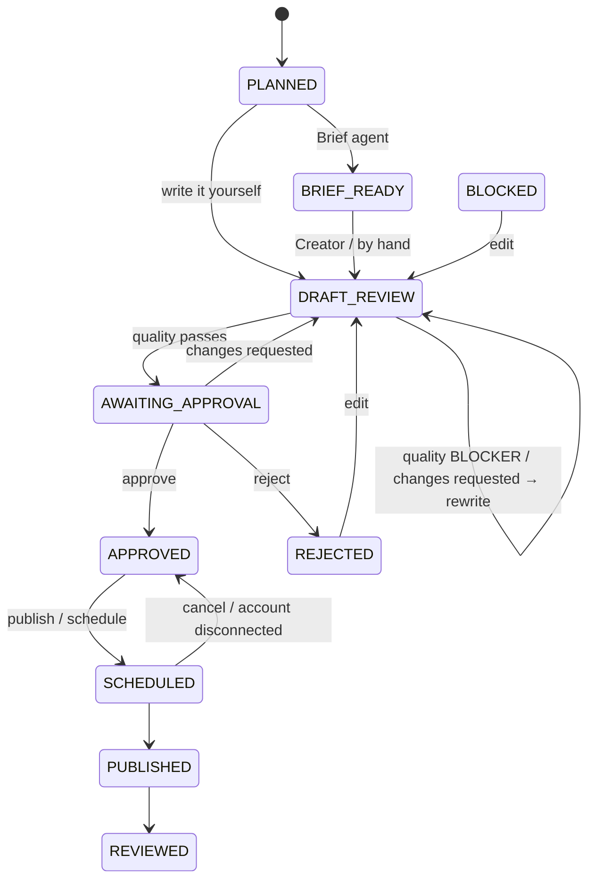
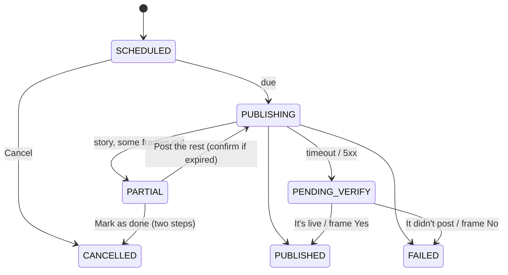
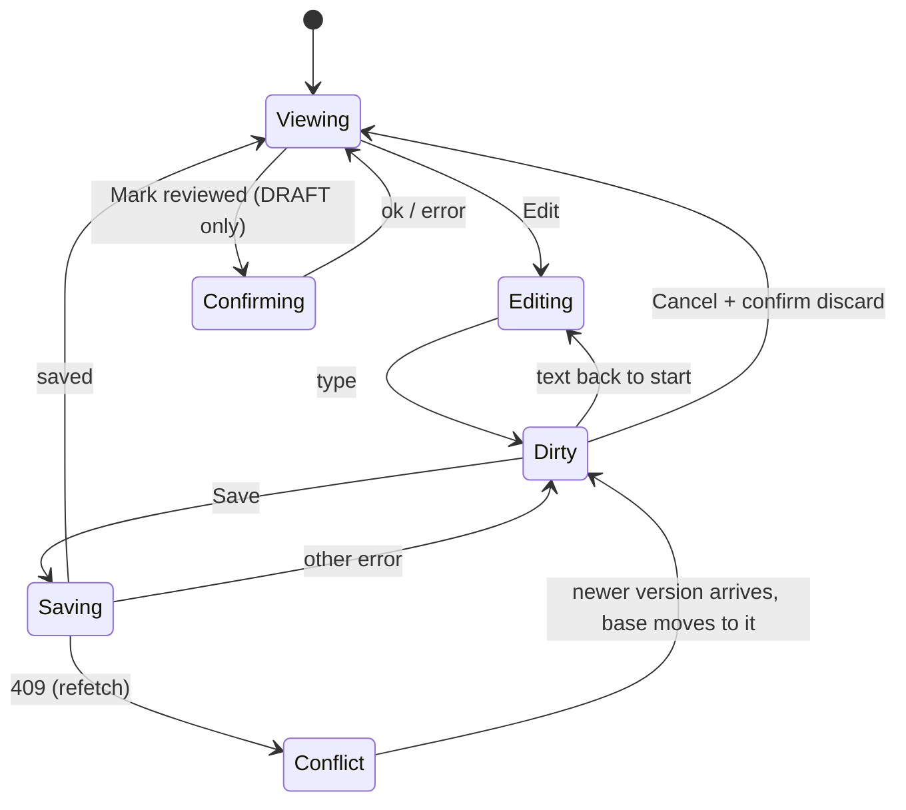
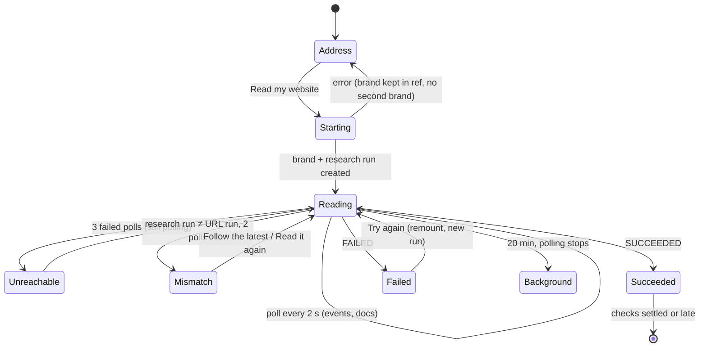
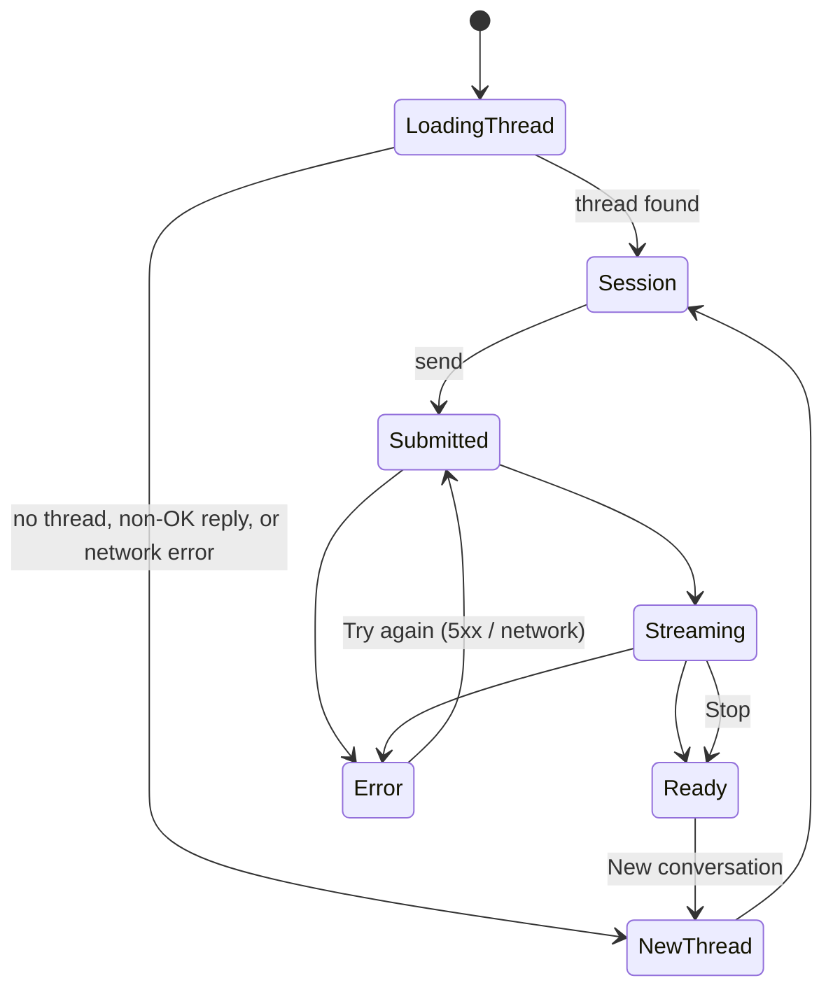

# Implicit state machines: web frontend

Scope: `apps/web/app/**` (not `app/api`), `apps/web/components/**`, `apps/web/lib/**`. Read only; no code changed.
Server code was read only to learn what states a screen can be shown and how the server guards repeats.

The web app has no story editor, reel or voice-clone recording, or billing screens. Those live in the mobile app.
On the web, stories are read-only (frames, approval, publish, post by hand).

Severity: **Critical** = data loss or money lost with no warning. **Important** = a realistic path costs credits,
hides data or leaves a wrong state the person can't fix without a reload. **Minor** = confusing or stuck UI that a
reload or a second click fixes.

No Critical problems were found. The server guards most repeats: in-flight agent runs are shared
(`server/agents/engine.ts:83-94`), publish and approve check the post status (`server/services/publishing.ts:271,356`),
a catalogue sync already queued is not queued again, and competitor audits are shared per domain.

## Summary

| # | Machine | File | Worst problem |
|---|---------|------|---------------|
| 1 | Workspace view router (URL ⇄ open item) | `components/workspace/workspace.tsx` | Minor: Back + "keep editing" cuts the forward history |
| 2 | Workspace overview loader and poll | `components/workspace/workspace.tsx` | Minor: polls every 5 s forever, even in a hidden tab |
| 3 | Agent run start (agent view, feed, tile) | `workspace.tsx`, `components/agents/agent-tile.tsx` | **Important: "Get ideas" / "Re-read it now" start a second paid run when the first one finishes** |
| 4 | Run watch (Planner from Ideas, next step on a post) | `components/workspace/content-panels.tsx` | Minor: "Planning posts…" can spin forever |
| 5 | Idea decision (shortlist / dismiss) | `content-panels.tsx` | none found |
| 6 | Shared polled brand data (`useBrandData`, `LoadGate`) | `content-panels.tsx` | none found |
| 7 | Post lifecycle view (`ContentStatus` branches) | `content-panels.tsx`, `components/workspace/release-panel.tsx` | Minor: draft editor stays open after the post is scheduled |
| 8 | Approval form | `release-panel.tsx` | Minor: buttons come back for a moment after a decision; a second click shows a false error |
| 9 | Publish form (upload, confirm, schedule) | `release-panel.tsx` | Minor: same stale-status window as #8 |
| 10 | Publication attempts and settling (`PublicationStatus`) | `release-panel.tsx` | Minor: one shared link box for every "check needed" row |
| 11 | Story posted by hand | `release-panel.tsx` | none found |
| 12 | Story frames render poll | `content-panels.tsx` | none found |
| 13 | Draft editor | `components/workspace/draft-editor.tsx` | none found (server refuses stale saves) |
| 14 | Context document editor + unsaved flag | `components/context/doc-pane.tsx`, `unsaved.ts` | Minor: a failed refetch after a 409 is an unhandled rejection in the workspace |
| 15 | Context board loader, research poll, re-run | `components/context/context-board.tsx` | Minor: polls every 3 s for as long as research says QUEUED |
| 16 | Welcome: website → reading room | `components/welcome/welcome-flow.tsx`, `reading-state.ts` | Minor: after "Try again", SEO/GEO rows show the old run's result |
| 17 | New brand dialog | `components/shell/new-brand-dialog.tsx` | **Important: a failed brand switch after a successful create invites a retry that creates a second brand and a second paid research run** |
| 18 | Brand and workspace switch | `components/shell/brand-switcher.tsx`, `workspace-switcher.tsx` | Minor: a failed brand switch replaces the page with the error screen |
| 19 | Chat: thread load → live session → offered agent start | `components/workspace/chat-pane.tsx` | **Important: a failed thread load starts a new conversation; the old one can no longer be opened** |
| 20 | Assistant drawer (wide column / narrow drawer) | `components/shell/assistant-panel.tsx` | none found |
| 21 | Agent Log poll | `components/agents/agent-log.tsx` | none found |
| 22 | Agents board poll | `components/agents/agents-board.tsx` | Minor: one failed poll blanks the agent list |
| 23 | Competitors (add, stop tracking, paid audit) | `components/workspace/competitors-panel.tsx` | Minor: "Stop tracking" has no busy state |
| 24 | Products: list, sync poll, product dialog | `components/products/products-board.tsx` | Minor: a sync already running is not shown after a reload; the poll gives up at 3 minutes |
| 25 | Campaigns, offers and brand timezone | `components/products/campaigns.tsx` | none found |
| 26 | Connected accounts (OAuth return, Shopify, disconnect) | `components/settings/connections-tab.tsx` | Minor: the "Connected X" banner replays when the tab is reopened |
| 27 | Settings permissions, tabs and the shared `useLoad` | `components/settings/settings-board.tsx`, `shared.tsx` | Minor: roles that fail to load turn role pickers read-only with no message |
| 28 | Members, invitations, roles, project access, AI models | `components/settings/*-tab.tsx`, `role-dialog.tsx` | none found beyond #27 |
| 29 | Auth: sign in, forgot, reset, accept invitation | `app/login/page.tsx`, `app/forgot-password`, `app/reset-password`, `app/invite` | Minor: a lost response on Accept turns success into "not valid" |
| 30 | Sign out | `components/workspace/sign-out-item.tsx` | Minor: "Signing out…" sticks if the request fails |
| 31 | Network layer and connection banner | `lib/net.ts`, `components/net/connection-banner.tsx` | none found |
| 32 | Navigation progress bar | `components/nav/nav-progress.tsx` | none found |
| 33 | Performance page reload on new report | `components/performance/audit-board.tsx` | none found |
| 34 | "Stories to post by hand" card | `workspace.tsx` (`DueStories`) | none found |

34 machines. 3 Important, the rest Minor or clean.

---

## 1. Workspace view router

- **Where:** `workspace.tsx:115` `view` (`home | doc | agent | content | competitor`), plus refs `viewNow`, `shownPanel`, `replaceUrl`, `urlRead`.
- **States:** the open item. The URL (`?post= ?doc= ?agent= ?competitor=`) mirrors it.
- **Transitions:**
  - URL changes (load, Back/Forward, sidebar link) → view from URL, after `okToDiscard()` (`:131-148`).
  - `open(v)` / `back()` → new view, after `okToDiscard()` (`:260-268`); an effect pushes the URL (`:149-158`).
  - Unknown `?doc=`/`?agent=` once lists load → `home`, URL replaced (`:160-165`).
- **Problems:**
  - Minor. Back while a document has unsaved text, then "Cancel" in the confirm: the code calls `pushState` with the current view (`:135-137`). That adds a new history entry instead of undoing the Back, so everything that was in the Forward history is lost.

## 2. Workspace overview loader and poll

- **Where:** `workspace.tsx:111-118` (`docs`, `agents`, `reports`, `connections`, `failed` map), derived `today.loading/failed` (`:247-250`).
- **States per source:** loading (`null` and not failed) → ready → ready-but-stale (`LoadGate` "Couldn't refresh") / failed (null and failed).
- **Transitions:** mount → `loadAll` → poll docs+agents every 5 s (`:216-227`); a finished SEO/GEO run reloads reports (`:230-233`); Retry clears `failed` and reloads (`:252-257`).
- **Problems:**
  - Minor. The docs+agents poll never stops and ignores `document.visibilityState` (`:219-222`), unlike `useBrandData` which pauses in hidden tabs (`content-panels.tsx:93`). A tab left open all day makes two requests every 5 s.
  - Minor. `refreshAgents` (`:185`) and the doc `onStale` (`:312`) have no `catch`; a failure is an unhandled promise rejection, and after a 409 the doc keeps its conflict state until the next poll.

## 3. Agent run start

- **Where:** `AgentView` `pending`, `error`, ref `autoStarted` (`workspace.tsx:1094-1118`); `AgentsFeed` `busy`, `error` (`:1329-1343`); `AgentTile` `pending`, `error` (`agent-tile.tsx:45-63`). Server state: `lastRun.status` `QUEUED | RUNNING | SUCCEEDED | FAILED`.

- **Transitions:** Run button (`:1134`), auto-run on open (`:1112-1118`), feed button (`:1371`), poll updates `agent` every 5 s.
- **Problems:**
  - **Important. Auto-run fires a second paid run.** The auto-run effect returns early while the agent is running, without setting `autoStarted` (`:1114`). It re-runs on every poll (deps `[autoRun, agent]`, and `agent` is a new object each poll). When the running run finishes, `running` turns false and the effect starts a new run (`:1115-1116`). Scenario: the person presses "Get ideas" on Today (`:741`), goes back to the workspace, presses it again while Scout is still running. The second agent view waits, then starts Scout again when the first run ends: two charges. The same happens with "Re-read it now" (`:579`, `run: true` at `:291`) while Research is running, which redrafts all five documents a second time. The server only shares runs that are still in flight (`engine.ts:87`), so it doesn't catch this.
  - Minor. `AgentView` is not keyed by agent (`:319`). Opening another agent from the feed keeps the old `error` text and the `autoStarted` ref. An error from Scout shows under the Planner, and a later `run: true` open of another agent does not auto-start.
  - Minor. After a successful start, `pending` clears before the refetched list arrives (`onRan()` is not awaited, `:1103`). The button reads "Run again" for up to a poll. A second press joins the same in-flight run on the server, so nothing is charged twice.

## 4. Run watch (Planner from Ideas, next step on a post)

- **Where:** `IdeasPanel` `planning` (run id), `planned`, `error` (`content-panels.tsx:212-241`); `NextStep` `started`, `pending`, `error`, `ranOut` (`:446-484`); `RunWatch` matches `agents[].lastRun.id === runId` (`:521-528`).
- **States:** idle → starting → watching(runId) → done ("Posts planned" / "The agent finished") | failed (error).
- **Transitions:** Plan / agent button (`:232-241`, `:472-484`); `RunWatch` calls `onDone` on SUCCEEDED, `onFailed` on FAILED (`:525-528`); `NextStep` also resets when the post moves on (`at` key, `:447-457`).
- **Problems:**
  - Minor. **"Planning posts…" can spin forever.** `RunWatch` only sees the agent's latest run. If another Planner run starts before the next poll sees ours finish (another person, or a second tab), `pick` returns null for good. `NextStep` recovers when the post changes (`:453-457`, noted in the ponytail at `:520`), but `IdeasPanel` has no reset: `planning` stays set, the button stays disabled with a spinner (`:267-270`) until the panel remounts.

## 5. Idea decision

- **Where:** `deciding {id,status}`, `error`, `planned` (`content-panels.tsx:209-255`). Server `OpportunityStatus`: all four handled (`:316`, `:336-358`).
- **Transitions:** Shortlist / Dismiss / Remove / Undo → PATCH → reload → idle. All buttons disabled while one is pending.
- No problems found.

## 6. Shared polled brand data

- **Where:** module maps `lastResponse`, `listeners`, `fetchedAt`; per hook `data`, `failed` (`content-panels.tsx:56-103`). `LoadGate` renders skeleton / failed / content / content + "Couldn't refresh" (`:131-161`).
- **Transitions:** mount → load; every 6 s if visible and not fetched in the last 3 s; on tab visible; `reload()`.
- No problems found. A brand switch remounts the workspace (`app/(shell)/page.tsx:29` keys it by brand), and the cache is keyed by URL.

## 7. Post lifecycle view

- **Where:** derived from `item.status` (`ContentStatus`) and `latest.check/review` in `nextStep` (`content-panels.tsx:430-442`) and the branch chain in `ReleasePanel` (`release-panel.tsx:136-179`). `ContentView.editing` (`content-panels.tsx:636-640`).

- **Enum coverage:** every `ContentStatus` is handled or deliberately silent. `CANCELLED` has no label (`STATUS_LABEL`, `:172-183`), but the list route never returns it (`content/route.ts:18`), so the post view says "This post no longer exists". `SCHEDULED` with no issue, `PUBLISHED`, `REVIEWED` show only History; that is intended.
- **Problems:**
  - Minor. `editing` resets only when the post id changes (`:638`). If a teammate approves and schedules the post while the editor is open, the editor stays open on a locked post. "Save" is then refused by the server (`EDITABLE`, `publishing.ts:198`), so nothing is lost, but the person writes for nothing.

## 8. Approval form

- **Where:** `ApproveForm` `note`, `pending` (verdict), `error`, `confirmReject`, `switchPick` (`release-panel.tsx:186-224`).
- **States:** idle → (reject) confirming → pending(verdict) → idle (+ error).
- **Transitions:** Approve / Approve anyway / Ask for changes / Reject (`:251-276`); `act()` posts, sets panel data, then calls `onChanged()` without waiting (`:90-96`).
- **Problems:**
  - Minor. **Stale status window.** After a decision, `pending` clears in `finally` (`:222`) while the `status` prop still says `AWAITING_APPROVAL` until the parent's refetch lands (`:95`). The form is still shown with live buttons. A second click gets "This post isn't waiting for approval" (`publishing.ts:271`) although the first one worked.
  - Minor. The form is not keyed by version (`:138`). When a new draft version arrives by poll, a half-typed note for the old version stays in the box.

## 9. Publish form

- **Where:** `PublishForm` `accountId`, `boardId`, links, `uploads`, `uploading`, `later`, `runAt`, `confirming`, `pending`, `error` (`release-panel.tsx:281-372`). `missing` derives the blocking reason (`:323-331`).
- **States:** editing → uploading → editing; editing → confirming (first press) → pending → done | error. Any form change drops `confirming` (`:375`).
- **Problems:**
  - Minor. Same stale-status window as #8: after "Publish now" succeeds, `pending` clears and the form is still shown with "Publish now" until the parent refetch. A second confirm is refused by the server (`publishing.ts:356`) with an error that reads like a failure.

## 10. Publication attempts and settling

- **Where:** server `PublicationStatus` per attempt; `History` `pending`, `error`, `link`, `expiredOk`, `doneAsk` (`release-panel.tsx:568-607`); busy poll every 3 s while an attempt is `PUBLISHING` or due within a minute (`:79-87`).

- **Enum coverage:** all seven statuses have a label and the right actions (`:557-565`, `:646-676`). "Overdue" is derived for a SCHEDULED attempt past its time (`:615`).
- **Problems:**
  - Minor. One `link` state is shared by every non-story `PENDING_VERIFY` row (`:571`, `:673`). With two such rows, a link typed in one shows in both and is sent with whichever "It's live" is pressed.

## 11. Story posted by hand

- **Where:** `StoryByHand` `at`, `link`, `pending` key, `error` (`release-panel.tsx:483-555`).
- **Transitions:** set time / stop / download zip / "I posted it", one at a time (`pending !== null` disables all).
- No problems found.

## 12. Story frames render poll

- **Where:** `StoryFrames` `data {rendering, renderError, frames}`, `failed`, `zoom` (`content-panels.tsx:536-566`).
- **Transitions:** fetch on mount and on version change; poll every 3 s while `rendering` (`:555-559`). Server `rendering` = a render job PENDING/RUNNING (`server/stories/service.ts:305-315`); a dead-lettered job turns it off with a `renderError`.
- No problems found.

## 13. Draft editor

- **Where:** `TextDraftEditor` fields, `baseVersion` (fixed at open), `pending`, `error`, `discarding`, derived `dirty` (`draft-editor.tsx:36-98`).
- **Transitions:** edit → dirty → (Cancel twice) closed | Save → pending → saved (parent closes) | error.
- No problems found. A newer save by someone else is caught by the server through `baseVersion`.

## 14. Context document editor

- **Where:** `DocPane` `editing`, `draft`, `base {version, markdown}`, `conflict`, `busy (save|confirm)`, `error` (`doc-pane.tsx:82-96`); module flag `unsaved` (`unsaved.ts`).

- **Problems:** see #2 for the unhandled refetch after a 409 inside the workspace. On the Context page the refetch (`context-board.tsx:323`) handles its own errors.

## 15. Context board loader, research poll, re-run

- **Where:** `state` (`loading | ready | error`), `rerun {pending, error}` (`context-board.tsx:45-55`); poll interval derived from research status (`:99`).
- **Transitions:** mount → load; poll every 3 s while research is QUEUED/RUNNING; every 15 s while nothing ever loaded; background failure keeps the old data (`:66`).
- **Problems:**
  - Minor. Polling depends only on the server's research status. A research run stuck in QUEUED (no worker running) keeps the page polling every 3 s with a spinner for as long as it is open.

## 16. Welcome: website → reading room

- **Where:** `WelcomeFlow.reading` (`welcome-flow.tsx:35`); `AddressStep` `pending`, `error`, ref `created` (`:60-100`); `ReadingRoom` `events`, `docs`, `checks`, `misses`, `fails`, `retrying`, `retryError`, `finishedAt`, clock (`:203-230`). Limits in `reading-state.ts`.

- **Problems:**
  - Minor. **Old check results after "Try again".** The retry remounts the room with an empty cursor (`:38`). The first events call without a cursor returns the brand's latest 100 events (`agent-events/route.ts:16-18`), not only this run's. The SEO/GEO rows take any `seo`/`geo` event (`:245-251`), so they show the earlier run's "Done" or "Stopped" right away.

## 17. New brand dialog

- **Where:** `open`, `name`, `url`, `pending`, `error {field}` (`new-brand-dialog.tsx:31-35`).
- **States:** closed → open → pending → closed (navigates to /context) | open + error.
- **Problems:**
  - **Important. Duplicate brand on retry.** `createBrand` and `setActiveBrand` share one `try` (`:43-48`). If the brand is created but the server action fails (network, expired session), the catch shows "Could not create the brand. Try again." (`:67-75`). Pressing Create again makes a second brand with the same site and starts a second paid Research run. The welcome flow already guards this with a `created` ref (`welcome-flow.tsx:66`, `:80-83`); this dialog doesn't. The comment at `:47` says the user can pick the brand from the switcher, but the message tells them it failed.

## 18. Brand and workspace switch

- **Where:** brand: `useTransition` `switching`, `target` (`brand-switcher.tsx:40-41`, `:84-90`). Workspace: none (`workspace-switcher.tsx:23-27`).
- **Problems:**
  - Minor. A failed `setActiveBrand` inside `startSwitch` (`brand-switcher.tsx:87-88`) is not caught. In React 19 an error thrown in a transition goes to the nearest error boundary, so a dropped connection while switching replaces the page with the error screen.
  - Minor. The workspace switch is fire-and-forget (`workspace-switcher.tsx:26`): no busy state, and a failure is silently dropped. The menu closes and nothing happens.

## 19. Chat

- **Where:** `ChatPane.loaded {base, thread}` (`chat-pane.tsx:67-93`); `useChat` `status` (`submitted | streaming | ready | error`), `error` (`:175-187`); `StartAgent` `idle | starting | started | {error}` (`:126-137`).

- **Problems:**
  - **Important. A failed load hides the existing conversation.** A non-OK reply (`r.ok ? … : { thread: null }`, `:73`) or any thrown error (`:82-89`: timeout after 30 s, offline after 60 s, a 5xx with no JSON body) opens a new empty thread with a fresh id. The GET route returns only the latest thread (`chat/route.ts:42-46`), and the panel has no thread list. Once the person sends a message, the new thread is the latest one, and the old conversation can't be opened from the UI again. The comment at `:71` says offline should wait rather than start a second conversation; only a 60 s wait is done.
  - Minor (noted in the ponytail at `:121-123`). `StartAgent` forgets "Started" on reload; pressing again joins the in-flight run or starts a new one once it finished.

## 20. Assistant drawer

- **Where:** `useAssistant().open`, `useWide()`, ref `wasOpen` (`assistant-panel.tsx:31-61`).
- No problems found.

## 21. Agent Log poll

- **Where:** `events`, `status (connecting | live | error)`, cursor ref (`agent-log.tsx:35-74`).
- **Transitions:** poll every 3 s, at once again after a full page; error keeps polling and the old lines.
- No problems found.

## 22. Agents board poll

- **Where:** `state (loading | ready | error)` (`agents-board.tsx:24-38`).
- **Problems:**
  - Minor. A single failed background poll replaces the ready list with the "service unavailable" screen (`:34`), and the next good poll brings it back. On a flaky connection the agent tiles flash away, and a tile's own `pending`/`error` state is lost. The Context board keeps the old data in the same case (`context-board.tsx:66`).

## 23. Competitors

- **Where:** `adding`, `addPending`, `error`, `removeError` (`competitors-panel.tsx:88-93`); `FreshAudit` `confirm`, `busy`, `error` (`:39-41`), server `auditRunning`.
- **Transitions:** Audit → confirm price → spend → running (server) → audited / failed.
- **Problems:**
  - Minor. "Stop tracking" has no busy state (`:111-120`). A slow DELETE leaves the row in place, and a second click asks again and sends a second DELETE, which then shows an error on a row that is about to disappear.

## 24. Products

- **Where:** `useLoad` state, `syncing`, `editing`, `removing`, `error` (`products-board.tsx:41-47`); sync poll every 4 s, up to 3 minutes (`:54-65`).
- **Problems:**
  - Minor. `syncing` is local. The list reply carries `running` (`products/api.ts:31-32`) but the board never reads it. After a reload during a sync (or during the daily sync) the page shows no "Syncing…" and offers "Sync now".
  - Minor. The poll gives up after 3 minutes (`:59`) and shows the list as if the sync were done. A big catalogue still syncing then shows the old count with no hint.

## 25. Campaigns, offers and brand timezone

- **Where:** `editing`, `withdrawing`, `zoneOpen`, `notice` (`campaigns.tsx:26-29`); dialog `busy`, `error`, `zone`.
- **Transitions:** first save sets the timezone, then creates (`:104-110`). A failure after the timezone step keeps the dialog open; the retry sets the same timezone again, which is harmless.
- No problems found.

## 26. Connected accounts

- **Where:** `busy` (provider), `error`, `removing`, `shopifyOpen`, `shown` (notice), `gone` (`connections-tab.tsx:48-54`). Server `ConnectionStatus`: ACTIVE, ERROR (reconnect button), REVOKED (filtered out by the server, `connections.ts:90`).
- **Transitions:** Connect → "Opening…" → full-page redirect → back with `?connected=`/`?connectError=` → banner checked against the list (`:57-66`), URL params dropped (`:70-76`).
- **Problems:**
  - Minor. The banner replays. In Settings, switching to another tab and back remounts `ConnectionsTab` with the same `notice` prop (`settings-board.tsx:143-148`), and `useState(notice)` (`:52`) shows "Connected X" again although the URL params were dropped.

## 27. Settings permissions, tabs and `useLoad`

- **Where:** `useLoad` (`shared.tsx:176-203`: `loading | ready | forbidden | error`, reload on `online`); `SettingsBoard` perms, roles, `active` tab in the URL (`settings-board.tsx:39-62`).
- **Problems:**
  - Minor. If the roles request fails, `roleList` is `[]` (`:49`). Members then shows plain role names with no picker (`members-tab.tsx:50`, `:76`) and Invitations shows "No roles available" (`invitations-tab.tsx:268`). Neither says the roles failed to load, and there is no retry outside the Roles tab.

## 28. Members, invitations, roles, project access, AI models

- **Where:** each tab's `pending`/`busy`, `status`, dialog state; `ConfirmDialog` `busy`, `error` (`shared.tsx:117-131`).
- No problems found beyond #27. Each action disables its own control while pending, and the confirm dialog stays open with the error on failure.

## 29. Auth flows

- **Sign in** (`app/login/page.tsx`): server actions; state lives in the URL (`?error=`, `?reset=`, `?invited=`, `?expired=`). `PendingButton` disables while the action runs. No problems found.
- **Forgot password** (`app/forgot-password/page.tsx`): `busy`, `sent`, `error`. No problems found.
- **Reset password** (`app/reset-password/reset-form.tsx`): `busy`, `error`, `done`, `invalid` booleans. They never overlap in practice. No problems found.
- **Accept invitation** (`app/invite/[token]/accept-invite.tsx`): `loading | invalid | error | ready | done`, plus `busy`, `error`.
  - Minor. If the accept request succeeds on the server but the reply is lost (timeout, connection drop), the retry finds the invitation used (`server/services/accounts.ts`: "This invitation was already used", or 404 → "Invitation not valid", `:108`). The person has an account but is told the link failed.

## 30. Sign out

- **Where:** `pending` (`sign-out-item.tsx:24-25`, `:42-43`).
- **Problems:**
  - Minor. `signOut` is called with `void` and no `catch`. If the sign-out request fails, the item stays disabled as "Signing out…" until the page reloads.

## 31. Network layer and connection banner

- **Where:** `send` (`lib/net.ts:46-66`): offline read waits up to 60 s then retries once; writes fail at once; 30 s timeout. Banner `online | offline | back` (`connection-banner.tsx:11`).
- No problems found.

## 32. Navigation progress bar

- **Where:** `idle | loading | done` (`nav-progress.tsx:62`), 15 s cut-off.
- No problems found.

## 33. Performance page reload on new report

- **Where:** `useLoad` + ref `runs` (`audit-board.tsx:100-127`), checks agents every 6 s while visible.
- No problems found.

## 34. "Stories to post by hand" card

- **Where:** `dismissedAt` (`null` until read from storage) (`workspace.tsx:928-948`).
- No problems found.

---

## Notes for the fix pass

- One shape repeats: `try { await A(); await B(); } catch { "A failed" }` where A already happened (#17). Keep a ref of what succeeded, as the welcome flow does.
- Two screens keep a spinner alive by matching "the agent's latest run id" (#4). Matching by the run id the start returned, through a per-run endpoint, would end both stuck cases.
- After `act()` the post's status prop lags the panel's own data (#8, #9). Hiding the action forms while `onChanged()` is in flight, or deriving the branch from the release data, would close the window.
- A load error and a "nothing there yet" reply both become an empty chat (#19). Showing a retry instead of a new thread would keep the old conversation reachable.
